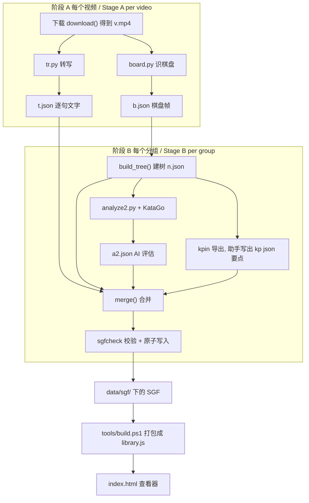
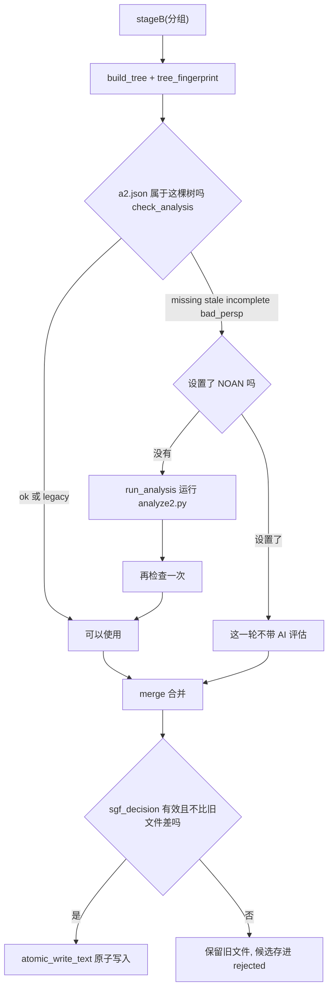
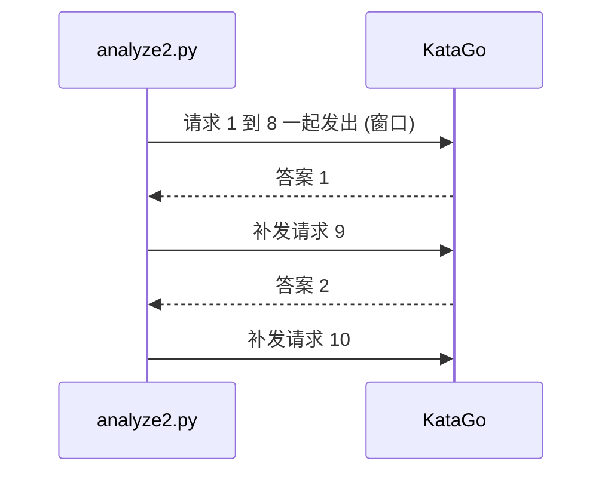
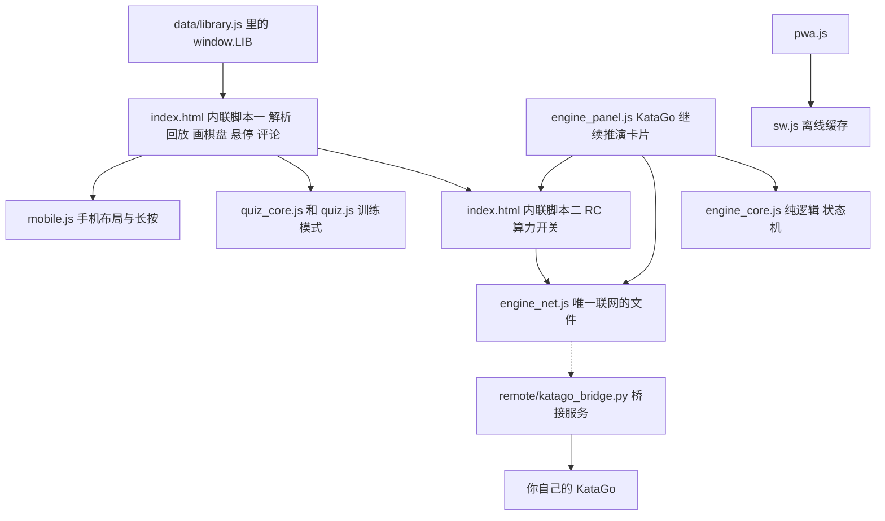

# 项目架构指南 / Architecture guide

本文面向项目的主人：一位围棋初学者，不是程序员，但想弄清楚这个项目的每一部分在做什么、为什么这样做、对应哪个文件的哪一段代码，以及现在做到了哪一步。读完以后，你应该能顺着逻辑从一个视频讲到一个能在浏览器里点开的变化树，也知道哪里还不可靠。

This guide is for the owner of the project: a Go beginner who is not a programmer, but wants to know what every part does, why it is built that way, which block of which file does it, and how far the work has come. After reading it you should be able to follow the logic from one video to one variation tree you can click through in a browser, and you should know where the project is still unreliable.

本文基于 `develop` 分支的提交 `9fa1fcd`（`Merge pull request #15`，手机版界面）写成，写作日期是 2026-11-08。文中的行号（写作 `L55-70`）是这个提交里的大致行号，代码以后再改就会漂移，所以请以函数名为准，行号只用来帮你快速翻到位置。凡是我实际运行过的东西（测试、示例脚本、只读的状态命令），都标了 **[已运行 / ran]**；凡是只靠读代码推断、或者根本没法验证的内容，都标了 **[未核实 / not verified]**。没有标记的句子，是我读这个提交里的代码得到的。

This guide was written against commit `9fa1fcd` of the `develop` branch (`Merge pull request #15`, the mobile edition) on 2026-11-08. Line numbers (written `L55-70`) are approximate positions in that commit and will drift when the code changes, so trust the function names and use the numbers only to find the place quickly. Everything I actually ran (tests, example scripts, read-only status commands) is marked **[已运行 / ran]**; everything inferred from the code alone, or impossible to verify, is marked **[未核实 / not verified]**. A sentence without a mark comes from reading the code in that commit.

## 一页概览 / One page summary

这个项目把围棋老师（陈林涛）在 B 站上的定式讲解视频，自动变成可以在浏览器里点着看的"变化树"。每一手棋旁边有三样东西：老师当时说的话（语音转写）、一句话要点，以及 KataGo（一个很强的围棋 AI）只在这个定式涉及的小范围里算出来的评估。整条路是：视频 → 下载 → 转写文字 + 识别棋盘画面 → 拼成变化树 → 让 KataGo 评估分叉点 → 合成 SGF 棋谱文件 → 打包成 `data/library.js` → 查看器 `index.html` 显示。

The project turns the joseki lessons of the Go teacher 陈林涛 (Chen Lintao) on Bilibili into a "variation tree" you can click through in a browser. Next to every move there are three things: what the teacher said at that moment (speech transcript), a one line key point, and an evaluation made by KataGo (a very strong Go AI) inside the small area the joseki is about. The road is: video, download, transcript plus board recognition from the picture, assemble a variation tree, let KataGo evaluate the branch points, merge into an SGF game record, pack into `data/library.js`, show in the viewer `index.html`.

| 步骤 / Step | 做什么 / What it does | 主要文件 / Main files |
|---|---|---|
| 1 下载 / Download | 用 yt-dlp 取视频，被限流就退避重试 / Fetch the video with yt-dlp, back off when throttled | `pipeline/orch2.py` `download()` |
| 2 转写 / Transcribe | Whisper 把语音变成带时间的文字 / Whisper turns speech into timed text | `pipeline/tr.py` |
| 3 识棋盘 / Read the board | 逐帧读视频里的棋盘，只认固定版式 / Read the board frame by frame, fixed layout only | `pipeline/board.py` |
| 4 建树 / Build the tree | 把一串棋盘画面拼成变化树 / Turn the board frames into a variation tree | `pipeline/orch2.py` `build_tree()` |
| 5 评估 / Evaluate | KataGo 只评估分叉点，只搜局部 / KataGo evaluates branch points only, locally | `pipeline/analyze2.py` |
| 6 合并 / Merge | 文字、要点、评估写进 SGF 的注释和 AN 属性 / Text, notes and evaluation go into SGF comments and the AN property | `pipeline/orch2.py` `merge()` |
| 7 显示 / Show | 打包后在浏览器里看，带悬停预览和训练模式 / Pack and view in the browser, with hover previews and quiz mode | `tools/build.ps1`, `index.html` |

| 项目 / Item | 数字（2026-11-08） / Number (2026-11-08) |
|---|---|
| 视频总数 / Videos in total | 115 个，约 20.4 小时：定式大全 52、套路研究 18、避雷 45（来自 `data/sources/chenlintao/index.json`）/ 115, about 20.4 hours: 52 + 18 + 45 (from `index.json`) **[已运行 / ran]** |
| `develop` 上的数据 / Data on `develop` | 94 个分组文件，只有 4 个有内容，1 个带 AI 评估，数据时间 11-01 05:18 / 94 group files, only 4 have content, 1 has AI evaluation, data stamp 11-01 05:18 **[已运行 / ran]** |
| 作者电脑上的工作目录（尚未提交） / The owner's working copy (not committed) | 94 个里有 47 个有内容：定式大全 29/31（15 个带 AI 评估，29 个带要点），套路研究 2/18，避雷 16/45；全部通过 SGF 校验；数字随流水线在变，这是 06:13 的读数 / 47 of 94 have content: 29/31 in 定式大全 (15 with AI evaluation, 29 with key points), 2/18 and 16/45 in the other two series; all pass SGF validation; the numbers move as the pipeline runs, these are the readings of 06:13 **[已运行 / ran]** |
| 自动测试 / Automated tests | Python 273 个（3 个跳过，见 6.1）和 Node 118 个，没有失败 / 273 Python tests (3 skipped, see 6.1) and 118 Node tests, no failure **[已运行 / ran]** |
| 版本 / Versions | 项目 `VERSION` 0.1，查看器界面 v4.7 / project `VERSION` 0.1, viewer interface v4.7 |

最需要你知道的五件事：第一，AI 数字是"只在局部范围内、比局部最优差几目"，不是胜率，也不是全局判断。第二，棋盘识别只认一种固定版式，套路研究和避雷两个系列的大部分视频版式不同，被拒绝了。第三，我写这份指南时发现一个还没修的缺陷：从"摆好的起始局面"开始的节点，AI 默认按黑棋先行评估，老师实际下白棋时这个节点的候选点就是错边的（见 6.3）。第四，老师的讲解文字版权属于原作者，私有数据仓库的流程只做了一半（PR 16 还没合并）。第五，KataGo 继续推演面板从来没有连过真实的 KataGo，手机版没有在真机上试过。

The five things you most need to know: first, the AI numbers mean "points worse than the local best, inside a small area", not a winrate and not a whole board judgement. Second, board recognition only accepts one fixed layout, and most videos of the other two series have a different layout and were rejected. Third, while writing this guide I found a defect that is not fixed yet: for nodes that start from a "laid out starting position", the AI assumes Black moves first by default, so when the teacher actually plays White the candidate points of that node are for the wrong side (see 6.3). Fourth, the teacher's commentary belongs to the original author, and the private data repository flow is only half done (PR 16 is not merged). Fifth, the KataGo continue panel has never been connected to a real KataGo, and the mobile edition has not been tried on real phones.

## 目录 / Table of contents

- [一页概览 / One page summary](#一页概览--one-page-summary)
- [0. 先认识这些词 / Key words first](#0-先认识这些词--key-words-first)
- [1. 全景 / The big picture](#1-全景--the-big-picture)
  - [1.1 它要解决什么问题 / The problem](#11-它要解决什么问题--the-problem)
  - [1.2 数据怎么流动 / How the data flows](#12-数据怎么流动--how-the-data-flows)
  - [1.3 三层结构与文件地图 / Three layers and the file map](#13-三层结构与文件地图--three-layers-and-the-file-map)
  - [1.4 一个完整的例子 / A worked example](#14-一个完整的例子--a-worked-example)
- [2. 流水线逐阶段 / The pipeline, stage by stage](#2-流水线逐阶段--the-pipeline-stage-by-stage)
  - [2.1 总调度和工作目录 / The driver and the work folder](#21-总调度和工作目录--the-driver-and-the-work-folder)
  - [2.2 下载 / Download](#22-下载--download)
  - [2.3 转写 / Transcription](#23-转写--transcription)
  - [2.4 识别棋盘 / Board recognition](#24-识别棋盘--board-recognition)
  - [2.5 建变化树 / Building the variation tree](#25-建变化树--building-the-variation-tree)
  - [2.6 KataGo 分析 / KataGo analysis](#26-katago-分析--katago-analysis)
  - [2.7 合并成 SGF / Merging into SGF](#27-合并成-sgf--merging-into-sgf)
  - [2.8 要点笔记与指纹 / Key point notes and fingerprints](#28-要点笔记与指纹--key-point-notes-and-fingerprints)
  - [2.9 错别字词典 / The typo dictionary](#29-错别字词典--the-typo-dictionary)
  - [2.10 护栏 / Guards](#210-护栏--guards)
  - [2.11 重建与小工具 / Regeneration and helper tools](#211-重建与小工具--regeneration-and-helper-tools)
- [3. 查看器 / The viewer](#3-查看器--the-viewer)
  - [3.1 架构 / Architecture](#31-架构--architecture)
  - [3.2 SGF 解析与回放 / SGF parsing and replay](#32-sgf-解析与回放--sgf-parsing-and-replay)
  - [3.3 画棋盘与视角 / Drawing the board and view modes](#33-画棋盘与视角--drawing-the-board-and-view-modes)
  - [3.4 AI 候选点 / AI candidates](#34-ai-候选点--ai-candidates)
  - [3.5 老师的圈与悬停预览 / Teacher circles and hover preview](#35-老师的圈与悬停预览--teacher-circles-and-hover-preview)
  - [3.6 AI 变化的悬停与固定 / AI line hover and pin](#36-ai-变化的悬停与固定--ai-line-hover-and-pin)
  - [3.7 提示框 / The tooltip](#37-提示框--the-tooltip)
  - [3.8 评论卡片、视频链接与征子演示 / Comment cards, video links and ladder demo](#38-评论卡片视频链接与征子演示--comment-cards-video-links-and-ladder-demo)
  - [3.9 算力开关 / The compute switch](#39-算力开关--the-compute-switch)
  - [3.10 KataGo 继续推演面板 / The engine panel](#310-katago-继续推演面板--the-engine-panel)
  - [3.11 训练模式 / Quiz mode](#311-训练模式--quiz-mode)
  - [3.12 页脚、署名与复制 SGF / Footer, credit and copy SGF](#312-页脚署名与复制-sgf--footer-credit-and-copy-sgf)
  - [3.13 手机版与离线应用 / Mobile edition and offline app](#313-手机版与离线应用--mobile-edition-and-offline-app)
  - [3.14 隐私设计 / Privacy design](#314-隐私设计--privacy-design)
- [4. 血的教训 / Lessons learned the hard way](#4-血的教训--lessons-learned-the-hard-way)
- [5. 仓库工作流 / Repository workflow](#5-仓库工作流--repository-workflow)
- [6. 现状与局限 / State and limits](#6-现状与局限--state-and-limits)
- [7. v1.0 就绪清单 / v1.0 readiness checklist](#7-v10-就绪清单--v10-readiness-checklist)
- [8. 术语表 / Glossary](#8-术语表--glossary)
- [附录 A 常用命令 / Appendix A: commands](#附录-a-常用命令--appendix-a-commands)

## 0. 先认识这些词 / Key words first

下面两张表把后文反复出现的词先讲一遍，每个词一句话加一个生活类比。后面第一次真正用到它们时我还会再提醒一次；全部术语在第 8 节也有一份术语表。围棋词放在前面，因为你是围棋初学者，这些词的准确含义比代码更重要。

The two tables below explain the words that come back again and again, one sentence and one everyday analogy each. I remind you again where they are first really used, and section 8 holds the complete glossary. The Go words come first because you are a Go beginner and their exact meaning matters more than any code.

| 围棋词 / Go word | 一句话 / One sentence |
|---|---|
| 定式 | 角上双方都认为公平的一套标准下法，像棋手之间约定俗成的"标准开场白" / Joseki: a standard corner sequence that both sides accept as fair, like a customary opening phrase between players |
| 星位、小目、三三 | 角上的三个常见落点：星位是四四的那个黑点，小目是三四，三三是第三线第三路 / Three common corner points: the star point (4-4, the marked dot), the 小目 (3-4) and the 三三 (3-3) |
| 小飞挂 | 对角上的子"挂"过去，位置是一个小飞（象步，走日字）的距离 / An approach to a corner stone placed a knight's move away |
| 夹击、一间低夹、二间高夹 | 挂角之后，从另一边夹住挂过来的子；"一间/二间"是夹击子和被夹子之间隔几路，"低/高"是夹击子在三路还是四路 / A pincer: attacking the approaching stone from the other side; one or two spaces apart, on the third line (low) or the fourth line (high) |
| 分叉点 | 老师在这里展示了不止一种下法的局面，变化树在这里分叉 / A position where the teacher shows more than one continuation, so the tree branches |
| 变化图、变化树 | 把"如果这样下，对方那样应"画出来就是变化图，把所有变化图按走法串起来就是树，像选择题式的剧情书 / A variation diagram shows "if this, then that"; all of them chained by their moves form a tree, like a choose-your-own-adventure book |
| 提子 | 把被围死的对方棋子从棋盘上拿掉 / Removing opposing stones that have no liberties left |
| 行棋方 | 轮到谁下，也叫"该谁走" / The side to move |
| 目差 | 用"目"（点）表示的差距，AI 说"这手比最优差 1.5 目"，就是预计最后少 1.5 点 / A gap measured in points, "1.5 points worse than the best" means 1.5 points less at the end |
| 局部最优 | 只在讲解的那一小块范围里比较时最好的一手，不等于全盘最好 / The best move when you only compare inside the small area being taught, not the best on the whole board |
| 候选点 | AI 认为值得一看的下一手 / A next move the AI thinks is worth a look |
| 脱先 | 不应对，转去别处下 / Not answering and playing elsewhere (tenuki) |
| 劫材 | 打劫时用来逼对方应一手的威胁 / A ko threat: a forcing move you play during a ko fight |
| 征子 | 连续叫吃、把对方一块棋沿对角线追着跑的手段，成败取决于前方有没有对方的接应子 / A ladder: chasing a group by repeated atari along a diagonal, whether it works depends on stones waiting ahead |

| 技术词 / Technical word | 一句话加类比 / One sentence with an analogy |
|---|---|
| SGF | 围棋棋谱的通用文本格式，像用固定符号写的棋谱笔记本，`;B[pd]` 的意思是黑棋下在 pd 这个点 / The common text format for Go game records, like a notebook written in fixed symbols, `;B[pd]` means Black plays at the point pd |
| 变化树（程序里的树） / Variation tree (in code) | 每个局面是一页，每一手是一条通往下一页的路，页和路连成一棵倒着长的树，像族谱 / Every position is a page and every move a road to the next page, joined into an upside down tree, like a family tree |
| KataGo | 开源的围棋 AI，像一位只报数字不说话的超强棋手 / An open source Go AI, like a very strong player who reports numbers instead of talking |
| 权重（网络文件） / Weights (network file) | AI 学出来的全部"经验"存成的一个大文件，没有它引擎就是空壳，像棋手的毕生棋感 / The file that holds everything the AI learned, without it the engine is an empty shell, like a player's lifetime of intuition |
| 访问次数 visits | AI 在这个局面上"往下推演了多少次"，像请朋友在心里摆 220 遍变化再回答 / How many times the AI looked ahead from this position, like asking a friend to play out 220 lines in their head before answering |
| 先验 prior | AI 还没认真算之前的第一直觉概率，像高手一眼扫过去的"感觉应该下这里" / The AI's first instinct before it really calculates, like a master's glance that says "probably here" |
| PV（主要变化） / PV (principal variation) | AI 预计双方接下来会走的那一串最佳着法，像它心里的"标准答案变化图" / The best sequence the AI expects both sides to follow, like the "model answer diagram" in its head |
| 视角（黑方视角、行棋方视角） / Perspective (Black's, side to move) | 同一个数字站在谁的角度看：黑方视角里，白棋占优时数字是负的 / Whose side a number is read from: in Black's view a number is negative when White is ahead |
| JSON | 一种把数据写成带标签文本的格式，像贴了标签的文件柜 / A text format for data with labels, like a filing cabinet with labelled drawers |
| Docker | 把软件和它需要的环境一起装进一个标准"集装箱"里运行，在哪台电脑上结果都一样 / Runs software together with its environment inside a standard "container" so the result is the same on every computer |
| 原子写入 | 先写到一个临时文件、写完整了再一下子换成正式文件，像先在草稿纸上写好信，再整封放进信箱，别人永远看不到写了一半的信 / Write to a temporary file first and swap it in as a whole, like drafting a letter on scrap paper and mailing it only when finished, so nobody ever sees half a letter |
| 指纹（哈希） / Fingerprint (hash) | 根据内容算出的一小段编码，内容变一点编码就全变，像人的指纹用来认人 / A short code computed from content, change the content a little and the code changes completely, like a fingerprint that identifies a person |
| ASR / Whisper | 自动语音识别，Whisper 是其中一个模型，像一位偶尔会听错同音字的速记员 / Automatic speech recognition, Whisper is one such model, like a stenographer who sometimes mishears homophones |
| yt-dlp 和 ffmpeg / yt-dlp and ffmpeg | 一个下载视频的工具，和一个处理音视频的瑞士军刀 / A video downloader, and a Swiss army knife for audio and video |
| 限流（HTTP 567） / Throttling (HTTP 567) | 网站嫌你请求太快，回一个错误码让你慢点，像饭店门口排队的人被拦住说"等一会儿" / The site answers with an error code because you ask too fast, like being told to wait at a restaurant door |
| 缓存 / Cache | 把用过的东西留一份在手边省得重取，缺点是可能拿到旧的 / Keeping a copy at hand to avoid fetching again, the risk is getting an old one |
| 令牌 token | 一串只有你知道的口令，凭它才能使用某个服务 / A secret string only you know, needed to use a service |
| PWA / 服务工作线程 / PWA and service worker | 让网页像手机应用一样安装、离线也能打开，服务工作线程是浏览器里的"后台管家"，替页面管缓存 / Lets a web page install like a phone app and open offline, the service worker is a "background steward" in the browser that manages the cache |
| 分支 / PR / 提交 / Branch, PR, commit | 分支是并行的一条修改线，提交是一次存档，PR（拉取请求）是请求把某条分支并回主线 / A branch is a parallel line of changes, a commit is one save point, a PR (pull request) asks to merge a branch into the main line |
| 显卡 GPU、OpenCL / GPU and OpenCL | 显卡是专门做大量并行计算的芯片，KataGo 靠它提速；OpenCL 是让程序使用显卡的一种接口，像显卡听得懂的一种"方言"；核显是集成在 CPU 里的小显卡 / A GPU is a chip built for massive parallel calculation that KataGo uses for speed; OpenCL is one interface that lets a program use a GPU, like a dialect a GPU understands; an integrated GPU is a small one built into the CPU |
| 量化（int8） / Quantisation (int8) | 把模型里的数字存得粗一点来换速度和内存，像把照片压成小图 / Storing the numbers of a model more coarsely to gain speed and memory, like shrinking a photo |
| 正则表达式 / Regular expression | 一种描述文字模式的写法，像带通配符的查找 / A way to describe a text pattern, like a search with wildcards |
| 文字编码（UTF-8、cp936） / Text encoding (UTF-8, cp936) | 把文字存成字节的规则；Windows 中文控制台默认的 cp936 和 UTF-8 不一样，像两本不同的字典，翻错就乱码 / The rule for storing text as bytes; the cp936 default of Chinese Windows consoles differs from UTF-8, like two different dictionaries, and a wrong lookup garbles the text |
| 接口（API）与跨域（CORS） / Interface (API) and cross origin (CORS) | 接口是程序之间约定好的"点菜单"；跨域是浏览器规定网页默认不能随便访问别的网站，除非对方明确同意，像进别人家要先收到邀请 / An interface is the "menu" two programs agree on; cross origin means a browser stops a page from freely reaching other sites unless they agree, like needing an invitation to enter someone's home |
| 浏览器储物柜 localStorage / localStorage | 浏览器给每个网站的一个小储物柜，只存在你这台电脑的这个浏览器里 / A small locker the browser gives every website, kept only in this browser on your computer |
| 内容安全策略（CSP） / Content security policy (CSP) | 页面告诉浏览器"只许运行这些脚本"的规则，像给大门挂一张来访名单 / A rule by which a page tells the browser "run only these scripts", like a guest list on the door |
| SSH 转发 / SSH forwarding | 把远程电脑的端口通过加密通道映射到自己电脑上，像一条私人隧道 / Mapping a port of a remote computer to your own through an encrypted channel, like a private tunnel |
| Node.js 运行环境 / Node.js | 让 JavaScript 在浏览器之外运行的程序，这里只用来跑测试 / A program that runs JavaScript outside the browser, used here only to run the tests |

## 1. 全景 / The big picture

### 1.1 它要解决什么问题 / The problem

围棋定式书和视频讲了很多变化，但有三个痛点：视频里的棋盘没法回放，老师说的话和棋盘上的某一手对不上，而 KataGo 默认只给全盘胜率，想只研究某个角上的局部变化时，周围的子会把答案搅乱。这个项目的做法是把视频"翻译"成棋谱：每一手棋盘上的变化对上老师当时说的那几句话，再让 KataGo 只在这一小块区域里比较，告诉你每个候选点比局部最优差几目，老师走的每一手也一定单独算一遍。

Joseki books and videos teach a lot of variations, but there are three pains: the board in a video cannot be replayed, what the teacher says does not line up with a move on the board, and KataGo by default only gives a whole board winrate, so when you want to study one corner the stones around it disturb the answer. The project "translates" the video into a game record: every change on the board is matched with the sentences the teacher said at that moment, and then KataGo compares candidates only inside that small area and tells you how many points each is worse than the local best, with every move the teacher played always evaluated separately.

这件事要自动化，是因为量很大：视频一共 115 个、约 20 小时，没有人能手工摆完。所以整个"流水线"可以不用人看着一直跑，它的难点不在某一步有多高深，而在每一步都会出错（下载被限流、语音听错字、版式不对、AI 算错边），所以大量代码是在"发现错误、拒绝坏数据、不要把好文件覆盖掉"。

It has to be automated because of the volume: 115 videos, about 20 hours, nobody can lay them out by hand. So the whole "pipeline" can run unattended. The difficulty is not that any single step is clever, but that every step can go wrong (downloads throttled, words misheard, a different layout, the AI evaluating for the wrong side), so a lot of code exists to notice errors, refuse bad data and never overwrite a good file.

### 1.2 数据怎么流动 / How the data flows

下图是整条路。左边的"阶段 A"对每个视频各做一遍，右边的"阶段 B"对每个"分组"做一遍。分组是指讲同一个定式的几个视频合成一棵树（例如三个视频都讲"星位小飞挂小飞守角"，就合成一个分组），分组由 `data/sources/chenlintao/plan.json` 决定。

The diagram shows the whole road. "Stage A" on the left runs once per video, "stage B" on the right runs once per "group". A group is the set of videos about the same joseki merged into one tree (for example three videos about one approach and its answers become one group), and `data/sources/chenlintao/plan.json` decides the groups.



图：视频先拆成文字和棋盘画面两路，在阶段 B 汇合成带评估的 SGF，再打包给查看器。

Figure: a video splits into text and board pictures, which meet again in stage B as an SGF with evaluation, then get packed for the viewer.

阶段 A 的结果都缓存在工作目录里（`v.mp4`、`t.json`、`b.json`），因为下载和转写最慢，不能每次重来；阶段 B 可以反复重跑（比如改了错别字词典之后），重跑时 AI 评估和要点也从缓存里取，只有"变化树变了"的时候才需要重新让 KataGo 算。

The results of stage A are cached in the work folder (`v.mp4`, `t.json`, `b.json`) because downloading and transcribing are the slowest and cannot start over every time. Stage B can be rerun again and again (for example after editing the typo dictionary), and a rerun takes the AI evaluation and the notes from the cache, so KataGo only has to run again when the tree has changed.

### 1.3 三层结构与文件地图 / Three layers and the file map

整个项目可以看成三层。最下面是流水线（Python，在作者的 Windows 电脑上跑，要用显卡、ffmpeg、Whisper 和 KataGo）；中间是数据（SGF 文件和打包出来的 `library.js`，是流水线和查看器之间唯一的交接物）；最上面是查看器（一个网页，纯前端，不需要服务器）。这样分层的好处是：查看器完全不知道流水线怎么工作，只要 SGF 的约定不变，两边可以各自改。

The project has three layers. At the bottom is the pipeline (Python, run on the owner's Windows computer, needing the graphics card, ffmpeg, Whisper and KataGo). In the middle is the data (SGF files and the packed `library.js`, the only hand over between pipeline and viewer). On top is the viewer (a web page, pure front end, no server needed). The benefit is that the viewer does not know how the pipeline works, so as long as the SGF conventions stay the same, both sides can change on their own.

| 路径 / Path | 它是什么 / What it is |
|---|---|
| `pipeline/orch2.py` | 总调度：下载、建树、合并、写 SGF（384 行）/ The driver: download, tree, merge, write SGF (384 lines) |
| `pipeline/tr.py`、`pipeline/board.py` | 转写与识棋盘，各自是一个单独运行的脚本 / Transcription and board recognition, each a script that runs on its own |
| `pipeline/analyze2.py` | 调用 KataGo 评估分叉点 / Calls KataGo to evaluate branch points |
| `pipeline/treesync.py` | 指纹与一致性检查，防止评估和笔记对错节点 / Fingerprints and consistency checks so evaluations and notes never land on the wrong node |
| `pipeline/sgfcheck.py`、`pipeline/wqutil.py` | SGF 校验，以及原子写入、日志、重试等公共工具 / SGF validation, plus atomic writes, logging, retry and other shared helpers |
| `pipeline/fixtext.py`、`pipeline/fixdict.json`、`pipeline/mkfix.py` | 错别字词典（303 条规则）和它的维护工具 / The typo dictionary (303 rules) and its maintenance tool |
| `pipeline/regen.py`、`pipeline/wq.py`、`pipeline/serve.py` | 从缓存重建 SGF、状态与检查命令、本地无缓存服务器 / Rebuild SGFs from the cache, status and check commands, a local no-cache server |
| `data/sources/chenlintao/` | `index.json` 是视频清单，`plan.json` 是哪些视频合成一个分组 / `index.json` is the video list, `plan.json` says which videos form a group |
| `data/sgf/` | 生成的棋谱，按"来源/系列/分组名.sgf"存放 / The generated game records, stored as source/series/group.sgf |
| `data/library.js` | 所有 SGF 打成一个 JS 文件，查看器直接读它，没有它网页是空的 / All SGFs packed into one JS file that the viewer reads, without it the page is empty |
| `index.html` | 查看器主体：解析、画棋盘、悬停预览、算力开关（362 行）/ The viewer core: parsing, board drawing, hover previews, compute switch (362 lines) |
| `engine_core.js`、`engine_net.js`、`engine_panel.js` | KataGo 继续推演面板：纯逻辑、唯一的联网文件、界面 / The KataGo continue panel: pure logic, the only network file, the interface |
| `quiz_core.js`、`quiz.js` | 训练模式：出题与记忆曲线的纯逻辑，以及界面 / Quiz mode: the pure logic of question making and the memory curve, and the interface |
| `mobile.js`、`pwa.js`、`sw.js`、`manifest.webmanifest`、`icons/` | 手机版布局和可安装的离线应用 / The phone layout and the installable offline app |
| `remote/` | 在远程显卡上批量跑 KataGo 的脚本，以及页面可选连接的桥接服务 `katago_bridge.py` / Scripts to run KataGo in batch on a remote GPU, and the bridge `katago_bridge.py` the page may connect to |
| `engine-config/` | KataGo 的配置文件，不含程序和权重 / KataGo configuration files, without program or weights |
| `tools/` | `build.ps1` 打包、`check_repo.py` 和 `check_bilingual.py` 检查、`make_site.py` 生成可部署文件夹等 / `build.ps1` packing, `check_repo.py` and `check_bilingual.py` checks, `make_site.py` building a deployable folder, and more |
| `tests/` | 自动测试，用 Docker 运行 / Automated tests, run in Docker |
| `docs/` | 使用、工作流、许可证、算力平台、事前复盘等文档 / Usage, workflow, license, compute platforms, pre-mortem and other documents |

### 1.4 一个完整的例子 / A worked example

下面用一个很小的、我自己编出来的例子，走一遍"一个视频怎么变成变化树里的一个分叉节点"。所有数字和文字都是虚构的，只是为了让你看清每一步的样子；但生成变化树、合并成 SGF、转换 KataGo 的答案这三步，我是**真的运行了仓库里的函数**（`build_tree()`、`merge()`、`analyze2.query()`、`analyze2.convert()`），下面贴的是它们的真实输出 **[已运行 / ran]**。KataGo 本身没有运行，它的答案是我编的。

Below is a very small example I made up, to follow "how a video becomes one branch node of the variation tree". All numbers and text are fictional, only to show you what each step looks like. But for three steps, building the tree, merging into SGF, and converting the KataGo answer, I **really ran the functions of the repository** (`build_tree()`, `merge()`, `analyze2.query()`, `analyze2.convert()`) and what follows is their real output **[ran]**. KataGo itself was not run, its answer is made up.

设想一个 22 秒的视频片段：棋盘上先下星位（右上角 Q16），白棋小飞挂（R14），然后黑棋一间低夹（R12）；老师接着说"回到前面，也可以走这里"，改下 Q12。

Imagine a 22 second video clip: a star point stone at Q16 in the upper right corner, White's knight's move approach at R14, then Black's pincer one space away on the third line at R12; the teacher then says "back to the earlier position, you can also play here" and plays Q12 instead.

**第 1 步，转写。** Whisper 输出一个列表，每句话有开始时间、结束时间和文字（`t.json`）。注意"黑旗"是语音识别的典型错字，应该是"黑棋"。

**Step 1, transcript.** Whisper outputs a list where each sentence has a start time, an end time and text (`t.json`). Note that "黑旗" is a typical recognition mistake, it should be "黑棋".

```json
[{"s": 2.1,  "e": 4.0,  "t": "好，我们先下一个星位"},
 {"s": 5.2,  "e": 8.0,  "t": "白棋小飞挂"},
 {"s": 11.3, "e": 14.0, "t": "黑旗一间低夹，这是最常见的下法"},
 {"s": 18.4, "e": 21.0, "t": "也可以走这里"}]
```

**第 2 步，棋盘画面。** `board.py` 每秒读 6 帧，每帧得到一个 342 个字符的字符串（18 列乘 19 行，`.` 是空点，`B` 黑子，`W` 白子；点的编号是 行号乘 18 加列号，从上到下、从左到右数）。真实字符串太长，下面只列出非空的点（`pd` 是 SGF 里的坐标写法，Q16 就是 `pd`）。

**Step 2, board frames.** `board.py` reads 6 frames per second and each frame becomes a string of 342 characters (18 columns times 19 rows, `.` is empty, `B` a black stone, `W` a white stone; a point's number is row times 18 plus column, counted top to bottom and left to right). The real string is too long, so only the non empty points are listed below (`pd` is the SGF way to write Q16).

| 时间（秒） / Time (s) | 画面上的子 / Stones on screen |
|---|---|
| 0 到 2 / 0 to 2 | 空棋盘 / empty board |
| 2 到 5 / 2 to 5 | 黑 69（Q16，`pd`）/ B 69 (Q16, `pd`) |
| 5 到 8 | 黑 69，白 106（R14）/ B 69, W 106 (R14) |
| 8 到 8.17 | 多出一个白 100：鼠标指针被误认成棋子，只出现 1 帧 / an extra W 100: the mouse pointer misread as a stone, for 1 frame only |
| 8.17 到 11 | 黑 69，白 106 / B 69, W 106 |
| 11 到 15 | 黑 69，白 106，黑 142（R12）/ B 69, W 106, B 142 (R12) |
| 15 到 18 | 黑 69，白 106：老师退回去了 / B 69, W 106: the teacher went back |
| 18 到 22 | 黑 69，白 106，黑 141（Q12）/ B 69, W 106, B 141 (Q12) |

**第 3 步，变化树。** `build_tree()` 读这些画面，真实运行的结果是 6 个节点（节点 3 是那一帧的鼠标指针，已经被当作闪烁删掉，下面标了 `dead`）。节点 2（白棋 R14 之后）有两个活的子节点：4（黑 R12）和 5（黑 Q12），所以它是一个分叉点，这就是我们要分析和评论的节点。

**Step 3, the tree.** `build_tree()` reads those pictures and the real result is 6 nodes (node 3 is the one frame of mouse pointer, deleted as flicker, marked `dead` below). Node 2 (after White's R14) has two live children, 4 (Black R12) and 5 (Black Q12), so it is a branch point, and this is the node we analyse and comment on.

```text
id 0  父 par None  mv None          pos ''              root
id 1  父 par 0     mv (69, 'B')     pos 'B69'           B Q16
id 2  父 par 1     mv (106, 'W')    pos 'B69W106'       W R14   ch [4, 5]   v [[5,11],[15,18]]
id 3  父 par 2     mv (100, 'W')    pos 'B69W100W106'   dead = True (flicker)
id 4  父 par 2     mv (142, 'B')    pos 'B142B69W106'   B R12   v [[11,15]]
id 5  父 par 2     mv (141, 'B')    pos 'B141B69W106'   B Q12   v [[18,22]]
```

注意节点 2 的出现时间有两段（5 到 11 秒，15 到 18 秒）：老师第二次回到这个局面时，程序认出"这个局面已经有节点了"，没有新建，而是给同一个节点加上第二段时间。

Note that node 2 has two time spans (5 to 11 s and 15 to 18 s): when the teacher came back to this position, the program recognised "a node for this position already exists" and added a second time span to the same node instead of creating a new one.

**第 4 步，给 KataGo 的问题和它的答案。** 只有分叉点（这里是节点 2）才问 KataGo。`analyze2.query()` 把"局面"写成一个请求：已经下过的着法、搜索次数 220、规则和贴目，以及最重要的 `allowMoves`，它把双方的候选点都限制在一个矩形范围内（这里是 50 个点，从 O19 到 S10）。下面是真实输出，其中 `allowMoves` 的点列表我缩写了。

**Step 4, the question for KataGo and its answer.** Only branch points (node 2 here) are sent to KataGo. `analyze2.query()` writes the "position" as a request: the moves played so far, 220 visits, the rules and komi, and above all `allowMoves`, which restricts the candidates of both sides to a rectangle (50 points here, from O19 to S10). This is the real output, with the list of points in `allowMoves` abbreviated.

```json
{"id": "2", "initialStones": [], "moves": [["B", "Q16"], ["W", "R14"]], "rules": "japanese", "komi": 6.5,
 "boardXSize": 19, "boardYSize": 19, "analyzeTurns": [2], "maxVisits": 220,
 "allowMoves": [{"player": "B", "moves": "[50 points, O19 ... S10]", "untilDepth": 40},
                {"player": "W", "moves": "[same list]", "untilDepth": 40}]}
```

本项目让 KataGo 用黑方视角回答，所以拿到答案要换成"行棋方视角"。下面是用真实函数 `convert()` 转换一个编出来的答案：白棋走，黑方领先 3.0 目，转换之后变成"行棋方（白）落后 3.0 目"；候选 C4 的黑方视角 +2.0 变成 -2.0。这是第 4 节第一个教训的核心。

The project makes KataGo answer from Black's point of view, so the answer must be converted to the "side to move" perspective. Below, the real function `convert()` converts a made up answer: White to move, Black leads by 3.0 points, which becomes "the side to move (White) is behind by 3.0"; candidate C4 with +2.0 in Black's view becomes -2.0. This is the core of the first lesson in section 4.

```json
{"turn": "W", "score": -3.0, "wr": 0.4,
 "cand": [{"m": "C4", "v": 120, "s": -2.0, "wr": 0.42, "p": 0.5, "pv": ["C4", "D5"]},
          {"m": "D4", "v": 40,  "s": -3.5, "wr": 0.38, "p": 0.2, "pv": ["D4"]}]}
```

老师走的第二手 Q12，如果 KataGo 主搜索给它的访问次数太少，程序会对"下了 Q12 之后的局面"单独再问一次，并把结果取反（因为那时轮到对方），然后标记 `f: 1`、先验记为 -1，表示"这是单独强制评估的老师着法"。

For the teacher's second move Q12, if the main search gave it too few visits, the program asks once more about "the position after Q12", negates the result (it is then the opponent's turn) and marks it `f: 1` with a prior of -1, meaning "this is the teacher's move, evaluated separately and forced".

**第 5 步，合并。** `merge()` 把时间对上：每句话落在"这句话开始时棋盘上的那个节点"里（5.2 秒那句落在节点 2，11.3 秒那句落在节点 4，等等），错别字词典把"黑旗"改成"黑棋"，AI 评估写进评论，并且把候选点压成一个短字符串放进 `AN` 属性。下面是真实输出（根节点的版权属性 `AP`、`CP`、`SO` 我省略了）：

**Step 5, merge.** `merge()` lines up the times: each sentence lands in "the node that was on the board when the sentence started" (the 5.2 s sentence lands in node 2, the 11.3 s sentence in node 4, and so on), the typo dictionary turns "黑旗" into "黑棋", the AI evaluation goes into the comment, and the candidates are squeezed into one short string in the `AN` property. This is the real output (the credit properties `AP`, `CP`, `SO` of the root are left out):

```text
(;GM[1]FF[4]CA[UTF-8]SZ[19]KM[6.5]GN[demo]PC[...]...
;B[pd]C[【老师讲解 @0|0:02】好，我们先下一个星位]
;W[qf]PL[B]C[【老师讲解 @0|0:05】白棋小飞挂
【AI局部评估】黑先。只在本定式涉及的区域内搜索,不看全盘胜率;数字=比局部最优差几目(0最优,越负越差)。局部最优⟨R12⟩;候选: ⟨R12⟩最优/先验55% ⟨P13⟩-0.2目/先验12% ⟨Q12⟩-0.7目(老师走的)
最优变化 ⟨R12 Q13 Q11⟩
视频变化⟨R12⟩:就是AI局部最优
视频变化⟨Q12⟩:比局部最优差0.7目
【周边子力影响】去掉区域外的子力后,局部最优为⟨R12⟩;带着外围子力时为⟨R12⟩ → 结论一致,外围影响小]
 AN[qh:0.0:0.55:46:118:R12 Q13 Q11;og:-0.2:0.12:45:31:P13 R12;ph:-0.7:-1.00:44:100:Q12 R13]
 (;B[qh]C[【老师讲解 @0|0:11】黑棋一间低夹，这是最常见的下法
【要点与考量】一间低夹是最常见的应对])
 (;B[ph]C[【老师讲解 @0|0:18】也可以走这里]))
```

（为了看清结构，我在 `AN` 和子节点前面加了换行和缩进，真实文件里它们紧跟在前一个括号后面。）几个要点：`PL[B]` 明确写出"轮到黑棋"；`@0|0:05` 是"第 0 个视频的 0 分 5 秒"，查看器把它变成一个能跳到视频那一刻的链接；`⟨R12⟩` 这种尖括号是给查看器的记号，它会把它变成可以点的小标签。

(I added line breaks and indentation before `AN` and the child nodes to show the structure, in the real file they follow the previous bracket directly.) Key points: `PL[B]` states plainly "Black to move"; `@0|0:05` means "video number 0, 0 minutes 5 seconds" and the viewer turns it into a link that jumps to that moment of the video; angle brackets such as `⟨R12⟩` are markers for the viewer, which turns them into little clickable tags.

`AN` 属性里每一项用分号隔开，每项有六个用冒号隔开的字段：

Each entry of the `AN` property is separated by a semicolon and has six colon separated fields:

| 字段 / Field | 例子 / Example | 含义 / Meaning |
|---|---|---|
| 位置 / Point | `qh` | SGF 坐标，`qh` 就是 R12 / SGF coordinate, `qh` is R12 |
| 目差 / Loss | `-0.2` | 比局部最优差几目，最优是 0，越负越差，永远不会是正数 / Points worse than the local best, the best is 0, more negative is worse, never positive |
| 先验 / Prior | `0.55` | AI 的第一直觉；`-1.00` 表示这是单独强制评估的老师着法 / The AI's first instinct, `-1.00` marks a teacher move evaluated separately and forced |
| 胜率 / Winrate | `46` | 百分数，只搜局部，所以没有全局意义，查看器不显示它 / A percentage, meaningless as a whole board number because the search is local, so the viewer does not show it |
| 访问次数 / Visits | `118` | AI 在这一手上推演了多少次 / How many times the AI looked ahead on this move |
| 变化 / PV | `R12 Q13 Q11` | AI 预计的后续着法，空格隔开 / The continuation the AI expects, separated by spaces |

**第 6 步，查看器。** 打开这个节点时，棋盘上会出现：黑色半透明棋子的三个候选点（因为轮到黑棋），圈的颜色按目差分绿、橙、红，圈下面写"最优"或 -0.2、-0.7；老师走的两个点 R12 和 Q12 上有蓝色虚线圈和数字 1、2，对应右边的变化列表；右边的评论被切成"老师讲解""AI 局部评估""周边子力影响"几张卡片。悬停在候选点上会预览那条变化，具体见第 3 节。

**Step 6, the viewer.** When you open this node the board shows three translucent black stones as candidates (because Black is to move), the ring colour is green, orange or red by loss and the label under it says "最优" or -0.2, -0.7. The two points the teacher played, R12 and Q12, carry dashed blue circles with the numbers 1 and 2 that match the variation list on the right, and the comment on the right is cut into cards "老师讲解", "AI 局部评估" and "周边子力影响". Hovering a candidate previews that line, see section 3 for the details.

## 2. 流水线逐阶段 / The pipeline, stage by stage

这一节按流水线的先后顺序，一个阶段一个阶段地讲：它做什么、为什么这样做、对应哪个文件哪个函数（括号里是大致行号），以及它会在哪里出错、代码怎样防住。每个阶段最后都有一句"限制"，把已知的弱点说清楚。

This section goes through the pipeline in order, one stage at a time: what it does, why it is built that way, which function of which file does it (approximate lines in brackets), where it can go wrong and how the code guards against that. Every stage ends with a "limit" sentence that states the known weak spots plainly.

### 2.1 总调度和工作目录 / The driver and the work folder

流水线的"总指挥"是 `pipeline/orch2.py`。它不在仓库里跑，而是在作者电脑上的一个单独的"工作目录"里跑，默认是 `D:\tmp\work`（环境变量 `WEIQI_WORK` 可以改）。这样分开是因为工作目录里有下载的视频和各种缓存（写这份指南时主工作目录约 1.3 GB，并且会随视频增多而增长），不能进仓库；仓库里只放脚本和最终成果，脚本用 `tools/sync_pipeline.ps1` 从工作目录单向拷进仓库的 `pipeline/`（方向永远是工作目录到仓库，从不反过来）。脚本里的默认路径是写死的 Windows 路径（`orch2.py` L9-14），换电脑要用环境变量覆盖，常用的有 `WEIQI_WORK`、`WEIQI_PROJ`、`WEIQI_SOURCE`、`WEIQI_SEASON`、`WEIQI_MAX_IDX`、`FFMPEG`，完整清单在 `docs/PREMORTEM.md` 第 5 节。

The "conductor" of the pipeline is `pipeline/orch2.py`. It does not run inside the repository but in a separate "work folder" on the owner's computer, `D:\tmp\work` by default (the environment variable `WEIQI_WORK` changes it). They are separate because the work folder holds the downloaded videos and all kinds of caches (about 1.3 GB for the main work folder when this guide was written, and it grows with every video) that cannot go into the repository. The repository only holds the scripts and the final results, and the scripts are copied one way from the work folder into the repo's `pipeline/` with `tools/sync_pipeline.ps1` (the direction is always work folder to repository, never back). The default paths in the scripts are hard coded Windows paths (`orch2.py` L9-14), so another computer needs environment variables, the common ones being `WEIQI_WORK`, `WEIQI_PROJ`, `WEIQI_SOURCE`, `WEIQI_SEASON`, `WEIQI_MAX_IDX` and `FFMPEG`, and the complete list is in section 5 of `docs/PREMORTEM.md`.

`orch2.py` 的最后几行（L379-384）先拿一把"文件锁" `orch2.lock`，保证同一时间只有一个 orch2 在跑（两个同时跑会抢下载、抢显卡、互相覆盖输出；进程退出时系统自动释放锁，所以崩溃也不会留下死锁）。然后 `run_pipeline()`（L346-378）开始干活：把所有分组按视频总时长从长到短排好（有一个分组 `小目-小飞挂-二间高夹` 被固定排在最前面，看起来是最早试验时留下的习惯），用一个 2 个线程的线程池在后台处理各个视频（阶段 A），主线程则按顺序等每个分组的视频都就绪，然后构建这个分组（阶段 B）。阶段 B 里有最慢的 KataGo 分析，所以它在主线程里一个一个串行地跑，而下载和转写在后台继续。全部跑完后还有一轮"补考"：失败的视频等 600 秒再试一次，成功的话它们所在的分组会重新构建。

The last lines of `orch2.py` (L379-384) first take a "file lock" `orch2.lock` so that only one orch2 runs at a time (two at once would fight over downloads and the graphics card and overwrite each other's output; the system releases the lock when the process ends, so a crash never leaves a stale lock). Then `run_pipeline()` (L346-378) starts working: it sorts all groups by total video length, longest first (one group, `小目-小飞挂-二间高夹`, is always put first, which looks like a habit left over from the first experiments), processes the videos in the background with a pool of 2 threads (stage A), while the main thread waits in order until all videos of a group are ready and then builds that group (stage B). Stage B contains the slowest part, the KataGo analysis, so it runs group after group in the main thread while downloading and transcribing carry on in the background. After everything there is one "resit" round: failed videos wait 600 seconds and try once more, and if they succeed, their groups are rebuilt.

线程和信号量是两个词：线程像同一家厨房里的几个厨师，可以同时各炒各的菜；信号量像厨房里唯一一口大锅，同一时间只能一个人用，用完才轮到下一个。`orch2.py` 里 `DL = threading.Semaphore(1)`（L28）就是"下载只能同时一个"。

Thread and semaphore are two words worth knowing. Threads are like several cooks in one kitchen who can cook their own dishes at the same time. A semaphore is like the single big wok in the kitchen that only one person can use at a time. In `orch2.py`, `DL = threading.Semaphore(1)` (L28) means "only one download at a time".

工作目录里的文件，按"谁写、谁读"整理如下。你不需要记住它们，但排查问题时它们是第一手线索：

The files in the work folder, by who writes and who reads them. You do not need to memorise them, but when something goes wrong they are the first clues:

| 文件 / File | 内容 / Content | 谁写 / Written by |
|---|---|---|
| `v/<序号>/v.mp4` | 下载的视频 / The downloaded video | `download()` |
| `v/<序号>/t.json` | 转写：`[{s, e, t}]` / Transcript | `tr.py` |
| `v/<序号>/b.json` | 棋盘帧：`[[秒, 342 字符串或 null]]` / Board frames | `board.py` |
| `v/<序号>/b.meta.json`、`*.rej.json` | 识别统计，或被拒绝的原因 / Recognition statistics, or the reason for a rejection | `board.py`、`tr.py` |
| `g_<分组>.n.json` | 变化树 / The variation tree | `stageB()` |
| `g_<分组>.a2.json` | AI 评估结果，行棋方视角 / The AI evaluation, side to move perspective | `analyze2.py` |
| `g_<分组>.a2.json.part`、`.progress.log`、`.stale` | 断点、进度与预计剩余时间、作废的旧评估 / Checkpoint, progress with ETA, an obsolete old evaluation | `analyze2.py`、`stageB()` |
| `kpin_<分组>.json`、`kp_<分组>.json` | 导给写要点的助手的文字，以及它写回来的要点 / The text handed to the helper that writes key points, and the notes it wrote back | `stageB()`、助手 / `stageB()`, the helper |
| `summary_<分组>.md` | 可选的整组概述，进入根节点注释；流水线只读取它，不生成它 / An optional summary of the whole group, goes into the root comment; the pipeline only reads it and never makes it | 流水线之外 / outside the pipeline |
| `fixlog_<分组>.json` | 这次触发了哪些错别字规则 / Which typo rules fired this time | `stageB()` |
| `status_<分组>.json` | 这个分组这一轮的完整状态记录 / The full status record of this group for this round | `stageB()` |
| `failed_videos.json`、`logs/orch2.log` | 失败的视频及原因，主日志 / Failed videos and why, the main log | `orch2.py` |
| `rejected/<分组>.sgf` | 被护栏拒绝写入的候选 SGF / A candidate SGF the guard refused to write | `stageB()` |

下面这张图是阶段 B 里 `stageB()`（L294-345）对"评估数据能不能用"和"新 SGF 能不能覆盖旧 SGF"的两道决定。它是整个流水线最重要的防线：宁可不更新，也不写坏东西。

The diagram below shows the two decisions `stageB()` (L294-345) makes in stage B: "may the evaluation data be used" and "may the new SGF replace the old SGF". It is the most important line of defence of the whole pipeline: better not to update than to write something wrong.



图：评估必须"属于这棵树"才用，新 SGF 必须"有效且不比旧的差"才写。

Figure: an evaluation is used only if it "belongs to this tree", a new SGF is written only if it is "valid and not poorer than the old one".

**限制 / Limit。** 调度是针对一台 Windows 电脑、一个固定的 B 站作者写的，路径和一些习惯（例如固定的优先分组、`WEIQI_MAX_IDX` 默认 49）都是历史遗留；换作者要提供自己的 `index.json` 和 `plan.json`（`docs/usage.md`），`validate_plan()` 会在开工前检查它们。

The driver was written for one Windows computer and one Bilibili author, and the paths and some habits (the fixed priority group, `WEIQI_MAX_IDX` defaulting to 49) are historical leftovers. Another author needs their own `index.json` and `plan.json` (`docs/usage.md`), and `validate_plan()` checks them before any work starts.

### 2.2 下载 / Download

**做什么 / What。** `download(i)`（`orch2.py` L55-70）用 yt-dlp 把第 i 个视频下载成 `v.mp4`，画质限制在 720p 以内、编码选 avc（`-f 'bv*[height<=720][vcodec^=avc]+ba/b[height<=720]/b'`）。`-N 1` 表示一次只下一个分片，`--sleep-requests 1` 表示每次请求之间停 1 秒，都是为了对服务器客气。下载完成的判断不是"文件存在"，而是"文件超过 1 MB，并且用 ffmpeg 量出来的时长至少是 `index.json` 里记录时长的 80%"，否则当作被截断或下到了预告片，改名成 `v.mp4.short` 重试（`probe_duration()` L48-54）。

`download(i)` (`orch2.py` L55-70) uses yt-dlp to download video number i as `v.mp4`, with the quality limited to 720p and the codec avc (`-f 'bv*[height<=720][vcodec^=avc]+ba/b[height<=720]/b'`). `-N 1` means one fragment at a time and `--sleep-requests 1` pauses 1 second between requests, both to be polite to the server. "Finished" is not judged by "the file exists" but by "the file is larger than 1 MB and the length measured with ffmpeg is at least 80% of the length recorded in `index.json`", otherwise it counts as truncated or as a preview clip, and the file is renamed `v.mp4.short` and the download is tried again (`probe_duration()` L48-54).

**为什么要退避 / Why back off。** B 站会在请求太快时返回非标准的错误码 567（有时是 412 或 429），意思是"你太快了，先停一停"。这就是限流。如果被拒绝后马上重试，只会让限流持续得更久。所以 `retry_with_backoff()`（`pipeline/wqutil.py` L156-172）让每次失败后等得更长：基础 60 秒，每次乘 3，也就是 60、180、540 秒，再加最多 20% 的随机抖动；这叫"退避"，像敲门没人应，下次隔更久再敲，而不是不停地砸门。最多试 4 次（`DL_TRIES`），都失败就放弃，把原因写进 `failed_videos.json`（`wqutil.Manifest`，会记录尝试次数和时间）。`failure_reason()`（L42-47）负责把 yt-dlp 的一大段报错压成一行，例如 `HTTP 567 (throttled)`。

Bilibili answers with the non standard error code 567 (sometimes 412 or 429) when requests come too fast, meaning "you are too fast, stop for a while". That is throttling. Retrying right after a refusal only makes the throttling last longer. So `retry_with_backoff()` (`pipeline/wqutil.py` L156-172) waits longer after every failure: a base of 60 seconds multiplied by 3 each time, that is 60, 180 and 540 seconds, plus up to 20% random jitter. This is called "backoff", like knocking on a door nobody opens and waiting longer before the next knock instead of pounding on it. It tries at most 4 times (`DL_TRIES`), and when all fail it gives up and writes the reason into `failed_videos.json` (`wqutil.Manifest`, which also counts attempts and records the time). `failure_reason()` (L42-47) squeezes the long yt-dlp error into one line, for example `HTTP 567 (throttled)`.

**一个关键的细节 / A key detail。** 下载只在 yt-dlp 真正运行的时候占着那把唯一的"下载锁" `DL`，等待重试的时候是放开的（`download()` 里 `attempt()` 内部才有 `with DL`，`sleep` 在 `retry_with_backoff` 里、锁之外）。早先的版本整个重试过程都占着锁，一个被限流的视频会把别的视频全部堵死（一组 4 个视频因此全部失败，见 `docs/PREMORTEM.md`）。

The single "download lock" `DL` is held only while yt-dlp is actually running and is released while waiting for a retry (`with DL` sits inside `attempt()`, and the `sleep` is in `retry_with_backoff`, outside the lock). An earlier version held the lock for the whole retry loop, so one throttled video blocked all the others (a group of 4 videos failed completely because of it, see `docs/PREMORTEM.md`).

**清单 / The manifest。** `failed_videos.json` 就是"失败清单"，每个视频一条：失败在哪个阶段（下载、识别棋盘、转写）、原因、尝试了几次、什么时候。`python wq.py status` 会把它和每个分组的状态一起打印出来。**[已运行 / ran]** 我读到的套路研究和避雷两个工作目录里的清单中，大部分失败是 `HTTP 567 (throttled)`，也有 `getaddrinfo failed`（电脑当时没网）。

`failed_videos.json` is the "failure list", one entry per video: the stage that failed (download, board recognition, transcription), the reason, the number of attempts and the time. `python wq.py status` prints it together with the state of every group. **[ran]** In the lists I read in the work folders of the other two series, most failures are `HTTP 567 (throttled)`, and a few are `getaddrinfo failed` (the computer had no network at that moment).

**限制 / Limit。** 退避只能缓解限流，不能消除；视频是否能下载最终取决于 B 站。代码不伪装请求头或身份，这是有意的。重试的等待时间在测试里用假的 `sleep` 跳过，所以 4 次退避的真实耗时没有被测试覆盖。

Backoff eases throttling but cannot remove it, and whether a video can be downloaded ultimately depends on Bilibili. The code does not fake request headers or identity, which is deliberate. In the tests the retry waits are skipped with a fake `sleep`, so the real duration of four backoffs is not covered by a test.

### 2.3 转写 / Transcription

**做什么 / What。** `pipeline/tr.py` 先用 ffmpeg 把视频的声音抽成 16 kHz 单声道（`extract_audio()`，L19-23），再交给 faster-whisper（Whisper 的一个更快的实现）。模型是 `small`，在 CPU 上用 `int8` 量化运行，语言固定为中文，并且给了一段"提示词"（`PROMPT`，L16），里面列着"二间高夹 小目 小飞挂 征子"这类围棋词汇，让 Whisper 更倾向于写出这些词。结果是 `t.json`：一个列表，每项是 `{s: 开始秒, e: 结束秒, t: 文字}`。

`pipeline/tr.py` first extracts the sound of the video to 16 kHz mono with ffmpeg (`extract_audio()`, L19-23) and then hands it to faster-whisper (a faster implementation of Whisper). The model is `small`, run on the CPU with `int8` quantisation, the language is fixed to Chinese, and a "prompt" (`PROMPT`, L16) lists Go words such as "二间高夹 小目 小飞挂 征子" so that Whisper leans towards writing these words. The result is `t.json`: a list where each item is `{s: start second, e: end second, t: text}`.

**为什么要检查 / Why check。** 最初的版本从不看结果：音频抽取失败时得到一个空的转写，也被当作"完成"永远保存下来。现在 `check_transcript()`（L26-41）会拒绝这些情况：没有音频、一分钟以上的音频却没有任何语音、两分钟以上的音频平均每分钟不到 10 个字、替换字符 `U+FFFD`（编码损坏的标志）超过 2%、以及时间戳超出音频长度。被拒绝的视频不写 `t.json`，而是写 `t.rej.json` 说明原因，退出码是 3，之后同一个视频不会重复这个昂贵的步骤。

The first version never looked at the result: when audio extraction failed it saved an empty transcript as "done" for ever. Now `check_transcript()` (L26-41) refuses these cases: no audio, more than a minute of audio with no speech, fewer than 10 characters per minute on average for audio over two minutes, more than 2% replacement characters `U+FFFD` (a sign of damaged encoding), and timestamps beyond the audio length. A rejected video gets no `t.json` but a `t.rej.json` with the reason and exit code 3, and the same video does not repeat this expensive step later.

**限制 / Limit。** 这是整条链里最不可靠的一环之一，因为语音识别会听错同音字：真实数据里最常见的是"黑旗/黑鸡"（应为黑棋）、"搬/班/斑"（应为扳）、"争子/针子"（应为征子）、"拖鲜/拖鞋"（应为脱先）。偶尔还会冒出一小段乱码般的中英混杂文字，或者整句被截断。围棋术语越冷门，越容易错。词典（2.9）能修掉已知的错，修不掉没见过的错，所以要点和评论里仍可能残留错字 **[未核实：没有人逐字核对过全部文本]**。另外 `small` 模型是为速度选的，没有和更大的模型比较过准确率 **[未核实]**。

This is one of the least reliable links of the whole chain, because speech recognition mishears homophones. The most common ones in the real data are "黑旗/黑鸡" (should be 黑棋), "搬/班/斑" (should be 扳), "争子/针子" (should be 征子) and "拖鲜/拖鞋" (should be 脱先). Sometimes a short stretch of garbled mixed Chinese and English text appears, or a whole sentence is cut off. The rarer the Go term, the likelier the mistake. The dictionary (2.9) fixes the known mistakes but not the unseen ones, so typos can remain in the key points and comments **[not verified: nobody has checked all the text word by word]**. The `small` model was chosen for speed and its accuracy was never compared with a larger model **[not verified]**.

### 2.4 识别棋盘 / Board recognition

**做什么 / What。** `pipeline/board.py` 用 ffmpeg 把视频解码成每秒 6 帧、统一缩放到 1134 乘 720 像素的画面（`FfmpegFrames`，L145-162），再对每一帧回答一个问题：棋盘上每个交叉点是黑子、白子还是空？做法非常朴素，不用任何机器学习：棋盘在画面里的位置是固定的，左上角第一个点在 `(X0, Y0) = (248, 40)`，相邻交叉点间隔 `D = 35.4` 像素（L22-23）；对每个交叉点，在它周围取 8 个像素，算亮度的中位数，亮度低于 75 判为黑子，亮度高于 185 且颜色饱和度低于 45 判为白子，其余是空点（`read_board()`，L45-53）。读出来的是 18 列乘 19 行，共 342 个字符。README 里写的是用 OpenCV 识别，但 `pipeline/` 里没有任何 `cv2` 导入，实际只用 numpy 做像素运算 **[已运行 / ran：搜索确认]**。

`pipeline/board.py` decodes the video with ffmpeg into 6 frames per second, all scaled to 1134 by 720 pixels (`FfmpegFrames`, L145-162), and answers one question for every frame: is each point of the board a black stone, a white stone or empty? The method is very plain, with no machine learning. The board sits at a fixed place in the picture, the first point at the top left is at `(X0, Y0) = (248, 40)` and neighbouring points are `D = 35.4` pixels apart (L22-23). For each point it takes 8 pixels around the centre and the median brightness: below 75 is a black stone, above 185 with low colour saturation (below 45) is a white stone, everything else is empty (`read_board()`, L45-53). What comes out is 18 columns by 19 rows, 342 characters. The README says OpenCV is used, but there is no `cv2` import anywhere in `pipeline/` and only numpy does the pixel work **[ran: confirmed by a search]**.

**为什么只认固定版式 / Why only the fixed layout。** 因为这样最简单也最准：陈林涛的定式大全视频用的是同一套录屏模板，棋盘的位置和大小不变，用几个像素位置的明暗就能读棋，不需要训练模型。代价是：换一种版式，所有坐标都对不上，读出来的是随机噪声，而且旧版本会"一声不吭地写出垃圾"，后面的建树程序就拿垃圾建出一棵无意义的树。所以现在每次识别后都要先过 `assess()`（L111-132）这道关，只要有一条不满足就整段视频被拒绝：

The reason is that this is the simplest and most accurate way: the 定式大全 videos of 陈林涛 use one screen recording template, so the board's place and size do not change, and a few bright and dark pixel positions are enough to read the stones without training a model. The price is that with another layout every coordinate is off and what is read is random noise, and the old version "wrote garbage without a word", after which the tree builder built a meaningless tree out of it. So every recognition now has to pass `assess()` (L111-132), and failing a single check rejects the whole video:

| 检查 / Check | 门槛 / Threshold | 想防住什么 / What it prevents |
|---|---|---|
| 视频尺寸 / Video size | 必须是 1134 乘 720 / must be 1134 by 720 | 另一种版式或分辨率 / another layout or resolution |
| 棋盘背景可见的帧数 / Frames that show the board background | 至少 50%（`WEIQI_MIN_BOARD_RATIO`）/ at least 50% | 根本不是棋盘讲解视频 / not a board lesson at all |
| 网格线对齐 / Grid lines line up | 中位数得分至少 20（`WEIQI_MIN_GRID_SCORE`），真实视频 46 到 91，别的版式 0 到 2 / median score at least 20, real videos 46 to 91, other layouts 0 to 2 | 坐标错位 / shifted coordinates |
| 见到过棋子 / Stones seen | 最多一帧的棋子数必须大于 0 / the maximum stones in a frame must be above 0 | 颜色阈值不适用 / colour thresholds do not fit |
| 棋子数合理 / Plausible stone count | 每帧棋子数的中位数不超过 150 / median stones per frame at most 150 | 把木纹或网格线当成了棋子 / wood grain or grid lines read as stones |

`grid_score()`（L56-86）值得多说一句：它检查"网格线是不是真的画在几何公式算出来的位置上"，办法是比较线上像素和两条线之间像素的亮度差，每 30 个棋盘帧（约 5 秒）抽查一次，允许偏差 4 个像素。这是一个"几何和现实对不对得上"的体检。

`grid_score()` (L56-86) deserves one more sentence: it checks "are the grid lines really drawn where the geometry formula says" by comparing the brightness of pixels on a line with those between two lines, sampled every 30 board frames (about 5 seconds) with a tolerance of 4 pixels. It is a health check of "does the geometry match reality".

整个检查在阶段 A 里放在转写之前（`stageA()`，L89）：棋盘检查很便宜，一个版式不对的视频在这里就被拒绝，省下了耗时很长的 Whisper 转写。被拒绝的结论也会被记住（`rejected()` L76-82），以后不会为同样的视频重复这些工作，除非设置 `WEIQI_RETRY_REJECTED=1`（比如改进识别器之后）。

In stage A the check runs before transcription (`stageA()`, L89): the board check is cheap, so a video with the wrong layout is refused here and the long Whisper run is saved. The verdict is also remembered (`rejected()` L76-82) so the same video does not repeat the work, unless `WEIQI_RETRY_REJECTED=1` is set (for example after improving the recogniser).

**限制 / Limit。** **[已运行 / ran]** 现实中这道关确实在起作用：套路研究和避雷两个系列的视频宽度是 1028 到 1174 像素之间的各种值（不是 1134），网格得分几乎为 0（有的甚至看不到棋盘背景），大部分被拒绝了，所以这两个系列目前只有少数 SGF（见 6.1）。这是第 6 节"要把识别器做成能适应多种版式"这条待办的来源。另外，读棋盘只读了 19 列里的 18 列（`COLS = 18`，L24），最右边那一线上的子永远看不见；这是已知的、有意没改的缺陷，因为改了会让所有缓存里的点重新编号（`docs/PREMORTEM.md` 第 22 行）。识别也不会处理老师在棋盘上画的标记、数字或鼠标指针，它们可能被误读成棋子（见 2.5 的闪烁修剪）。

In practice this check really works: the videos of the other two series have widths between 1028 and 1174 pixels (not 1134), their grid score is close to 0 (some show no board background at all), and most were rejected, so those two series only have a few SGFs for now (see 6.1). This is where the item "make the recogniser handle several layouts" in section 6 comes from. Also, only 18 of the 19 columns are read (`COLS = 18`, L24), so a stone on the rightmost line is never seen. This is a known defect that was deliberately left, because changing it would renumber the points in every cache (`docs/PREMORTEM.md` row 22). Recognition also does not handle marks, numbers or the mouse pointer the teacher puts on the board, which can be misread as stones (see the flicker pruning in 2.5).

### 2.5 建变化树 / Building the variation tree

**做什么 / What。** `build_tree(vids)`（`orch2.py` L107-145）把一个分组的所有视频的"棋盘帧"，变成一棵变化树。输入是 `b.json`：每帧一个 342 字符的字符串；输出是一个节点列表，每个节点有编号 `id`、父节点 `par`、这一手 `mv`（点的编号和颜色）、出现的时间段 `v`（`[开始, 结束, 第几个视频]`）、子节点 `ch`、是否被删除 `dead`、是否是"摆好的起始局面" `setup`、局面 `pos`。

`build_tree(vids)` (`orch2.py` L107-145) turns the "board frames" of all videos of a group into a variation tree. The input is `b.json`: one string of 342 characters per frame. The output is a list of nodes, each with an `id`, a parent `par`, the move `mv` (point number and colour), the time spans `v` (`[start, end, which video]`), the children `ch`, whether it was deleted `dead`, whether it is a "laid out starting position" `setup`, and the position `pos`.

算法按帧一帧一帧走，每一帧要回答"现在的局面，和已经建好的树是什么关系"，只有四种情况：

The algorithm walks frame by frame, and for each frame it answers "how does the current position relate to the tree built so far". There are only four cases:

1. 和上一帧完全一样：只是把当前节点的时间段延长（L116-118）。**这里要懂的是**：视频每秒 6 帧，同一个局面会连续出现几十帧，它们属于同一个节点。

   Identical to the previous frame: just extend the time span of the current node (L116-118). **What to understand here**: the video has 6 frames per second, so the same position appears for dozens of frames, and they belong to one node.

2. 这个局面以前出现过（在 `index` 字典里）：不新建节点，直接跳回那个旧节点，给它加一段新的时间（L124-128）。这就是**转置**（transposition）的处理：两条不同的走法顺序走到同一个局面，只算一个节点，像通过两条不同的路到了同一个路口。老师"悔棋"（退回前面的局面再试别的）也是这个情况：退回去的画面和旧节点完全一样，所以程序认出"回来了"。

   This position has appeared before (it is in the `index` dictionary): no new node, jump back to the old node and add a new time span to it (L124-128). This is the handling of **transpositions**: two different move orders reaching the same position count as one node, like two different roads arriving at the same crossing. A teacher taking back moves (stepping back to an earlier position to try something else) is the same case: the picture after stepping back is identical to the old node, so the program recognises "we are back".

3. 这是个新局面，而且和某个已有节点只差一手合法的棋：新建一个子节点（L129-130）。具体做法是在所有已有节点里找"和当前局面差别最小"的那个（局面之间的差异用"对称差"算，差的子数最少的优先，同样差的话优先选当前节点），然后判断"多出来的恰好是一个子，并且消失的子都是对方颜色"：下一手只能多一个子，提子只会拿掉对方的子，所以这是一手合法的棋。

   It is a new position and differs from some existing node by one legal move: a new child node is created (L129-130). Concretely it looks among all existing nodes for the one that "differs least" from the current position (differences are counted as the symmetric difference, fewest differing stones first, and the current node first on a tie), then checks "exactly one stone was added and every vanished stone has the opposite colour": a move adds exactly one stone and a capture only removes the opponent's stones, so this is a legal move.

4. 其他情况（新增的子不止一个、没有新增子、或者消失的子里有己方颜色）：说明视频切到了另一幅图，新建一个"摆好的起始局面"节点挂在根下面，`setup` 标记为真（L131）。导出成 SGF 时它不是一手棋，而是 `AB[...]`、`AW[...]` 这样的摆放（见 `merge()`）。

   Anything else (more than one stone added, no stone added, or a vanished stone of the same colour): the video cut to another diagram, so a new "laid out starting position" node is hung under the root with `setup` true (L131). In the exported SGF it is not a move but a placement such as `AB[...]` and `AW[...]` (see `merge()`).

**闪烁修剪 / Flicker pruning。** 视频里会有很短暂的"中间状态"：鼠标指针被误读成棋子、转场动画、老师画的标记。它们会建出一批只存在一两帧的叶子节点。L132-140 的循环反复删除这样的叶子：停留时间不到 0.5 秒的叶子，以及所有"摆好的起始局面"叶子（没有任何后续的摆放没有意义）。删除是迭代的，因为删掉一个叶子可能让它的父节点变成新的叶子。被删的节点只标 `dead`，不从列表里移走，这样其他节点的编号不会变。我在示例里让鼠标指针出现了 1 帧，真实运行的结果是它变成了 `dead` 的节点 3 **[已运行 / ran]**。

**Flicker pruning。** Videos contain very short "intermediate states": the mouse pointer misread as a stone, a transition animation, a mark drawn by the teacher. They build a number of leaf nodes that exist for only a frame or two. The loop at L132-140 deletes such leaves again and again: leaves that stayed less than 0.5 seconds, and all "laid out starting position" leaves (a placement with nothing after it is meaningless). Deletion is iterative because deleting a leaf can turn its parent into a new leaf. A deleted node is only marked `dead` and not removed from the list, so the numbers of the other nodes do not change. In my example the mouse pointer appears for 1 frame and the real run turned it into the `dead` node 3 **[ran]**.

**多个视频合并成一棵树 / Several videos in one tree。** `index` 字典对整个分组只有一份，所以同一个分组的几个视频如果讲到了相同的局面，它们共享同一个节点，每个视频各自留下自己的时间段（`v` 里的第三项是视频序号）。这就是为什么 SGF 里的 `@0|3:25` 要写"第几个视频"。

**Several videos in one tree。** There is only one `index` dictionary for the whole group, so if several videos of a group reach the same position they share the same node, and each video leaves its own time spans (the third item in `v` is the video number). This is why `@0|3:25` in the SGF has to say "which video".

**节点的先后顺序。** 节点的子节点按"最早出现的时间"排序（`merge()` 里的 `live()`），所以查看器里变化列表的 1、2、3 就是老师第一次展示它们的先后顺序。

**Order of children。** The children of a node are sorted by "earliest appearance" (`live()` in `merge()`), so 1, 2, 3 in the viewer's variation list is the order in which the teacher first showed them.

**限制 / Limit。** 这个算法有几处近似，需要你心里有数：局面用"一组（点，颜色）"表示，不记走棋顺序，所以转置会被合并，但也意味着"先走哪一手"这个信息丢了；合法性只检查"多一个子、只少对方的子"，没有真的模拟提子规则，也不懂打劫；停留不到 0.5 秒的叶子一律当作闪烁，如果老师真的快速摆了一个很短的变化，它也会被当成噪声删掉；老师在棋盘上叠加的文字、箭头只要让某个交叉点的亮度跨过阈值，就会被读成棋子。变化树的准确度没有被系统地对照视频逐点检查过 **[未核实]**，用户抽查过一些节点（第 4 节）。

This algorithm has several approximations you should know. A position is a set of (point, colour) and does not remember the move order, so transpositions are merged but the information "which move came first" is lost. Legality only checks "one stone more, only opposing stones fewer" and does not really simulate the capture rules or know about ko. A leaf that stayed less than 0.5 seconds is always taken as flicker, so if the teacher really did lay out a very short variation quickly it is deleted as noise. Text or arrows the teacher overlays on the board are read as stones as soon as they push the brightness of a point across a threshold. The accuracy of the variation tree has never been checked point by point against the videos **[not verified]**, the user did spot check some nodes (section 4).

### 2.6 KataGo 分析 / KataGo analysis

**做什么 / What。** `pipeline/analyze2.py` 对一个分组的变化树，挑出一些节点让 KataGo 评估。它把 KataGo 当成一个子进程运行（`katago analysis`，L46-49），往它的标准输入一行写一个 JSON 请求，从它的标准输出一行读一个 JSON 答案；这种"一行一个 JSON"的格式叫 NDJSON，像一叠明信片，一张一个问题或一个答案。KataGo 用的神经网络是 `kata1-tf3-b11c768-s12752M-d6531M.bin.gz`（"权重"文件，一个 Transformer 网络，路径在 `cfg()`，L34-43），在作者的核显上用 OpenCL 跑，`remote/README.md` 里记的基准是每次查询（220 次访问）约 11 秒，一个分组约 30 到 40 分钟 **[来自 `remote/README.md`，我没有重测]**。

`pipeline/analyze2.py` picks some nodes of a group's variation tree and lets KataGo evaluate them. It runs KataGo as a child process (`katago analysis`, L46-49), writes one JSON request per line to its standard input and reads one JSON answer per line from its standard output. This "one JSON per line" format is called NDJSON, like a stack of postcards, one question or one answer per card. The neural network KataGo uses is `kata1-tf3-b11c768-s12752M-d6531M.bin.gz` (the "weights" file, a Transformer network, its path is in `cfg()`, L34-43), run with OpenCL on the owner's integrated GPU, and the baseline recorded in `remote/README.md` is about 11 seconds per query (220 visits), 30 to 40 minutes per group **[from `remote/README.md`, I did not measure it again]**.

**为什么只分析分叉点 / Why branch points only。** `branch_nodes()`（L269-273）只选两类节点：有两个以上活的子节点的分叉点，以及"摆好的起始局面"后面的第一个节点。叶子节点（没有后续）和单链节点（只有一条路）没有什么可比较的，评估它们既花时间又没有信息。一个有几百个节点的分组，真正被分析的只有几十到两百多个节点（作者电脑上已经完成的分组是 60 到 239 个）**[已运行 / ran]**。

`branch_nodes()` (L269-273) picks only two kinds of nodes: branch points with two or more live children, and the first node after a "laid out starting position". Leaves (nothing after them) and nodes on a single chain (only one road) have nothing to compare, so evaluating them costs time and carries no information. A group with several hundred nodes really gets only some tens to two hundred and some nodes analysed (the finished groups on the owner's computer have 60 to 239) **[ran]**.

**为什么只搜一个区域 / Why a region。** 如果让 KataGo 在全盘搜索，它经常会说"最好的一手是去别处下一个大场"，对研究这个角上的定式毫无用处；周围的棋子还会让结论随外面的情况摇摆。所以 `region()`（L189-218）先算出这个分组所有着法（加上起始局面里的子）的 x 坐标和 y 坐标的第 3% 到第 97% 分位，再向外扩 2 路，靠近边线（小于等于第 4 路）就贴到边上，得到一个矩形。然后 `query()`（L254-262）里的 `allowMoves` 把黑白双方的候选点都限制在这个矩形里，`untilDepth: 40` 表示搜索树的前 40 层都遵守这个限制。结果是：AI 说的"最优"是"只在这个区域里下的最优"，像对朋友说"假设棋盘别处都不许下，你觉得这里怎么走最好"。取分位数而不是最小最大值，是为了让个别跑到很远的着法不要把矩形撑得过大。

If KataGo searched the whole board it would often say "the best move is a big point somewhere else", which is useless for studying this corner, and the surrounding stones would make the conclusion swing with what happens outside. So `region()` (L189-218) computes the 3rd to 97th percentile of the x and y coordinates of all moves of the group (plus the stones of the starting position), widens it by 2 lines, and snaps it to the edge when it is close (the fourth line or less), giving a rectangle. Then `allowMoves` in `query()` (L254-262) restricts the candidates of both Black and White to this rectangle, and `untilDepth: 40` means the first 40 levels of the search tree obey the restriction. The result is that the AI's "best" is "the best when playing only inside this area", like telling a friend "assume nothing may be played elsewhere on the board, where is the best move here". Percentiles instead of the minimum and maximum keep the odd move that wandered far away from stretching the rectangle too much.

**对照实验 / The control run。** 如果这个局面里区域外面有棋子，`analyze()`（L403-408）还会多问一次"去掉区域外的棋子之后"的结果，搜索次数取 `min(VB, 200)`，答案存成 `<节点号>_0`。`merge()` 把两次的最优点比一比，写出"周边子力影响：结论一致/外围子力改变了选择"。这回答的是围棋初学者最容易困惑的问题：周围的子到底有没有影响这个定式的选择。

If there are stones outside the region in this position, `analyze()` (L403-408) asks once more for the result "without the stones outside the region", with `min(VB, 200)` visits, and stores the answer as `<node id>_0`. `merge()` compares the best points of the two runs and writes "influence of the surrounding stones: same conclusion / the outer stones change the choice". This answers the question a Go beginner is most likely to be confused by: do the stones around really change the choice in this joseki.

**视角换算 / Perspective conversion。** KataGo 的配置里写着 `reportAnalysisWinratesAs = BLACK`（`engine-config/analysis.cfg`），所以它报告的所有目差和胜率都是黑方视角：黑棋领先是正数。如果轮到白棋下，"白棋这一手让黑棋领先 3 目"对白棋来说其实是 -3。如果不换算就拿来排名，白棋的最优手会被选成"最差的一手"。`convert()`（L82-91）是全项目唯一翻转正负号的地方（`stm_sign()` 决定符号），换算成"行棋方视角"（stm，side to move）后再保存。更进一步，`detect_report_as()`（L101-124）不相信配置文件，而是启动时先问 KataGo 一个"九子让子局面，白棋走"的问题：黑方这么大优势，如果报告的胜率大于 0.65，就说明确实是黑方视角；小于 0.35 说明是行棋方视角。实测结果优先于配置文件。`treesync.perspective_suspect()` 则是事后的体检：KataGo 的候选是按"对行棋方有多好"排序的，所以换算对了之后第一个候选应该接近最好；如果白棋的节点里第一个候选总是最差，那就是视角错了，文件会被拒绝合并（`analyze()` 末尾返回退出码 3）。

KataGo's configuration says `reportAnalysisWinratesAs = BLACK` (`engine-config/analysis.cfg`), so all the point differences and winrates it reports are from Black's view: Black ahead is positive. If it is White's turn, "this White move leaves Black 3 points ahead" is really -3 for White. Without conversion, ranking by these numbers would pick White's best move as "the worst one". `convert()` (L82-91) is the only place in the whole project that flips signs (`stm_sign()` decides the sign), and it saves everything in the "side to move" perspective (stm). Going further, `detect_report_as()` (L101-124) does not trust the configuration file but first asks KataGo a question at startup, "nine handicap stones, White to move": Black is so far ahead that a reported winrate above 0.65 shows it really is Black's view, and below 0.35 shows it is the side to move's view. What the engine really does beats what the file says. `treesync.perspective_suspect()` is a check afterwards: KataGo orders its candidates by how good they are for the side to move, so after a correct conversion the first candidate should be close to the best, and if in White's nodes the first candidate is always the worst, the perspective is wrong and the file is refused for merging (`analyze()` returns exit code 3 at the end).

**强制评估老师的着法 / Forced evaluation of the teacher's moves。** 老师走的那手棋，AI 的前几名里不一定有，访问次数也可能太少而不可信。如果这时显示"AI 几乎不考虑"，是不公平的，也是用户最反感的。所以第二阶段（L412-437）对每个分叉点的每个老师着法，检查它在主搜索里的访问次数够不够（至少 `max(10, 最大访问次数的 10%)`）；不够就单独问一次"走了这手之后的局面"，因为那时轮到对方，所以把得分取反（`s = -f['score']`），搜索次数 `VF = 100`，结果加上标记 `f: 1`、先验 `p: -1`。如果老师那手落在区域外（脱先、去别处），不评估，评论里写"区域外着法，未评估"。

The move the teacher played is not necessarily among the AI's top choices, and its visit count may be too low to trust. Showing "the AI hardly considers it" at that point would be unfair, and it is what the user disliked most. So the second phase (L412-437) checks, for every teacher move at every branch point, whether it got enough visits in the main search (at least `max(10, 10% of the largest visit count)`); if not, it asks once more about "the position after this move". Because it is then the opponent's turn, the score is negated (`s = -f['score']`), the visits are `VF = 100`, and the result is marked `f: 1` with a prior of `p: -1`. If the teacher's move is outside the region (tenuki, playing elsewhere) it is not evaluated and the comment says "outside the region, not evaluated".

**窗口式发送，以及旧版本为什么会卡死 / Windowed requests, and why the old version hung。** 旧版本（提交 `86d1179` 的 `run()`）先把所有请求一口气写给 KataGo，写完之后才开始读答案。两个进程之间的通道（管道）容量有限：如果答案写满了通道而我们还在写请求，两边就会各等对方，谁也动不了，这叫**死锁**，像两个人各端着一满桶水，都等对方先放下。新版本的 `run_queries()`（L323-358）用一个"窗口"：同一时间最多只有 `window = 8` 个请求在途，每收到一个答案才补发一个。另外 `Engine` 类（L133-184）用单独的线程读答案，这样等待可以超时：900 秒没有任何答案就放弃并报错（`WEIQI_STALL_S`），引擎进程死掉也能立刻发现，而不是永远等下去。**[未核实]** 我能确认的是旧代码的写法和修复提交 `777a03e` 的说明；当时真正卡住的确切原因没有留下日志，所以"管道写满导致死锁"这个因果链是依据代码的推断，没有在真实 KataGo 上复现。

The old version (`run()` in commit `86d1179`) wrote all requests to KataGo in one go and only started reading the answers afterwards. The channel (pipe) between the two processes has a limited capacity: if the answers fill the channel while we are still writing requests, both sides wait for each other and nothing moves. This is a **deadlock**, like two people each holding a full bucket of water and waiting for the other to put theirs down first. The new `run_queries()` (L323-358) uses a "window": at most `window = 8` requests are in flight at any time, and a new one is sent only when an answer has arrived. The `Engine` class (L133-184) also reads answers in a separate thread so the wait can time out: after 900 seconds without any answer it gives up and reports (`WEIQI_STALL_S`), and a dead engine process is noticed at once instead of being waited for for ever. **[Not verified]** What I can confirm is the shape of the old code and the description of the fix commit `777a03e`. The exact cause of the real hang was not logged, so the chain "a full pipe caused the deadlock" is an inference from the code and was not reproduced with a real KataGo.



图：新版本每收到一个答案才补发一个请求，在途请求从不超过 8 个。

Figure: the new version sends a new request only after an answer has arrived, so never more than 8 requests are in flight.

**断点续跑与进度 / Checkpoint and progress。** 分析一个分组要几十分钟，进程可能被杀掉。`run_queries()` 每 25 个答案（或每 30 秒）把已有结果写进 `<输出>.part`（`save()`，L389-391，原子写入），下次启动时 `load_part()`（L313-318）只在"同一棵树、同样的搜索次数、同样的视角"时才接着用。`Progress`（L278-310）把进度和预计剩余时间写进 `.progress.log` 和 `.progress.json`，`python wq.py status` 能读到。退出码有明确含义：0 正常、2 树里没有着法、3 分数看起来是黑方视角、4 引擎出错、5 找不到引擎（L362）。

Analysing a group takes tens of minutes and the process can be killed. `run_queries()` writes the results so far into `<output>.part` every 25 answers (or every 30 seconds) (`save()`, L389-391, atomic), and on the next start `load_part()` (L313-318) reuses them only for "the same tree, the same number of visits, the same perspective". `Progress` (L278-310) writes progress and the estimated time left into `.progress.log` and `.progress.json`, which `python wq.py status` can read. The exit codes have meanings: 0 fine, 2 no moves in the tree, 3 the scores look like Black's view, 4 engine failure, 5 engine not found (L362).

**限制 / Limit。** (1) 这些都只用 `tests/fake_katago.py`（一个假的引擎）测过，真实 KataGo 的启动检测、请求窗口和断点从来没有在整条链上被自动测试覆盖 **[未核实]**，只是流水线在作者电脑上真的跑出了结果。(2) 规则固定为日本规则、贴目 6.5，网络固定一个，搜索次数固定 220（主搜索）和 100（老师着法），220 次对区分差 0.1 到 0.3 目的候选来说并不充分，这些小差距应当当作噪声 **[我的判断]**。(3) `detect_report_as()` 的实时检测分不清"白方视角"和"行棋方视角"（让子局面里行棋方就是白方，两种视角给出同样的数字），只能分清黑方视角；项目只使用黑方视角，所以目前不会出事 **[代码阅读，没有测试]**。(4) 有一个已经发现的缺陷：没有 `moves` 的"摆好的起始局面"节点没有告诉 KataGo 谁先走，见 6.3。

(1) All this was tested only with `tests/fake_katago.py` (a fake engine). The startup detection, the request window and the checkpoint with a real KataGo were never covered by an automated test along the whole chain **[not verified]**, it is only that the pipeline really produced results on the owner's computer. (2) The rules are fixed to Japanese rules with komi 6.5, the network is a single one, the visits are fixed at 220 (main search) and 100 (teacher moves), and 220 is not enough to separate candidates that differ by 0.1 to 0.3 points, so those small gaps should be read as noise **[my judgement]**. (3) The live check in `detect_report_as()` cannot tell "White's view" from "side to move's view" (in the handicap position the side to move is White, so both give the same number), it can only recognise Black's view. The project only uses Black's view, so nothing breaks today **[code reading, not tested]**. (4) One defect has been found: a "laid out starting position" node without `moves` does not tell KataGo who moves first, see 6.3.

### 2.7 合并成 SGF / Merging into SGF

**做什么 / What。** `merge(N, A, vids, name, summ, KP)`（`orch2.py` L165-235）把四样东西拼成一个 SGF 文本：变化树 `N`、AI 评估 `A`、转写文字、要点笔记 `KP`。SGF 文件长什么样，第 1.4 节已经看过一个真实输出。这里讲它的几个关键步骤。

`merge(N, A, vids, name, summ, KP)` (`orch2.py` L165-235) puts four things together into one SGF text: the variation tree `N`, the AI evaluation `A`, the transcript text and the key point notes `KP`. Section 1.4 already showed a real output. Here are the key steps.

**把话分给节点 / Giving the words to nodes。** L167-177：把变化树里所有活节点的时间段按开始时间排好；对转写里的每一句话，取"开始时间加 0.3 秒"，找到那一刻棋盘上显示的节点，这句话就属于它。所以老师在某个局面上说的话，会出现在那个局面对应的节点里，一个节点可以收到好几句话，它们按时间顺序连起来，通过错别字词典（`fix()`，见 2.9），并记下第一句的时间做成 `@视频序号|分:秒` 链接。

L167-177: it sorts the time spans of all live nodes of the tree by start time. For every sentence of the transcript it takes "start time plus 0.3 seconds", finds the node that was on the board at that moment, and the sentence belongs to it. So what the teacher says over a position ends up in the node of that position, a node can receive several sentences, they are joined in time order, pass through the typo dictionary (`fix()`, see 2.9), and the time of the first one is recorded as an `@video number|minutes:seconds` link.

**评论里的几个部分 / The sections of a comment。** 每个节点的 `C[]` 评论由下面这些以"【】"开头的段落按顺序拼成，查看器按段落切成不同颜色的卡片（3.8）：

The `C[]` comment of each node is joined from the following sections that start with "【】", and the viewer cuts them into cards of different colours (3.8):

| 段落 / Section | 内容 / Content | 来源 / Source |
|---|---|---|
| `【核心结论】`等整组概述 / the group summary | 根节点上的一段概述，可选 / An optional summary on the root | `summary_<分组>.md`（流水线之外）/ outside the pipeline |
| `【起手局面】` | 摆好的起始局面里有哪些子 / The stones of a laid out starting position | `merge()` |
| `【老师讲解 @v\|m:ss】` | 老师当时说的话（转写，已改错别字）/ What the teacher said (transcript, typos fixed) | `t.json` + `fix()` |
| `【要点与考量】` | 一句话要点 / A one line key point | `kp_<分组>.json` |
| `【AI局部评估】` | 候选、最优变化、老师的每一手比最优差几目 / Candidates, best line, how much worse each teacher move is | `a2.json`，`ai()` L187-206 |
| `【周边子力影响】` | 去掉外围子力后结论是否变化 / Whether the conclusion changes without the outer stones | `a2.json` 里的 `_0` 条目 / the `_0` entries |

`ai()`（L187-206）还做两件事。第一，筛选候选：保留访问次数不少于 `max(5, 最大访问次数的 8%)` 的候选，以及强制评估过的老师着法，其余的当作 KataGo 没认真看过，不展示；"局部最优"是筛选之后得分最高的那个，每个候选显示比它差几目。第二，生成 `AN` 属性：最多 10 个候选，每个是 `位置:目差:先验:胜率%:访问次数:变化`（含义见 1.4 的表）。

`ai()` (L187-206) does two more things. First, it filters the candidates: it keeps those with at least `max(5, 8% of the largest visit count)` visits, and the teacher moves that were evaluated by force, and treats the rest as never seriously looked at by KataGo and does not show them. The "local best" is the one with the highest score after filtering, and every candidate shows how much worse than it is. Second, it generates the `AN` property: up to 10 candidates, each `point:loss:prior:winrate%:visits:line` (meaning in the table of 1.4).

**其他的 SGF 属性 / Other SGF properties。** `PL[B]` 或 `PL[W]` 写出"轮到谁下"，来自分析里记录的 `turn`（L216），查看器画候选点的颜色就靠它。根节点有 `GN`（分组名）、`PC`（来源和视频的 BV 号）、`SZ[19]`、`KM[6.5]`、`CA[UTF-8]`、`FF[4]`，以及署名三件套 `AP`（应用和版本）、`CP`（版权和许可说明）、`SO`（来源网址），由 `credit_props()`（L161-164）生成，这样棋谱被拷走以后署名也跟着走。文字里的 `]` 和 `\` 都要加反斜杠转义（`esc()`，L154），否则会弄坏 SGF。`clean_cands()`（L155-156）会扔掉"pass"这样不是棋盘坐标的候选。变化树的子节点超过一个时写成括号包起来的多个变化，只有一个时直接接在后面（L232-234）。

`PL[B]` or `PL[W]` says whose turn it is, taken from the `turn` recorded in the analysis (L216), and the viewer's candidate colours depend on it. The root has `GN` (group name), `PC` (source and the BV numbers of the videos), `SZ[19]`, `KM[6.5]`, `CA[UTF-8]`, `FF[4]`, and the credit trio `AP` (application and version), `CP` (copyright and license note) and `SO` (source URL), produced by `credit_props()` (L161-164), so the credit travels with the game record when it is copied. A `]` and a `\` inside text must be escaped with a backslash (`esc()`, L154), otherwise they break the SGF. `clean_cands()` (L155-156) throws away candidates such as "pass" that are not board coordinates. When a node has more than one child they are written as several variations in brackets, with a single child it simply follows (L232-234).

**限制 / Limit。** 话是按"这句话开始时棋盘上是哪个局面"来分配的，老师"边说边下"时有一点时间错位；`AN` 和评论里的数字是四舍五入到 0.1 目、胜率到整数百分比的，足够显示，但不适合再做精细计算。

Words are assigned by "which position was on the board when the sentence began", so when the teacher "talks while playing" there is a little time misalignment. The numbers in `AN` and in the comment are rounded to 0.1 points and whole percentages, enough for display but not for further fine calculation.

### 2.8 要点笔记与指纹 / Key point notes and fingerprints

**为什么需要指纹 / Why fingerprints。** 这是一个吃过亏的设计。AI 评估（`a2.json`）和要点笔记（`kp_<分组>.json`）都是"按节点编号"存的。但节点编号只是 `build_tree()` 建树时的顺序，是偶然的：如果同一个分组后来又下载好了一个视频，重建的树会有不同的编号，旧的评估和笔记就会悄悄贴到错误的着法上，而且没有任何报错。解决办法是让每个派生文件带上"它是从哪棵树来的"。

This design was paid for with a mistake. The AI evaluation (`a2.json`) and the key point notes (`kp_<group>.json`) are both stored "by node number". But node numbers are only the order in which `build_tree()` happened to build the tree, an accident: if another video of the same group finishes downloading later, the rebuilt tree has different numbers, and the old evaluation and notes silently stick to the wrong moves with no error at all. The remedy is to let every derived file carry "which tree it came from".

**怎么做 / How。** `tree_fingerprint(N)`（`pipeline/treesync.py` L22-30）把树的结构（编号、父节点、着法、子节点、是否删除、是否摆好的起始局面、局面）序列化后取 SHA-1 的前 16 位，这就是"指纹"。时间段 `v` 故意不算进去：时间稍微偏一点不会让评估作废，如果算进去就会让显卡白白重算。`a2.json` 里有一个 `_meta` 块（`make_meta()` L45-50），记着指纹、视角（`stm`）、是否完整、搜索次数、区域、引擎的汇报方式等。合并前 `check_analysis()`（L120-149）给出一个状态：

`tree_fingerprint(N)` (`pipeline/treesync.py` L22-30) serialises the structure of the tree (numbers, parents, moves, children, whether deleted, whether a laid out starting position, the position) and takes the first 16 characters of its SHA-1, and that is the "fingerprint". The time spans `v` are deliberately left out: a small shift in time does not invalidate an evaluation, and counting them would make the graphics card recompute for nothing. `a2.json` has a `_meta` block (`make_meta()` L45-50) with the fingerprint, the perspective (`stm`), whether it is complete, the visits, the region, how the engine reports, and so on. Before merging, `check_analysis()` (L120-149) returns a status:

| 状态 / Status | 含义 / Meaning | 怎么处理 / What happens |
|---|---|---|
| `ok` | 指纹对得上 / The fingerprint matches | 可以合并 / may be merged |
| `legacy` | 没有指纹，但通过了结构检查（编号都存在、轮到谁与上一手相反、候选不在已有棋子上）/ No fingerprint but passes the structural check | 可以合并，同时警告，可用 `wq.py stamp` 补指纹 / merged with a warning, `wq.py stamp` adds the fingerprint |
| `stale` | 它是为另一棵树做的 / Made for another tree | 旧文件改名 `.stale` 并重新分析，绝不合并 / the old file is renamed `.stale` and the analysis is rerun, never merged |
| `incomplete` | 一次被限制或中断的运行 / A limited or aborted run | 同上 / same |
| `bad_persp` | 分数看起来不是行棋方视角 / The scores do not look like the side to move's view | 同上 / same |
| `missing` | 没有评估 / No evaluation | 如果设置了 `NOAN` 就不带 AI 评估 / without AI evaluation if `NOAN` is set |

**要点笔记如何"跟着位置走" / How notes "follow the position"。** 要点由一个大语言模型（一个 AI 助手，不是 Whisper）写成：流水线先把"老师的话至少 60 个字的节点"导出成 `kpin_<分组>.json`（每项有节点号、从根到这里的着法路径、文字），助手读了写出 `kp_<分组>.json`（节点号对一句话要点）。这个助手不在本仓库的代码里，是流水线之外的一个手工或半自动步骤 **[仓库里没有调用它的脚本]**。因为助手只见过当时那一版的树，所以笔记也要防编号漂移。办法是：`pos_key(n)`（L33-35）对"局面加上最后一手是谁走的"取哈希，作为跨重建的身份；`kp_ident()` 把整棵树的指纹和每个节点的身份都记下来，随着笔记存成 `_meta`。重建后如果指纹变了，`check_kp()`（L159-190）按"身份"把旧笔记搬到新树对应的节点上（状态 `remapped`），搬不过去的才丢弃（`stale`）。

The key points are written by a large language model (an AI assistant, not Whisper). The pipeline first exports "nodes where the teacher said at least 60 characters" as `kpin_<group>.json` (each item has the node number, the move path from the root to it, and the text), the helper reads it and writes `kp_<group>.json` (node number to a one sentence key point). This helper is not in the repository code, it is a manual or semi automatic step outside the pipeline **[the repository has no script that calls it]**. Because the helper only saw the tree as it was then, the notes also need protection against number drift. The way: `pos_key(n)` (L33-35) hashes "the position plus who played the last move" as an identity that survives a rebuild, and `kp_ident()` records the fingerprint of the whole tree and the identity of every node, stored with the notes as `_meta`. If the fingerprint has changed after a rebuild, `check_kp()` (L159-190) moves the old notes onto the matching nodes of the new tree by "identity" (status `remapped`), and only those that cannot be moved are dropped (`stale`).

**限制 / Limit。** **[已运行 / ran]** 作者电脑上有两个分组（`星位-点三三` 和 `星位-小飞挂-小飞守角与托角连扳`）的要点笔记还是 `legacy`（没有指纹，按"大部分编号对得上"放行），建议用 `python wq.py stamp "<分组>"` 补上指纹，前提是你确认这些笔记确实属于当前这棵树。

On the owner's computer the key point notes of two groups (`星位-点三三` and `星位-小飞挂-小飞守角与托角连扳`) are still `legacy` (no fingerprint, let through because "most numbers fit"). It is advisable to add the fingerprint with `python wq.py stamp "<group>"`, provided you are sure these notes really belong to the current tree.

### 2.9 错别字词典 / The typo dictionary

**做什么 / What。** `pipeline/fixtext.py` 把转写和要点里的已知错字改正。规则存在两处：代码里的 `BUILTIN`（25 条左右的内置规则，L26-30）和 `pipeline/fixdict.json`（303 对"错词、正词"，用 `mkfix.py` 维护），再加上 `KEEP`（几个"必须原样保留"的正确词，L33）。合并时 `fix()`（`orch2.py` L151-152）把规则套到每个节点的老师讲解和要点上。我运行了一次真实的 `Fixer`，输入 `黑旗一间低夹，白旗搬了一下，拖鲜`，输出 `黑棋一间低夹，白棋扳了一下，脱先` **[已运行 / ran]**，词典全部合起来有 331 条规则，环检查通过 **[已运行 / ran]**。

`pipeline/fixtext.py` corrects the known mistakes in the transcript and the key points. The rules live in two places: `BUILTIN` in the code (about 25 built in rules, L26-30) and `pipeline/fixdict.json` (303 pairs of "wrong word, right word", maintained with `mkfix.py`), plus `KEEP` (a few correct words that must stay as they are, L33). During merging `fix()` (`orch2.py` L151-152) applies the rules to the teacher commentary and the key point of every node. I ran the real `Fixer` once with the input `黑旗一间低夹，白旗搬了一下，拖鲜` and the output was `黑棋一间低夹，白棋扳了一下，脱先` **[ran]**, and all rules together are 331, and the cycle check passes **[ran]**.

**为什么不是简单的"查找替换" / Why not a plain find and replace。** 早先的做法是一条规则接一条规则地 `str.replace`，它出过两种事故：短规则命中了长的正确词（规则"黑棋力→黑棋立"把"黑棋力量"改成了"黑棋立量"），一条规则的输出又被另一条规则改了一遍（"隐争→隐征→引征"），所以把已经改过的文字再改一遍结果就不同。现在 `Fixer`（L50-77）的做法是：所有规则编进一个正则，**最长的规则优先**，所以不管规则在文件里的顺序，在每个位置总是最长的匹配赢；**重复到稳定为止**（最多 8 轮），因为词典里有些规则是互相接力的（"三天低→三间低"之后"低家→低夹"，合起来才把"三天低家"改对），稳定后再改一遍结果不变；**受保护的词**（`KEEP`，例如"拖延"，因为有一条单字规则"拖→托"）写成"自己改成自己"的规则，靠最长优先挡住短规则；每次还统计触发了哪些规则（`fixlog_<分组>.json`），让奇怪的改动看得见。`check_rules()`（L80-94）会检查词典里有没有永远不会稳定的循环。

The earlier approach applied the rules one after another with `str.replace`, which caused two kinds of accidents: a short rule hit a longer correct word (the rule "黑棋力 to 黑棋立" turned "黑棋力量" into "黑棋立量"), and the output of one rule was changed again by another rule ("隐争 to 隐征 to 引征"), so fixing already fixed text gave a different result. The `Fixer` (L50-77) now works like this: all rules are compiled into one regular expression with the **longest rule first**, so whatever the order in the file, the longest match wins at every position; it **repeats until stable** (at most 8 passes), because some dictionary rules feed each other ("三天低 to 三间低", then "低家 to 低夹", together turning "三天低家" into the right words), and once stable a further pass changes nothing; **protected words** (`KEEP`, for example "拖延", because a single character rule "拖 to 托" exists) are written as "rewrite to itself" rules and the longest first order shields them from the short rule; and it counts which rules fired (`fixlog_<group>.json`), so a surprising change is visible. `check_rules()` (L80-94) checks the dictionary for cycles that would never settle.

**怎么维护 / How to maintain it。** `python mkfix.py check` 检查词典；`python mkfix.py add 错词=正词` 加规则（会先检查、并留一个 `.bak` 备份）；`python mkfix.py apply 文件` 试着对一段文字运行并显示触发了哪些规则，不修改文件。**改了词典之后，必须运行 `regen.py` 重建 SGF**，因为文字是在合并时就改好写进 SGF 的，不是查看器显示时才改。

`python mkfix.py check` checks the dictionary, `python mkfix.py add wrong=right` adds a rule (after checking it, and leaving a `.bak` backup), and `python mkfix.py apply file` tries it on a text and shows which rules fired without changing the file. **After editing the dictionary you must run `regen.py` to rebuild the SGFs**, because the text is corrected at merge time and written into the SGF, not corrected when the viewer displays it.

**限制 / Limit。** 词典只知道"见过的错"，不理解上下文：所有单字规则（例如 `搬→扳`、`拖→托`、`斑→扳`）都会在正确的词里误伤，目前只有三个词被保护。`python mkfix.py check` 会列出单字规则供你复查。词典是在真实转写文本上一点点积累起来的（`docs/PREMORTEM.md` 在 14784 条真实文本上检查过它是否稳定），但每条规则本身是否都正确，没有被系统验证过 **[未核实]**。

The dictionary only knows "mistakes it has seen" and does not understand context: every single character rule (for example `搬 to 扳`, `拖 to 托`, `斑 to 扳`) can hurt a correct word, and only three words are protected today. `python mkfix.py check` lists the single character rules for you to review. The dictionary grew bit by bit on real transcript text (`docs/PREMORTEM.md` checked its stability on 14784 real texts), but whether every single rule is correct has not been verified systematically **[not verified]**.

### 2.10 护栏 / Guards

流水线里大约一半的代码是护栏。下表按"防什么"列出，每一行都对应一次真实或预想的事故（完整的事前复盘在 `docs/PREMORTEM.md`）：

About half of the pipeline's code is guards. The table lists them by "what they prevent", and every row corresponds to a real or anticipated incident (the full pre-mortem is in `docs/PREMORTEM.md`):

| 护栏 / Guard | 防什么 / What it prevents | 在哪里 / Where |
|---|---|---|
| SGF 校验 `validate()` / SGF validation | 括号不配对、坐标超出棋盘、`PL` 不是 B 或 W、`AN` 格式错误或目差为正 / Unbalanced brackets, coordinates off the board, `PL` not B or W, a malformed `AN` or a positive loss | `pipeline/sgfcheck.py` L83-131 |
| "不能更差"比较 `worse()` / "Never poorer" comparison | 新 SGF 的节点数、带 AI 的节点数、要点数比旧文件少（老师讲解允许少 20%）就拒绝覆盖 / Refuse to replace when the new SGF has fewer nodes, AI nodes or notes than the old one (teacher text may drop 20%) | `sgfcheck.py` L134-155，`orch2.sgf_decision()` L266-276 |
| 原子写入 / Atomic writes | 被杀、断电时留下写了一半的 json 或 SGF，或查看器读到半个文件 / A half written json or SGF after a kill or power cut, or the viewer reading half a file | `pipeline/wqutil.py` L22-61 |
| 容错读取 / Tolerant reading | 带 BOM 的文件、被截断的 json；损坏的文件被改名 `.corrupt`，让产生它的阶段重做 / Files with a BOM, truncated json; a damaged file is renamed `.corrupt` so the stage that makes it runs again | `wqutil.read_json()` L64-87 |
| 单实例锁 / Single instance lock | 同时有两个 orch2 / Two orch2 at once | `wqutil.single_instance()` L208-225 |
| 指纹与视角检查 / Fingerprint and perspective checks | 评估和笔记贴到错的节点，以及分数视角错 / Evaluation and notes on the wrong nodes, and the wrong score perspective | `pipeline/treesync.py` |
| 识别与转写自检 / Recognition and transcript self checks | 另一种版式的视频、空转写 / A video with another layout, an empty transcript | `board.assess()`，`tr.check_transcript()` |
| 计划校验 / Plan validation | `plan.json` 里有不存在的视频、重复或非法的组名 / A video that does not exist, duplicate or illegal group names in `plan.json` | `orch2.validate_plan()` L239-255 |
| 统一 UTF-8 / UTF-8 everywhere | Windows 控制台（cp936）乱码、默认编码出错 / Garbled cp936 consoles and wrong default encodings | `wqutil.setup_stdio()`、`utf8_env()` |
| 状态与日志 / Status and logs | "不知道它做了什么"：每个分组一份 `status_<分组>.json` / "No idea what it did": one `status_<group>.json` per group | `stageB()` L342-343 |

`perspective_suspect()` 的检查值得多说一句，因为它是用真实数据校准过的：对白棋的节点，正确换算的文件里第一个候选接近最好的比例是约 100%，而旧的黑方视角文件只有 13% 到 22%，所以阈值取 50%（`docs/PREMORTEM.md` 第 11 行）。

The check in `perspective_suspect()` deserves one more sentence because it was calibrated with real data: for White's nodes, the share of nodes whose first candidate is close to the best was about 100% in correctly converted files and only 13% to 22% in the old Black perspective files, so the threshold is 50% (`docs/PREMORTEM.md` row 11).

**限制 / Limit。** 护栏只能挡住"明显坏"的东西：一个 SGF 即使通过了校验，里面的棋也可能读错了（识别错）、话可能听错了（转写错）。它们保证的是"不比以前差、不写坏文件、不贴错节点"，不保证内容正确。

Guards can only stop what is "obviously bad": an SGF that passes validation can still contain misread stones (recognition errors) and misheard words (transcription errors). What they guarantee is "not poorer than before, no damaged files, no notes on the wrong node", not that the content is correct.

### 2.11 重建与小工具 / Regeneration and helper tools

| 工具 / Tool | 作用 / What it does | 要点 / Notes |
|---|---|---|
| `pipeline/regen.py` | 不下载、不转写、不跑 KataGo，只用缓存重建每个分组的 SGF，例如改了词典之后 / Rebuild the SGF of every group from the cache only, without downloading, transcribing or running KataGo, for example after editing the dictionary | `--dry-run` 只报告不写，`--only 名字` 只重建某组，`--analyze` 才允许跑 KataGo，`--force` 才允许覆盖更好的文件 / `--dry-run` reports only, `--only name` rebuilds one group, `--analyze` is the only way to allow KataGo, `--force` the only way to overwrite a richer file |
| `pipeline/wq.py` | 看和确认，从不启动重活 / Look and bless, never starts heavy work | `status` 每组一行状态加失败视频和运行中的分析；`check 分组` 对比树和评估、笔记；`stamp 分组` 补指纹；`validate 路径` 校验 SGF；`fix-check` 检查词典 / `status` one line per group plus failed videos and running analyses; `check group` compares tree, evaluation and notes; `stamp group` adds fingerprints; `validate path` checks SGFs; `fix-check` checks the dictionary |
| `pipeline/mkfix.py` | 词典维护 / Dictionary maintenance | `check`、`normalize`、`add`、`apply` |
| `pipeline/serve.py` | 在 127.0.0.1:8765 起一个本地服务器，响应头带 `Cache-Control: no-store`，保证看到的是最新页面和最新的 `library.js` / A local server on 127.0.0.1:8765 whose responses carry `Cache-Control: no-store`, so you always see the newest page and `library.js` | 双击 `index.html` 也能用，服务器只在浏览器限制 `file://` 时需要 / Double clicking `index.html` also works, the server is only needed when the browser restricts `file://` |
| `tools/build.ps1` | 为 `plan.json` 里还没有 SGF 的分组生成占位骨架（不会覆盖已有内容），再把全部 SGF 打包成 `data/library.js` / Makes placeholder skeletons for groups of `plan.json` that have no SGF yet (never overwriting content), then packs all SGFs into `data/library.js` | 这是流水线和查看器之间唯一的"交接"，忘了运行它，新的 SGF 就不会出现在页面里 / This is the only "hand over" between pipeline and viewer, if you forget it new SGFs do not appear in the page |
| `tools/sync_pipeline.ps1` | 把工作目录里的脚本拷进仓库的 `pipeline/` / Copies the scripts of the work folder into the repo's `pipeline/` | 只拷两边都有的 `.py` 和 `fixdict.json` 以及 `kp_*.json`；不会覆盖更新的仓库文件；`-DryRun` 先看 / Only copies `.py` files and `fixdict.json` that exist in both, plus `kp_*.json`; never over a newer repo file; `-DryRun` first |
| `tools/fetch_playlists.ps1` | 向 B 站的合集接口取视频清单，生成 `index.json` / Fetches the video list from Bilibili's playlist endpoint and writes `index.json` | 加新作者时用 / Used when adding a new author |
| `tools/local_analyze.ps1` | 手工对一个局面在指定矩形里问一次 KataGo / Asks KataGo about one position inside a given rectangle by hand | 调试用 / For debugging |
| `remote/analyze_remote.py` 等 / and the rest of `remote/` | 在更强的远程显卡上批量跑同样的分析，输出格式与 `a2.json` 相同，可以直接放回工作目录 / Runs the same analysis in batch on a stronger remote GPU, with the same output format as `a2.json`, so it can be put straight back into the work folder | 没有在真实云平台上跑过 / Never run on a real cloud platform **[未核实 / not verified]** |

## 3. 查看器 / The viewer

查看器是用户真正看到的东西：一个网页，双击 `index.html` 就能在浏览器里离线使用，不需要服务器、不需要安装。这一节按功能一项一项讲，每项给出文件和代码块的位置（`index.html` 的行号都是 `9fa1fcd` 里的大致位置）。

The viewer is what the user really sees: a web page that works offline in the browser when you double click `index.html`, with no server and no installation. This section goes through it feature by feature, giving the file and the block of code for each (the line numbers of `index.html` are approximate positions in `9fa1fcd`).

### 3.1 架构 / Architecture

页面没有用任何框架，也没有构建步骤：就是几个 JS 文件按顺序加载，共用浏览器里的全局变量。这样做的好处是"双击就能用"，代价是模块之间靠约定而不是靠接口耦合，所以改动时要格外小心（后面会看到测试怎样替我们守住底线）。加载顺序见 `index.html` L30 和 L39-40、L362：

The page uses no framework and has no build step: just a few JS files loaded in order that share the browser's global variables. The benefit is "double click and it works", the price is that the modules are coupled by convention rather than by interfaces, so changes need extra care (you will see below how the tests hold the line for us). The load order is in `index.html` L30, L39-40 and L362:

1. `mobile.js`（在 `<head>` 里，手机布局）/ in `<head>`, the phone layout
2. `data/library.js`（定义 `window.LIB` 和 `window.LIBT`）/ defines `window.LIB` and `window.LIBT`
3. `engine_core.js`、`engine_net.js`、`engine_panel.js`、`pwa.js`
4. 内联脚本一（L41-280）：SGF 解析、回放、画棋盘、悬停、评论面板 / inline script one (L41-280): SGF parsing, replay, board drawing, hover, comment panel
5. 内联脚本二（L281-361）：算力开关 `window.RC` / inline script two (L281-361): the compute switch `window.RC`
6. `quiz_core.js`、`quiz.js`：训练模式 / quiz mode



图：页面中心是 index.html 的两段脚本；只有 engine_net.js 会联网，而且只在你选了本机或远程之后（虚线）。

Figure: the centre is the two scripts of index.html; only engine_net.js touches the network, and only after you choose local or remote (dotted line).

数据结构只有一个：`LIB` 是一个数组，每项是 `{id, source, sourceName, series, name, videos: [{bvid, title}], sgf}`，其中 `sgf` 是整份 SGF 文本。页面启动时（L272-279）按"来源"和"系列"把它们排成左边的列表，并默认打开 SGF 最长的那个（也就是内容最丰富的）。页面顶部的小字显示"界面 v4.7 · 数据 11-01 05:18"（L278），前者是代码版本（`VIEWER_VER`，L254），后者是 `library.js` 的生成时间；如果还有分组没填内容，会出现一条黄色提示"内容生成中：已完成 D/M 个定式"（SGF 超过 1500 个字符算"已完成"）。这两处是为了不再让用户看到旧页面而不自知（第 4 节）。

There is a single data structure: `LIB` is an array whose items are `{id, source, sourceName, series, name, videos: [{bvid, title}], sgf}`, where `sgf` is the whole SGF text. At startup (L272-279) the page arranges them into the list on the left by "source" and "series" and opens the longest SGF by default (the richest in content). The small text at the top shows "界面 v4.7 · 数据 11-01 05:18" (L278): the first is the code version (`VIEWER_VER`, L254), the second is the generation time of `library.js`. If some groups are still unfilled, a yellow notice "内容生成中：已完成 D/M 个定式" appears (an SGF longer than 1500 characters counts as "done"). These two are there so the user never again looks at an old page without knowing it (section 4).

### 3.2 SGF 解析与回放 / SGF parsing and replay

**解析 / Parsing。** `parse(s)`（L43-48）是一个很小的递归解析器：遇到 `(` 就开一个新的变化，遇到 `;` 就新建一个节点 `{p: {属性: [值]}, c: [子节点], up: 父节点}`，读属性名和方括号里的值，值里的 `\` 是转义。因为项目生成的 SGF 只用到有限的几种语法，所以这个解析器很短；标准的 SGF 工具（Lizzie、Sabaki、KataGo GUI）也能打开这些文件。

`parse(s)` (L43-48) is a very small recursive parser: a `(` opens a new variation, a `;` creates a new node `{p: {property: [values]}, c: [children], up: parent}`, and it reads property names and the values in square brackets, where `\` escapes. Because the SGFs this project generates use only a few kinds of syntax, the parser is short, and standard SGF tools (Lizzie, Sabaki, KataGo GUI) can open these files too.

**回放 / Replay。** `replay(node)`（L52-59）从根节点一路走到当前节点，在一块 19 乘 19 的空棋盘上重新下一遍：先处理摆放（`AB` 黑、`AW` 白、`AE` 清空；`expand()` 负责把 `aa:cc` 这样的范围展开），再处理落子（`B`、`W`），并且给每一手编号。落子之后，检查四个邻居里对方的棋子：如果某块对方棋子已经没有气，就把它整块拿掉，这就是**提子**；然后检查自己这块有没有气，没有就也拿掉（自杀）。判断一块棋有几口气，用的是"从一个点出发把同色相连的点都找出来，数它们旁边有几个空点"（`grp()`，L54），像沿着一串相连的棋子摸一圈，数周围有几个空位。回放返回棋盘 `b`、手数编号 `num`、最后一手 `last` 和手数 `k`。

`replay(node)` (L52-59) walks from the root to the current node and replays it on an empty 19 by 19 board: first the setups (`AB` black, `AW` white, `AE` clear; `expand()` unfolds ranges such as `aa:cc`), then the moves (`B`, `W`), and numbers every move. After a move it checks the four neighbours for opposing stones: if an opposing group has no liberty left it is removed as a whole, which is a **capture**; then it checks whether its own group has a liberty and removes it if not (suicide). To count the liberties of a group it "starts from one point, finds all connected points of the same colour and counts the empty points next to them" (`grp()`, L54), like feeling along a chain of connected stones and counting the empty spaces around it. The replay returns the board `b`, the move numbers `num`, the last move `last` and the count `k`.

这个回放按"记录里怎么写就怎么走"，不检查打劫规则。`replay()` 在 `quiz_core.js` 里有一份刻意复制的版本（因为那个文件要能在 Node 里单独测试），两份必须保持一致，但目前没有一条测试直接把它们放在一起比较，只有各自的测试（`tests/quiz_core.test.js` 里有"回放会提子并计手数"）**[未核实：两份是否一直一致]**。

The replay does "what the record says" and does not check the ko rule. `quiz_core.js` has a deliberately copied version of `replay()` (because that file has to be testable on its own in Node), the two must stay the same, but no test compares them directly, there are only tests for each (`tests/quiz_core.test.js` has "replay captures stones and counts moves") **[not verified: whether the two have always been identical]**.

### 3.3 画棋盘与视角 / Drawing the board and view modes

**画什么 / What is drawn。** `drawBoard()`（L142-178）是整个查看器最大的一个函数，每次状态变化都重画一遍。顺序是：确定要显示的范围和格子大小；画木色背景、网格线、星位的黑点、四周的坐标；画棋子（半透明或不透明）和手数；画最后一手的红圈；然后依次叠加 AI 候选点（3.4）、老师的蓝圈（3.5）、鼠标悬停时的预览（3.5、3.6）、评论里点选的高亮、外围棋子的光环；最后让训练模式（`QZ.over`）和说明条再画一层。"状态"都是全局变量：`cur`（当前节点）、`tree`、`col`（当前的棋谱集合）、`view`（显示范围）等，所以重画就是"根据这些变量从头画一遍"。

`drawBoard()` (L142-178) is the biggest function of the viewer and redraws everything on every state change. The order is: decide the area and the cell size; draw the wooden background, the grid lines, the black dots of the star points, the coordinates around; draw the stones (translucent or opaque) and move numbers; draw the red ring on the last move; then layer on the AI candidates (3.4), the teacher's blue circles (3.5), the hover preview (3.5, 3.6), the highlights picked from the comment and the halo around outer stones; finally quiz mode (`QZ.over`) and the caption bar draw one more layer. The "state" is all in global variables: `cur` (the current node), `tree`, `col` (the current collection), `view` (the shown area) and so on, so redrawing means "draw everything again from these variables".

**视角三档 / Three view modes。** 底部按钮"视角"在三档之间轮换（`VM = ['自动', '聚焦', '全盘']`，L69、L270）。"聚焦"只显示讲解涉及的那一块：`bbox(root)`（L62-66）取这棵树里所有棋子坐标的第 3% 到 97% 分位加 2 路，靠边就贴边，再调成接近正方形，和 `analyze2.region()` 是同一个思路。"全盘"显示整个棋盘。"自动"的规则是：平时显示聚焦，但当前评论提到了需要看外围的内容，就切到全盘。判断"提到了外围"的是 `ctxInfo()`（L73-75）：它找出不在左下角局部窗口（`LOC = {x1: 10, y0: 8}`，L69）里的所有棋子，再看评论里有没有出现关键词（`KW`，L70：征子、厚势、外势、接应、配合、对角、一路、二路、三路、上方、下方、左边、右边、右下、右上、左上、劫材）或者这些外围棋子的坐标；有的话，外围的棋子会被画上一圈脉动的橙色光环（L172，动画限制在每秒约 30 帧，页面隐藏时停止），评论里点名的区域（`REG`，L71，例如"右下"）会被橙色虚线框起来。这样当老师说"这里要考虑右下的接应"时，视线会被带到对应的位置。

The "view" button at the bottom cycles through three modes (`VM = ['自动', '聚焦', '全盘']`, L69, L270). "Focus" shows only the part the lesson is about: `bbox(root)` (L62-66) takes the 3rd to 97th percentile of all stone coordinates of the tree plus 2 lines, snaps to the edge when close and adjusts to a near square, the same idea as `analyze2.region()`. "Whole board" shows the entire board. The rule of "auto" is: normally focus, but switch to the whole board when the current comment mentions something outside. `ctxInfo()` (L73-75) decides "mentions something outside": it finds all stones outside the local window in the lower left (`LOC = {x1: 10, y0: 8}`, L69), then checks whether the comment contains keywords (`KW`, L70: 征子, 厚势, 外势, 接应, 配合, 对角, 一路, 二路, 三路, 上方, 下方, 左边, 右边, 右下, 右上, 左上, 劫材) or the coordinates of those outer stones. If so, the outer stones get a pulsing orange halo (L172, the animation limited to about 30 frames per second and stopped when the page is hidden) and the areas named in the comment (`REG`, L71, for example "右下") are framed with an orange dashed box. So when the teacher says "consider the support in the lower right here", the eye is led to the right place.

**限制 / Limit。** `LOC` 默认老师的讲解都在棋盘的左下角：陈林涛的视频确实把定式摆在左下角（流水线最初的默认区域也是左下），但如果将来加入摆在别的角的讲解，"周边"判断会出错 **[代码阅读，没有用别的角测试过]**。

`LOC` assumes the teacher's lessons are all in the lower left corner of the board. The videos of 陈林涛 do put the joseki in the lower left (the pipeline's first default region was also the lower left), but if a lesson in another corner is added later, the "surrounding" judgement would be wrong **[code reading, never tested with another corner]**.

### 3.4 AI 候选点 / AI candidates

**数据从哪来 / Where the data comes from。** 当前节点的候选数据是 `anOf(n)`（L101）：如果算力开关里有实时结果（3.9）就用实时的，否则用 SGF 里缓存的 `AN` 属性；只有"有后续的节点"才显示（叶子节点没有可比较的东西）。画的时候把 `AN` 按分号切开，每一项再按冒号切成 `位置、目差、先验、胜率、访问次数、变化` 六段（L161）。

The candidate data of the current node is `anOf(n)` (L101): the live result of the compute switch (3.9) if there is one, otherwise the cached `AN` property in the SGF; only "nodes with a continuation" show it (a leaf has nothing to compare). When drawing, `AN` is split at the semicolons and every item at the colons into the six parts `point, loss, prior, winrate, visits, line` (L161).

**怎么画 / How it is drawn（L160-164）。** 每个候选点画成一颗**半透明的棋子**，颜色是行棋方的颜色（轮到黑棋就是半透明的黑子），所以你一眼就能看出"这是黑棋的候选"还是"白棋的候选"。棋子外面有一个圈，圈的颜色表示"比局部最优差多少"：差不到 0.3 目是绿色，差 0.3 到 1.5 目是橙色，差得更多是红色；圈的下方写"最优"或具体数字（例如 -0.7）。这套颜色规则同样用在训练模式的反馈里（`lossCol()`），保持一致。

Each candidate is drawn as a **translucent stone** in the colour of the side to move (a translucent black stone when it is Black's turn), so you see at once whether "this is a candidate for Black" or "for White". Around the stone is a ring whose colour says "how much worse than the local best": within 0.3 points is green, 0.3 to 1.5 points is orange, worse is red. Under the ring the label says "最优" or the number (for example -0.7). The same colour rules are used in the feedback of quiz mode (`lossCol()`), to stay consistent.

**"轮到谁"怎么决定 / How "whose turn" is decided。** `nextCol(n)`（L102）的顺序是：实时分析里声明的行棋方；SGF 里这个节点的 `PL` 属性；沿着父节点往上找到最近一手棋，取它的对方；都没有就当黑棋。这是"棋子颜色画反"这次事故的修复点（第 4 节）：颜色必须来自数据里明说的行棋方，而不是靠猜。

The order in `nextCol(n)` (L102) is: the side to move declared by the live analysis; the `PL` property of this node in the SGF; the opponent of the most recent move found by walking up through the parents; otherwise Black. This is the fix point of the "stone colours drawn the wrong way round" incident (section 4): the colour must come from a side to move that the data states, not from a guess.

### 3.5 老师的圈与悬停预览 / Teacher circles and hover preview

**蓝色虚线圈 / The blue dashed circles。** 老师在视频里从当前局面走过的每一手，都会在棋盘上画成一个蓝色虚线圈，圈的右上角有一个蓝色小圆标，写着序号 1、2、3（L165-166）。这些序号和右边"变化"列表里的编号是一一对应的（`panel()` 里的 `bt.textContent`，L186-188：序号、黑白、坐标、"AI 最优"或"AI -0.7 目"，以及要点的前 22 个字）。点蓝圈或点列表项，就进入那个分支（`go()`，L192）；↑↓ 选择、→ 进入、← 回退。

Every move the teacher played from the current position in the video is drawn on the board as a blue dashed circle with a small blue badge at its upper right that reads 1, 2, 3 (L165-166). These numbers match, one to one, the numbering in the "variations" list on the right (`bt.textContent` in `panel()`, L186-188: the number, black or white, the coordinate, "AI 最优" or "AI -0.7 目", and the first 22 characters of the key point). Clicking a circle or a list item enters that branch (`go()`, L192); ↑↓ choose, → enters, ← steps back.

**悬停预览 / Hover preview。** 把鼠标放到某个蓝圈上，不点击，棋盘就会"预演"这个分支：只显示这个分支，隐藏其他蓝圈和所有 AI 候选点，让画面保持干净。预演的内容由 `bPlan(n0)`（L112-121）算出来：从这个子节点开始，沿着"只有一个后续"的单链一直往下走，直到遇到分叉、叶子、新的摆放，或者超过 150 手；每一手的颜色就取这个节点自己的 `B` 或 `W`，不做任何全局推断；然后用 `replay()` 算出走完整条链之后的真实局面（包括链条里发生的提子），所以被提掉的预览棋子不会画出来。`drawBV()`（L133-140）负责画：留在盘上的链条棋子画成半透明、带蓝色实线圈、从 1 开始编号。

Put the mouse on a blue circle without clicking and the board "plays out" this branch: only this branch is shown, the other blue circles and all AI candidates are hidden to keep the picture clean. The content comes from `bPlan(n0)` (L112-121): starting at this child it follows the single chain of "only one continuation" until it reaches a fork, a leaf, a new setup, or more than 150 moves. The colour of each move is simply the node's own `B` or `W`, with no global inference. Then `replay()` computes the real position after the whole chain (including captures inside the chain), so preview stones that were captured are not drawn. `drawBV()` (L133-140) draws it: the chain stones that remain on the board are translucent, with a solid blue ring, numbered from 1.

链条的末端如果是一个分叉，预演还会在分叉处画出**下一层**的几个点：紫色点状圈，加上一个带全名的小药丸，例如 `3-a`、`3-b`。这些只是显示，不能悬停也不能点击，要点进这个分支之后才能选。命名规则是层级之间用连字符连接：第 1 层用 1、2、3；第 2 层用 a、b、c；第 3 层用 i、ii、iii；第 4 层用 α、β、γ，所以一个深处的节点可以叫 `3-b-ii-γ`；颜色也按层固定（蓝 `#2d6cdf`、紫 `#8e44ad`、品红 `#d63384`、灰蓝 `#5d6d7e`，避开了 AI 点用的绿橙红）。进入一个分支以后，新的当前节点的子节点又从第 1 层重新编号（`lvPart()` 和 `lvLabel()`，L107-109）。

If the end of the chain is a fork, the preview also draws a few points of the **next level** at the fork: purple dotted circles with a small pill carrying the full name, for example `3-a`, `3-b`. They are display only, cannot be hovered or clicked, and can only be chosen after entering this branch. The naming joins the levels with hyphens: level 1 uses 1, 2, 3; level 2 uses a, b, c; level 3 uses i, ii, iii; level 4 uses α, β, γ, so a deep node can be called `3-b-ii-γ`. The colours are fixed per level too (blue `#2d6cdf`, purple `#8e44ad`, magenta `#d63384`, slate grey `#5d6d7e`, avoiding the green, orange and red used by the AI dots). After entering a branch, the children of the new current node are numbered from level 1 again (`lvPart()` and `lvLabel()`, L107-109).

**悬停的规则 / The hover rules。** 悬停的状态只取决于"鼠标此刻是否在某个一级蓝圈的交叉点上"：移开就在同一个事件里立刻清除，没有延迟，没有记忆（`hoverBranch()`，L233-239；`setHover()`，L219 同时让右边列表里对应的条目高亮）。显示和命中有优先级：先是预演后仍在盘上的链条棋子，其次是下一层的字母圈，最后才是被隐藏的 AI 点和其他蓝圈，这样"看到的"和"点到的"永远一致。预演计划按节点缓存（`bPlanC`，L122），因为树不会变，所以结果也不会变。

The hover state depends only on "is the mouse right now on the intersection of a level one blue circle": moving away clears it in the same event, with no delay and no memory (`hoverBranch()`, L233-239; `setHover()`, L219 also highlights the matching item in the list on the right). Display and hit testing have a priority: first the chain stones still on the board after the preview, then the letter circles of the next level, and only last the hidden AI dots and the other blue circles, so "what you see" and "what you hit" always agree. The preview plan is cached per node (`bPlanC`, L122), because the tree never changes and neither does the result.

### 3.6 AI 变化的悬停与固定 / AI line hover and pin

**悬停 / Hover。** 把鼠标放在一个 AI 候选点上，棋盘会显示这个候选点的**主要变化**（PV，AI 预计的后续）：同样只显示这一条线，真实的棋子加上带序号的变化棋子。`pvPlan()`（L127-130）把变化着法按顺序"下"在一份**棋盘副本**上（复用 3.2 里同样的提子和自杀逻辑，`put()`，L78），颜色从 `nextCol(cur)` 开始轮流（也可以由第三个元素显式给出）；一颗变化棋子只有在"它是这个点上最后一手，并且走完变化后仍在盘上"时才画出来（`st(i)`），被提掉的不画，提示框里会写"变化内提子：提掉原有 N 子"。

Put the mouse on an AI candidate and the board shows the candidate's **principal variation** (PV, what the AI expects to follow): again only this line, the real stones plus the numbered variation stones. `pvPlan()` (L127-130) "plays" the variation moves in order on a **copy of the board** (reusing the same capture and suicide logic as in 3.2, `put()`, L78), with colours alternating from `nextCol(cur)` (or given explicitly by a third element). A variation stone is drawn only if "it is the last move on that point and still on the board after the variation" (`st(i)`), captured ones are not drawn, and the tooltip says "captures inside the variation: N original stones".

**固定 / Pin。** 点击候选点会把这条线"钉"在棋盘上（`pinAI`，L249）；再点同一个候选点取消；点棋盘别处也会释放。因为固定的线会隐藏所有 AI 点，所以必须允许"点任何地方都能释放"。评论里的 `⟨F4 M12 C6⟩` 这样的小标签（`chip`）也是同样的东西：点它会把这条线显示在棋盘上（L195）。

Clicking a candidate "pins" this line on the board (`pinAI`, L249); clicking the same candidate again unpins it, and clicking elsewhere on the board also releases it. Because a pinned line hides all AI dots, "click anywhere to release" has to be allowed. The small tags such as `⟨F4 M12 C6⟩` in the comments (`chip`) are the same thing: clicking one shows the line on the board (L195).

### 3.7 提示框 / The tooltip

悬停时旁边会出现一个提示框，对 AI 候选点显示"位置、局部最优或比最优差几目、（只搜局部，不显示全盘胜率）、先验或'老师走的着法，已单独评估'、搜索次数、变化"（L243）；对老师的蓝圈显示"分支编号、老师走的着法、AI 的局部评估、之后还有几手、下一个分叉有几个分支、有几手在区域外没有画出、链内提子"等（`tipB()`，L221-232）。

While hovering, a tooltip appears next to the pointer. For an AI candidate it shows "the point, local best or how many points worse than the best, (local search only, no whole board winrate), prior or 'the teacher's move, evaluated separately', visits, the line" (L243). For a teacher's blue circle it shows "branch number, the teacher's move, the AI's local evaluation, how many moves follow, how many branches the next fork has, how many moves are outside the region and not drawn, captures inside the chain" and so on (`tipB()`, L221-232).

两个小设计值得说。第一，提示框是 60% 不透明的深色半透明面板，白字加深色文字阴影，这样下面的棋子还能认出来，同时对比度满足无障碍标准 WCAG AA 的 4.5 比 1（代码注释 L198-200 里记着测量值：在纯白底上 5.07 比 1，在白棋子上 5.41 比 1）。第二，提示框的位置不是固定在鼠标右下角，而是在鼠标周围的 6 个候选位置里，挑一个"盖住的重要东西最少"的（`placeTip()`，L212-216）：预览出来的棋子和字母药丸权重为 1，盘上其他棋子权重为 0.3，重叠面积最小的赢，并且有一点"粘性"（除非别的位置明显更好，否则保持上一次的选择），所以鼠标稍微抖动时提示框不会跳来跳去。提示框的文字只在悬停目标变化时才重新生成，鼠标移动只更新位置，这样不卡。

Two small designs are worth mentioning. First, the tooltip is a dark panel at 60% opacity with white text and a dark text shadow, so the stones under it stay recognisable while the contrast meets the accessibility standard WCAG AA of 4.5 to 1 (the measured values are in a code comment, L198-200: 5.07 to 1 on pure white, 5.41 to 1 on a white stone). Second, the tooltip is not fixed to the lower right of the mouse but picks, among 6 candidate places around the pointer, the one that "covers the least important things" (`placeTip()`, L212-216): preview stones and letter pills have weight 1, other stones on the board weight 0.3, the smallest overlap wins, and there is a little "stickiness" (the previous choice is kept unless another one is clearly better), so the tooltip does not jump around when the mouse jitters slightly. The text of the tooltip is rebuilt only when the hovered target changes, mouse movement only updates the position, which keeps it smooth.

### 3.8 评论卡片、视频链接与征子演示 / Comment cards, video links and ladder demo

**评论卡片 / Comment cards。** `panel()`（L179-191）把当前节点的 `C` 评论按"以【开头的行"切成若干段，每段变成一张卡片：标题含"要点"的是橙色卡片，含"周边"的是紫色，含"AI"的是绿色，其他（老师讲解）是棕色（L18 的样式）。正文先做 HTML 转义，再把两种标记变成可点的东西：`⟨...⟩` 变成小标签（3.6），`@0|3:25` 变成"▶视频1 3:25"的链接，点击会用浏览器打开 `https://www.bilibili.com/video/<BV号>?t=<秒数>`（L194），直接跳到视频里老师讲这一手的时刻。除此之外，面板还有变化列表、手顺条（可以点任意一手跳回去）、"第 N 手 · M 个后续"信息条，以及键盘操作 ←→↑↓、Home、End（L271）。

`panel()` (L179-191) cuts the `C` comment of the current node into sections at "lines starting with 【", and each becomes a card: a title containing "要点" gives an orange card, "周边" purple, "AI" green, and the rest (teacher commentary) brown (the styles at L18). The body is HTML escaped first and then two kinds of markers become clickable: `⟨...⟩` becomes a small tag (3.6), and `@0|3:25` becomes a link "▶视频1 3:25" that opens `https://www.bilibili.com/video/<BV id>?t=<seconds>` in the browser (L194), jumping straight to the moment in the video where the teacher talks about this move. The panel also has the variation list, the move path bar (click any move to jump back), the "move N, M continuations" info line, and keyboard control ←→↑↓, Home, End (L271).

有一处历史遗留：节点有分叉却没有 AI 数据时，面板会显示一张绿色卡片"本分组的 AI 分析正在用修正后的方法重新生成（旧结果因分数视角错误已撤下）"（L184）。这句话是第一次视角事故之后写的，现在对"从未分析过的分组"也会出现，措辞已经不准确，可以改成"本分组还没有 AI 评估"。

One historical leftover: when a node has a fork but no AI data, the panel shows a green card "本分组的 AI 分析正在用修正后的方法重新生成（旧结果因分数视角错误已撤下）" (this group's AI analysis is being regenerated with the corrected method, the old result was withdrawn because of a score perspective error) (L184). The sentence was written after the first perspective incident and now also appears for groups that were never analysed, so the wording is no longer accurate and could become "this group has no AI evaluation yet".

**征子演示 / Ladder demo。** 如果评论里提到"征子"，工具栏里会出现"演示征子"按钮（L176）。`ladderDemo()`（L91-99）在当前局面上找气不超过 2 口的棋块（从最近的几手棋开始），用 `runLadder()`（L79-90）模拟追的过程：追的一方每一手都叫吃，被追的一方沿对角线逃，最多走 60 手；结果有四种：撞到边上或遇到追方的子被提掉，征子成立；遇到被追方的接应子逃了出去，征子不成立；追的一方无法继续叫吃，征子不成立；超过 60 手没有结论。结果会把走法画成幽灵棋子，并在说明条里写出结论，例如"遇到白方接应子 K10，征子不成立，追方黑不利"。**限制 / Limit**：它靠"最近的几手棋"猜测要演示哪一块，可能选错棋块，所以只是一个演示，不是证明。

If the comment mentions "征子", a "演示征子" button appears in the toolbar (L176). `ladderDemo()` (L91-99) looks in the current position for groups with at most 2 liberties (starting with the most recent moves) and simulates the chase with `runLadder()` (L79-90): the chasing side plays atari each move and the chased side runs along the diagonal, for at most 60 moves. There are four results: hitting the edge or a chaser's stone and being captured means the ladder works; meeting a ladder breaker (the chased side's stone) and escaping means the ladder fails; the chaser cannot continue the atari, the ladder fails; more than 60 moves without a conclusion. The result draws the moves as ghost stones and states the conclusion in the caption bar, for example "meets a White ladder breaker at K10, the ladder fails, bad for the chaser Black". **Limit**: it guesses which group to demonstrate from "the most recent moves" and can pick the wrong group, so it is a demonstration, not a proof.

### 3.9 算力开关 / The compute switch

**它是什么 / What it is。** 左侧边栏最下面有一个折叠的"算力 · 缓存"（`<details id="rc">`，L32）。默认模式"缓存"：页面只用 SGF 里已经算好的 AI 数据，**完全不联网**。如果你自己运行了 KataGo，可以把它切到"本机"或"远程 GPU"，页面就会向你填的桥接地址请求实时分析。实现是 `window.RC` 这个对象（`index.html` L284-360），设置（模式、是否自动分析、每种模式的地址和 token）保存在浏览器的 `localStorage` 里，键名是 `josekiapp.rc.v1`，每次读写都包在 `try/catch` 中，因为有些浏览器（隐私窗口）会禁止它。

At the very bottom of the left sidebar there is a folded "算力 · 缓存" (compute, cache) (`<details id="rc">`, L32). The default mode "cache" means the page only uses the AI data already computed in the SGF and **never touches the network**. If you run your own KataGo you can switch to "local" or "remote GPU" and the page asks the bridge address you typed for a live analysis. It is the object `window.RC` (`index.html` L284-360). The settings (mode, auto analysis, the address and token of each mode) are saved in the browser's `localStorage` under the key `josekiapp.rc.v1`, every access wrapped in `try/catch` because some browsers (private windows) forbid it.

**它做的几件事 / What it does。**

- **连接测试**：`test()`（L299-305）向桥接服务的 `/health` 发请求，只有当桥接服务在响应里声明 `winratesAs === 'BLACK'` 时才接受，否则拒绝使用（"为避免视角错误已拒绝使用"）。

  **Connection test**: `test()` (L299-305) calls the bridge's `/health` and only accepts it when the bridge declares `winratesAs === 'BLACK'` in the response, otherwise it refuses to use it ("rejected to avoid perspective errors").

- **把局面写成请求**：`query()`（L315-321）从根到当前节点，取最后一次摆放之后的棋盘作为 `initialStones`，后面的着法逐手写进 `moves`（脱先写成 `pass`），区域用 `region()`（L308-313，和流水线 `analyze2.region()` 是同一套规则的 JS 版），并且 `allowMoves` 限制在区域内。注意：这里没有着法时会写 `initialPlayer`（L321），说明谁先走。

  **Write the position as a request**: `query()` (L315-321) takes the board after the last setup from the root to the current node as `initialStones`, writes the following moves one by one into `moves` (a tenuki becomes `pass`), uses `region()` (L308-313, the JS version of the same rules as `analyze2.region()`), and restricts `allowMoves` to the region. Note that when there are no moves it writes `initialPlayer` (L321) to say who moves first.

- **视角换算**：`conv()`（L323-327）把黑方视角换成行棋方视角，和流水线的 `convert()` 是同一个公式；如果响应没有声明黑方视角，就拒绝。

  **Perspective conversion**: `conv()` (L323-327) turns Black's perspective into the side to move's perspective with the same formula as the pipeline's `convert()`, and refuses if the response does not declare Black's perspective.

- **强制评估老师的着法**：`forceTeacher()`（L329-332）和流水线第二阶段一样，主搜索访问次数不够的老师着法单独再问一次，最多同时 3 个请求，以免压垮桥接服务。

  **Forced evaluation of the teacher's moves**: `forceTeacher()` (L329-332) does what the pipeline's second phase does, asking separately for the teacher moves with too few visits in the main search, with at most 3 concurrent requests so the bridge is not overwhelmed.

- **生成候选串**：`mkAN()`（L334-335）把结果压成和 SGF 里一模一样的 `AN` 字符串，存进 `node.live`；`anOf()` 优先用 `live`，其余的画图代码一行都不用改。

  **Build the candidate string**: `mkAN()` (L334-335) squeezes the result into exactly the same `AN` string format as in the SGF and stores it in `node.live`; `anOf()` prefers `live`, so none of the drawing code has to change.

- **试下一手**：开着算力时，点击讲解区域内的空点会建一个临时节点（不会加进棋谱的树里），并分析"对方怎么应"（`RC.click()`，L350-354）；区域外的点和自杀的点会被拒绝并提示。

  **Try a move**: with compute on, clicking an empty point inside the teaching region creates a temporary node (never added to the tree of the game record) and analyses "how the opponent answers" (`RC.click()`, L350-354); a point outside the region or a suicide point is refused with a message.

连接失败时，页面会自动退回缓存数据并说明原因，不会因为引擎不可用而卡住。

When the connection fails, the page falls back to the cached data automatically and says why, so it never hangs because the engine is unavailable.

**限制 / Limit。** 视角换算、区域计算、候选串这三套规则在 Python（流水线）和 JavaScript（这里）各有一份，改一边时必须同步另一边。`tests/engine_conv.test.js` 会把 `index.html` 里真实的 `conv` 和 `mkAN` 抠出来跑，防止它们被悄悄改坏；但区域计算两边是否一致，没有测试直接比较 **[未核实]**。

The perspective conversion, the region calculation and the candidate string exist in two copies, Python (pipeline) and JavaScript (here), and changing one side means keeping the other in sync. `tests/engine_conv.test.js` extracts the real `conv` and `mkAN` from `index.html` and runs them so they cannot be broken silently, but whether the region calculation is the same on both sides is not compared by any test **[not verified]**.

### 3.10 KataGo 继续推演面板 / The engine panel

**做什么 / What。** 当前节点右边评论卡片下面有一张"KataGo 继续推演"卡片（还有工具栏的"推演"按钮）：你可以让 KataGo 在当前局面上不停地往下算，看着候选点和目差一边跳一边收敛，可以暂停、继续、停止，设置次数上限（200、1000、5000 次或直到停止），可以只搜讲解区域，可以显示最佳线，还可以把这条线"采用"成一段 SGF 复制走。它和 3.9 共用同一个桥接服务，只是用流式接口，让答案边算边到。

Below the comment cards of the current node there is a "KataGo 继续推演" (KataGo continue) card (and a "推演" button in the toolbar): you can let KataGo keep calculating from the current position and watch the candidates and point differences jump and settle, pause, resume and stop it, set a visit cap (200, 1000, 5000 or until stopped), search only the teaching region, show the best line, and "adopt" this line as a piece of SGF to copy away. It shares the bridge with 3.9 and only uses the streaming interface, so answers arrive while the search is running.

它由三个文件组成，分工很清楚：

It consists of three files with a clean division of work:

| 文件 / File | 角色 / Role | 要点 / Notes |
|---|---|---|
| `engine_core.js`（225 行） | 纯逻辑，不碰页面也不联网，所以能在 Node 里测试 / Pure logic, touches neither the page nor the network, so it can be tested in Node | `createLineParser()` 处理被切断的 NDJSON；`validateEndpoint()` 要求地址里没有用户名、参数，token 只放在专门的栏里；`mapError()` 把错误翻成一句中文和一行"怎么办"；`effectiveCap()` 次数上限；`reduce()` 是一个状态机，阶段有 `idle`、`connecting`、`running`、`stopping`、`paused`、`done`、`error`，并用"任务编号"丢掉过期的答案；`sgfSnippet()` 生成"采用这条线"的 SGF / `createLineParser()` handles NDJSON cut in the middle; `validateEndpoint()` demands no user name or parameters in the address, the token only in its own field; `mapError()` turns an error into one Chinese sentence and one line of "what to do"; `effectiveCap()` the visit cap; `reduce()` is a state machine with the phases `idle`, `connecting`, `running`, `stopping`, `paused`, `done`, `error`, using a "job number" to drop stale answers; `sgfSnippet()` makes the SGF of "adopt this line" |
| `engine_net.js`（78 行） | 整个页面**唯一**允许联网的文件 / The **only** file of the page allowed to use the network | `EngineNet.request()` 是唯一调用 `fetch` 的地方（L39）：不带 cookie（`credentials: 'omit'`）、不带来源页面（`referrerPolicy: 'no-referrer'`）、拒绝重定向（`redirect: 'error'`），token 只放在 `Authorization` 头里；每次请求先写一条"网络活动"记录再发送，所以那个列表按构造就是完整的 / `EngineNet.request()` is the only call to `fetch` (L39): no cookies (`credentials: 'omit'`), no referrer (`referrerPolicy: 'no-referrer'`), redirects refused (`redirect: 'error'`), the token only in the `Authorization` header; every request writes an entry to the "network activity" list before it is sent, so that list is complete by construction |
| `engine_panel.js`（329 行） | 卡片的界面和接线 / The card's interface and wiring | `startJob()`（L79-97）向 `/stream` 发请求并带上 `reportDuringSearchEvery: 0.5`（每 0.5 秒来一次更新）；`onMsg()`（L98-113）把每次更新用 `RC.conv()` 转换，存进 `node.live`，再调用页面自己的 `draw()` 重画；`finishJob()` 结束后补做老师着法的强制评估；`autoGhost()` 自动显示最佳线；`loadModels()` 和 `switchModel()`（L137-162）读取并切换桥接服务允许的网络；翻页（`go()`）会通过 `onGo()` 立刻取消正在运行的搜索 / `startJob()` (L79-97) sends a request to `/stream` with `reportDuringSearchEvery: 0.5` (an update every 0.5 s); `onMsg()` (L98-113) converts every update with `RC.conv()`, stores it in `node.live` and calls the page's own `draw()`; `finishJob()` adds the forced evaluation of the teacher moves at the end; `autoGhost()` shows the best line; `loadModels()` and `switchModel()` (L137-162) read and switch the networks the bridge allows; moving to another node (`go()`) cancels a running search at once through `onGo()` |

关键的设计原则是"面板不重复实现任何规则"：位置到请求、视角换算、候选串、强制评估全部直接调用页面的 `RC`；面板只往 `node.live` 里放结果，画点、圈、悬停、提示框全部走页面原来的代码。`tests/engine_conv.test.js` 的第一条测试会检查面板文件里没有任何视角换算代码。

The key design principle is "the panel re-implements no rule": the position to request, the perspective conversion, the candidate string and the forced evaluation all call the page's `RC` directly, the panel only puts results into `node.live`, and drawing dots, circles, hover and tooltips all go through the page's original code. The first test of `tests/engine_conv.test.js` checks that the panel files contain no perspective conversion code.

**桥接服务 / The bridge。** `remote/katago_bridge.py`（1072 行，版本 2，只用 Python 标准库）是页面和你自己的 KataGo 之间的"翻译官"：它启动 KataGo 的分析引擎，把页面发来的请求检查、清理后转给引擎，再把答案传回去。接口有：`GET /health`（引擎状态、版本、当前网络、限制）、`GET /models`（运维允许的网络，只给 id 和名字，不给路径）、`POST /analyze`（一问一答）、`POST /stream`（一问多答，NDJSON 流，最后一行带 `"done": true`）、`POST /terminate`（立刻停止当前搜索）、`POST /switch`（按 id 切换网络，过程用流返回）。安全设计：必须带令牌（`Authorization: Bearer ...`，用常数时间比较；没有给的话在回环地址上随机生成并只打印一次）；默认只监听 `127.0.0.1`，端口 8787，换地址要显式加 `--host`，并且没有 TLS 会大声警告；跨域只允许白名单来源；`sanitize()`（L89-165）只接受白名单字段并限制访问次数、着法数、请求体大小；同一时间只允许一个流式搜索（新的会顶掉旧的）；网络和配置只能按 id 从运维给的白名单里选，请求里永远不能写路径；强制把 `reportAnalysisWinratesAs=BLACK` 通过命令行传给 KataGo，并在每个响应里写上 `bridge.winratesAs`，让页面核对视角。`--fake` 选项不启动 KataGo，返回明确标注为"模拟数据"的假结果，只用来试界面。

`remote/katago_bridge.py` (1072 lines, version 2, standard library only) is the "interpreter" between the page and your own KataGo: it starts KataGo's analysis engine, checks and cleans the requests the page sends, hands them to the engine and passes the answers back. Its interface: `GET /health` (engine state, version, current network, limits), `GET /models` (the networks the operator allowed, ids and names only, never paths), `POST /analyze` (one question, one answer), `POST /stream` (one question, many answers, an NDJSON stream whose last line carries `"done": true`), `POST /terminate` (stop the current search now), `POST /switch` (switch the network by id, progress returned as a stream). Security design: a token is required (`Authorization: Bearer ...`, compared in constant time, and if none is given one is generated randomly on a loopback address and printed once); it listens on `127.0.0.1` only by default, port 8787, any other address needs an explicit `--host` and a missing TLS triggers a loud warning; cross origin access is only allowed for allowlisted origins; `sanitize()` (L89-165) accepts only allowlisted fields and caps visits, number of moves and body size; only one streaming search at a time (a new one preempts the old one); networks and configs can only be chosen by id from the operator's allowlist and a request can never name a path; it forces `reportAnalysisWinratesAs=BLACK` on KataGo's command line and writes `bridge.winratesAs` into every response so the page can check the perspective. The `--fake` option does not start KataGo and returns fake results clearly labelled "simulated", only for trying the interface.

**限制 / Limit。** **[未核实]** 整套引擎面板和桥接服务从来没有连过真实的 KataGo：面板的逻辑有 Node 测试，桥接服务有用假引擎和回环套接字的自检（`remote/selftest.py`），页面在浏览器里对着一个模拟的桥（页内的 `fetch` 桩）试过，但"真实 KataGo 的流式输出、暂停、切换网络"这条完整路径没有人实际走过（`remote/README.md` 第 8 节也这样写）。云端部署没有试过，条款风险的说明在 `remote/README.md` 第 5 节：不要用 ngrok 之类的隧道把 Colab 免费版或 Kaggle 暴露成实时服务。

**[Not verified]** The whole engine panel and the bridge have never been connected to a real KataGo. The panel's logic has Node tests, the bridge has a self test with a fake engine and a loopback socket (`remote/selftest.py`), and the page was tried in a browser against a simulated bridge (an in-page `fetch` stub), but the whole path "real KataGo streaming, pause, switching networks" has not actually been walked by anyone (section 8 of `remote/README.md` says so too). Cloud deployment was never tried, and the terms of service risks are described in section 5 of `remote/README.md`: do not expose the free tier of Colab or Kaggle as a real time service through a tunnel such as ngrok.

### 3.11 训练模式 / Quiz mode

**它是什么 / What it is。** 工具栏的"训练"按钮进入一个"实战题库"式的练习：系统从定式里出一道题，给你一个局面，你在棋盘上点出你认为的下一手，它判对错，讲解老师和 AI 怎么看，并按"记忆曲线"安排你什么时候再做这道题。逻辑全部在 `quiz_core.js`（412 行，纯逻辑，可在 Node 里测试），界面在 `quiz.js`（374 行）。按你的产品目标，玩法参考了涨棋网的实战题库 **[这一条来自你的需求，不在代码里]**。

The "训练" (training) button of the toolbar enters a practice mode in the style of a "practical problem bank": the system poses a question from a joseki, gives you a position, you click on the board the next move you think is right, it judges right or wrong, explains how the teacher and the AI see it, and schedules when you should do this question again by a "memory curve". All the logic is in `quiz_core.js` (412 lines, pure logic, testable in Node), the interface is in `quiz.js` (374 lines). Following your product goal, the play style takes the practical problem bank of 涨棋网 as a model **[this comes from your requirement, not from the code]**.

**怎么出题 / How questions are made。** `extractQuestions()`（`quiz_core.js` L157-185）：棋谱里每个有两个以上老师后续、或者带有 `AN` 数据的节点，就是一道题：局面是到这个节点为止的棋子，任务是行棋方的下一手。如果这个节点既没有老师讲解文字也没有 AN，就跳过；如果合理的着法不足两个，也跳过（太简单或没法判断）。行棋方由 `questionSide()`（L111-115）决定：有 `PL` 就用 `PL`，没有就看老师的着法是不是同一种颜色，再不行才按"上一手的对方"。题目编号是"局面的着法路径"的 53 位哈希（`hash53()`，L131-140），所以即使数据重新生成，只要局面不变，你的学习进度就不会丢。

`extractQuestions()` (`quiz_core.js` L157-185): every node of the game record that has two or more teacher continuations, or carries `AN` data, is a question: the position is the stones up to this node, the task is the next move of the side to move. A node with neither teacher text nor AN is skipped, and so is one with fewer than two sensible moves (too easy, or impossible to judge). The side to move is decided by `questionSide()` (L111-115): `PL` if there is one, otherwise whether the teacher's moves all have the same colour, and only then "the opponent of the last move". The question id is a 53 bit hash of "the move path of the position" (`hash53()`, L131-140), so even if the data is regenerated, your learning progress is not lost as long as the position stays the same.

**什么算对 / What counts as correct。** `acceptedOf()`（L199-216）：AI 评估里排名前 N 的候选（默认 N 等于 3；比最优差超过 3 目的永远不算，并列的算进去），加上老师走过的着法（只要它比最优差不超过 1 目，或者这个节点根本没有 AI 数据）。如果这个节点有 AI 数据，而老师的某一手落在区域外（没有被评估），就不算对，因为那是脱先之类的手。这就是为什么 AI 数据完整的分组出的题更可靠。**注意：** 这套判断完全信任 SGF 里的 `PL`，所以第 6.3 节说的"起始局面节点按错边评估"的缺陷，也会让对应的题变成"问错了一方"。

`acceptedOf()` (L199-216): the top N candidates of the AI evaluation (N is 3 by default; those worse than the best by more than 3 points never count, and ties are included), plus the moves the teacher played (provided they are at most 1 point worse than the best, or the node has no AI data at all). If the node has AI data and one of the teacher's moves lies outside the region (so was not evaluated), it does not count as correct, because it is a tenuki or similar. This is why groups with complete AI data produce more reliable questions. **Note:** this judgement trusts the `PL` in the SGF completely, so the defect described in 6.3, "starting position nodes evaluated for the wrong side", also turns the matching questions into "asked about the wrong side".

**八种对称 / The eight symmetries。** 棋盘有 8 种等价的摆法（4 个旋转、4 个镜像，`SYM`，L224-229），同一个定式摆在哪个角、朝哪个方向，在围棋里本质上是同一个定式。每道题随机选一种变换（`randomSym()`），把局面变过去给你看，这样你记住的是"形状"而不是"坐标"；答完之后，讲解按原方向还原显示，因为讲解文字里写的坐标是按原图的。

A board has 8 equivalent ways to be laid out (4 rotations, 4 mirror images, `SYM`, L224-229), and the same joseki placed in another corner or turned another way is essentially the same joseki in Go. Every question picks one transformation at random (`randomSym()`) and shows you the transformed position, so what you memorise is the "shape" and not the "coordinates". After the answer the explanation is restored to the original orientation, because the coordinates written in the explanation text follow the original diagram.

**记忆曲线（莱特纳盒子） / The memory curve (Leitner boxes)。** 莱特纳盒子像一排复习用的抽屉：做对了，这道题往后挪一格，下次再见的间隔更长；做错了，退回第一格，当天还会再来。档位间隔是 0、1、2、4、7、15、30 天（`INTERVALS`，L15）。`grade()`（L282-293）记录一次作答：对则升一档，错则回到 0 档并且当天到期；连续两次到达最高档就算"已掌握"，不再出现。`eligible()`（L277-280）规定什么时候能出现：没掌握、到期了，而且 10 分钟内答过的不重复（答错的重做除外）。`buildSession()`（L328-336）组成每天的题单：先是到期的复习题（档位低的、过期久的优先），然后是新题，新题数量受"每日上限"限制（默认 20）；"混合"模式会把各个定式的题交错开，避免连续做同一个定式。答对之后可能再出最多 2 道"附加题"（`followUp()`，L342-356）：沿着老师的最佳变化走下一手，继续考同一方的下一个选择，附加题不计入记忆曲线。还可以按深度过滤：开局（前 4 手内）、中段（5 到 10 手）、深入（11 手以上）。

Leitner boxes are like a row of drawers used for revision: a correct answer moves the question one drawer further, so the next meeting comes after a longer interval, a wrong answer sends it back to the first drawer and it comes again the same day. The intervals are 0, 1, 2, 4, 7, 15 and 30 days (`INTERVALS`, L15). `grade()` (L282-293) records one answer: correct moves up one box, wrong goes back to box 0 and is due the same day, and arriving at the top box twice in a row counts as "mastered" and it never appears again. `eligible()` (L277-280) says when a question may appear: not mastered, due, and not answered in the last 10 minutes (a retry of a wrong answer excepted). `buildSession()` (L328-336) builds the daily list: first the due reviews (low boxes and the longest overdue first), then new questions, whose number is limited by the "daily limit" (20 by default). The "mixed" mode interleaves the questions of the different joseki so you do not do the same one in a row. After a correct answer up to 2 "follow-up questions" may come (`followUp()`, L342-356): it follows the teacher's best line, asking the next choice of the same side, and follow-ups do not count for the memory curve. You can also filter by depth: opening (within the first 4 moves), middle (5 to 10 moves), deep (11 moves or more).

**进度保存与界面 / Saving progress and the interface。** 进度只存在你自己浏览器的 `localStorage`（键 `josekiapp.quiz.v1`，`quiz.js` L10），并且可以"导出进度"成一个 JSON 文件、"导入进度"合并回来（`importProgress()`，L384-396，合并时按每题最后一次作答取新的；导入前用 `sanitize()` 清洗，防止坏文件），所以换一台电脑或清掉浏览器数据时不会丢。界面方面，训练视图"借用"查看器的画布：`showBoard()`（`quiz.js` L86-96）把查看器的全局变量（`cur`、`tree`、`col`、`view`）临时换成题目局面的副本，`drawBoard()` 照常画；`enter()` 和 `exit()`（L111-130）负责保存和恢复，退出训练时一切回到原样。

Progress is only kept in your own browser's `localStorage` (key `josekiapp.quiz.v1`, `quiz.js` L10) and can be "exported" as a JSON file and "imported" back to merge (`importProgress()`, L384-396, which keeps the newer record per question by the last answer, and cleans the input with `sanitize()` first so a bad file cannot do harm), so nothing is lost when you change computer or clear browser data. For the interface, the quiz view "borrows" the viewer's canvas: `showBoard()` (`quiz.js` L86-96) temporarily replaces the viewer's global variables (`cur`, `tree`, `col`, `view`) with a copy of the question position, and `drawBoard()` draws as usual. `enter()` and `exit()` (L111-130) save and restore, so leaving the quiz puts everything back.

**限制 / Limit。** 题目的质量取决于数据：AI 评估越完整，"对"的集合越可靠；没有 AI 评估的分组只能靠老师的着法判断，一道题可能只有一个"对"的答案。`tests/scan_library.js` 可以扫一遍真实的 `library.js`，列出每个定式的题数、没有或只有一个可接受着法的题数，用来检查阈值是否合理；我没有在 develop 当前的数据（只有 4 个有内容的分组）上得出有意义的结论 **[未核实：真实题库的质量]**。

The quality of the questions depends on the data: the more complete the AI evaluation, the more reliable the set of "correct" answers, and a group without AI evaluation can only be judged by the teacher's moves, so a question may have a single "correct" answer. `tests/scan_library.js` scans a real `library.js` and lists for each joseki the number of questions and how many have no or only one acceptable move, to check whether the thresholds are sensible. I did not draw a meaningful conclusion on the current data of develop (only 4 groups with content) **[not verified: the quality of a real question bank]**.

### 3.12 页脚、署名与复制 SGF / Footer, credit and copy SGF

许可证把"署名"当作再使用的条件，所以署名在查看器里有三处。第一，页面最下面的页脚（L37-38）一直可见，写着项目名、代码许可（PolyForm Noncommercial 1.0.0）、数据与文档许可（CC BY-NC-SA 4.0）、"讲解文字版权归陈林涛"，以及指向 `NOTICE.md` 的链接；源码里的注释要求拷贝或改写查看器时保留它。第二，"复制 SGF"按钮（L270）复制的是 `withCredit(col.sgf)`（L257-268）：它逐个属性读根节点，只补上文件里还没有的 `AP`、`CP`、`SO`，所以复制出去的棋谱也带着署名；存放在库里的 SGF 本身不会被改。第三，流水线生成的每个 SGF 根节点本来就写了这三个属性（2.7）。

The licenses make "credit" a condition of reuse, so credit appears in three places in the viewer. First, the footer at the bottom of the page (L37-38) is always visible and carries the project name, the code license (PolyForm Noncommercial 1.0.0), the data and docs license (CC BY-NC-SA 4.0), "the copyright of the commentary text belongs to 陈林涛", and a link to `NOTICE.md`; a comment in the source asks to keep it when the viewer is copied or adapted. Second, the "复制SGF" (copy SGF) button (L270) copies `withCredit(col.sgf)` (L257-268): it reads the root node property by property and only adds the `AP`, `CP` and `SO` the file does not have yet, so a game record copied out carries the credit too, while the SGF stored in the library is never changed. Third, every SGF the pipeline generates already has these three properties on its root (2.7).

### 3.13 手机版与离线应用 / Mobile edition and offline app

**手机布局 / Phone layout。** `mobile.js`（270 行）只在手机和平板尺寸的窗口里启用，宽屏桌面保持原来的三栏。竖屏且宽度不超过 1100 px 时（模式 A）：棋盘在最上面并保持粘住，评论和变化列表在下面滚动，底部固定一条有六个按钮的控制栏（上一手、下一手、变化、视角、AI 局部点、更多），其他按钮收在"更多"里；目录和算力卡片收进一个抽屉。横屏且宽度不超过 1199 px 时（模式 B）：棋盘在左，评论在右。细节上：用 `100dvh` 避开手机浏览器的地址栏、`env(safe-area-inset-*)` 避开刘海、输入框字号至少 16 px 防止 iOS 聚焦时自动放大、按钮至少 44 px 方便手指点、页面没有横向滚动。

`mobile.js` (270 lines) is active only in windows of phone and tablet size, and wide desktops keep the original three columns. In portrait up to 1100 px wide (mode A): the board is on top and stays stuck, the comments and the variation list scroll below it, a control bar with six buttons is fixed at the bottom (previous, next, variations, view, AI dots, more), the other buttons go into "more", and the collection list and the compute card go into a drawer. In landscape up to 1199 px wide (mode B): the board on the left, the comments on the right. In detail: `100dvh` avoids the address bar of phone browsers, `env(safe-area-inset-*)` avoids the notch, input fields use at least 16 px so iOS does not zoom on focus, buttons are at least 44 px for fingers, and the page has no horizontal scroll.

**触摸操作 / Touch。** 手机没有"悬停"，所以把悬停功能换成"长按"：在棋盘上按住约 0.32 秒（`HOLD = 320`，`mobile.js` L200），效果和鼠标悬停完全一样，手指滑动可以切换预览，松手立刻清除。实现上，长按只是去调用棋盘原来的鼠标处理函数（`cv.onmousemove`），所以悬停的所有规则只有一份代码。长按之后浏览器补发的那次点击会被吞掉，避免误进分支；触摸之后浏览器合成的鼠标事件会被忽略，避免出现"幽灵悬停"；双击缩放和手势缩放在棋盘上被禁止。训练模式在手机上改成两次点击答题：第一次点击只在那个点放一颗半透明的预览棋子，第二次点同一位置才确认，防止手滑交卷。

A phone has no "hover", so hover features become "long press": hold the board for about 0.32 seconds (`HOLD = 320`, `mobile.js` L200) and you get exactly what mouse hover gives, sliding the finger switches the preview and releasing clears it at once. In the implementation a long press only calls the board's original mouse handler (`cv.onmousemove`), so all the hover rules exist in one copy of code. The click the browser sends after a long press is swallowed to avoid entering a branch by accident, the mouse events a browser synthesises after a touch are ignored to avoid a "ghost hover", and double tap zoom and gesture zoom are blocked on the board. In quiz mode on a phone the answer takes two taps: the first tap only puts a translucent preview stone on that point, the second tap on the same place confirms, so a slip of the finger does not hand in the answer.

**离线应用 / Offline app。** `manifest.webmanifest` 加上四个图标（`tools/make_icons.py` 用标准库画的），让页面可以"添加到主屏幕"像应用一样打开；`pwa.js`（28 行）只做一件事：注册 `sw.js`；`sw.js`（40 行）是服务工作线程，把页面外壳和 `data/library.js` 存进缓存（缓存名 `joseki-shell-v` 加界面版本号 `4.7`），断网也能打开。它只处理同源的 GET 请求，跨域的（B 站链接、你自己的桥接服务）原样放行，从不缓存。外壳文件是"缓存优先"；`library.js` 则是"先返回缓存，同时在后台刷新"，因为流水线会不升版本号地重新生成它，下次打开就是新数据。更新是安全的：新版本装好后处于等待状态，页面底部出现"有新版本，点这里更新"，点了才切换并刷新，正在使用的会话不会被偷偷换掉。

`manifest.webmanifest` plus four icons (drawn by `tools/make_icons.py` with the standard library) let the page be "added to the home screen" and open like an app. `pwa.js` (28 lines) does one thing: it registers `sw.js`. `sw.js` (40 lines) is the service worker, which stores the page shell and `data/library.js` in a cache (the cache name is `joseki-shell-v` plus the interface version `4.7`) so it opens even without a network. It handles same origin GET requests only, cross origin ones (Bilibili links, your own bridge) pass through untouched and are never cached. Shell files are "cache first". `library.js` is "answer from the cache and refresh in the background", because the pipeline regenerates it without a version bump, so the next open has new data. Updating is safe: a new version waits after installing, a notice "有新版本，点这里更新" (a new version, tap here to update) appears at the bottom of the page, and the switch and reload happen only after the tap, so a running session is never replaced behind your back.

**可部署的文件夹 / A deployable folder。** `tools/make_site.py` 把查看器需要的文件复制到一个 `site/` 文件夹，并生成 `_headers`（内容安全策略：唯一的内联脚本靠它的 sha256 哈希放行，页面脚本不需要 `unsafe-inline`；还有不发 Referer、禁摄像头麦克风定位等）、`robots.txt`（不让搜索引擎收录）和一个说明。`--strip-commentary` 选项会把老师讲解部分的正文去掉，只留标题和时间链接（点开仍然跳到视频）。它只复制和改写文件，从不上传。

`tools/make_site.py` copies the files the viewer needs into a `site/` folder and generates `_headers` (a content security policy where the one inline script is allowed by its sha256 hash, so page scripts need no `unsafe-inline`; plus no referrer, no camera, microphone or location, and so on), `robots.txt` (keeps search engines out) and a short note. The `--strip-commentary` option removes the body of the teacher commentary sections and keeps only the title and the time link (which still jumps to the video). It only copies and rewrites files and never uploads anything.

**限制 / Limit。** **[未核实]** 手机版只在电脑浏览器里用改变视口大小的办法检查过（`docs/MOBILE-AND-HOSTING.md` 的设备矩阵，宽度从 280 到 720 像素，都通过），**没有在任何真实的手机上试过**：长按的手感、iOS Safari 的细节、添加到主屏幕、离线打开，都需要你在真机上确认。托管也没有做：没有开 GitHub Pages，没有部署，没有任何公开网址。

**[Not verified]** The mobile edition was only checked in a desktop browser by resizing the viewport (the device matrix in `docs/MOBILE-AND-HOSTING.md`, widths from 280 to 720 pixels, all pass), and **has not been tried on any real phone**: the feel of the long press, the details of iOS Safari, adding to the home screen and opening offline all need you to confirm on a real device. Hosting is not done either: no GitHub Pages, no deployment, no public URL.

### 3.14 隐私设计 / Privacy design

隐私是按"默认什么都不发"来设计的，并且有自动测试守着。

Privacy is designed as "send nothing by default", and an automated test guards it.

- 默认的"缓存"模式不联网；没有统计、没有第三方请求、没有 cookie。

  The default "cache" mode does not use the network; there is no analytics, no third party request and no cookie.

- 整个页面只有 `engine_net.js` 可以联网（`sw.js` 里有一次同源的 `fetch`，受限更严）；`tests/privacy.test.js` 会读取查看器的每一个 JS 和 HTML 文件，只要有别的文件出现 `fetch`、`XMLHttpRequest`、`WebSocket`、`sendBeacon`、`indexedDB`、`document.cookie`、`eval`、动态创建 `script` 或 `img`、用代码改 `src` 或 `location`、`<form>`，或者页面自动加载绝对网址，测试就失败。它是防"不小心"和防"慢慢走样"的栏杆，不是防有人故意藏代码的证明；好在源码很小，可以自己读。

  Only `engine_net.js` of the whole page can use the network (`sw.js` has one same origin `fetch`, under tighter limits). `tests/privacy.test.js` reads every JS and HTML file of the viewer and fails as soon as another file contains `fetch`, `XMLHttpRequest`, `WebSocket`, `sendBeacon`, `indexedDB`, `document.cookie`, `eval`, a dynamically created `script` or `img`, code that changes `src` or `location`, a `<form>`, or a page that loads an absolute URL by itself. It is a railing against "by accident" and "slowly drifting", not a proof against someone hiding code on purpose; the source is small enough to read yourself.

- 选了"本机/远程"之后，发出去的只有当前局面的棋盘坐标（哪些点有子、走了哪几手、讲解区域），不含文件名和页面网址；token 只放在 `Authorization` 头里，不进网址，不发 cookie，不发来源页面，也不跟随重定向；"网络活动"列表在内存里，刷新就清空。如果你用远程 GPU，服务商的机器能看到这些坐标，经 SSH 转发或 https 时路上的人看不到。详细说明在 `docs/ENGINE-SETUP.md` 第 1 节。

  After choosing "local/remote", what is sent is only the board coordinates of the current position (which points have stones, which moves were played, the teaching region), no file name and no page address. The token goes only in the `Authorization` header, never in the address, no cookies, no referrer, and redirects are not followed. The "network activity" list lives in memory and is cleared on reload. With a remote GPU the provider's machine can see these coordinates, while people on the way cannot over an SSH forward or https. Details are in section 1 of `docs/ENGINE-SETUP.md`.

- 浏览器里只有三个键：`josekiapp.rc.v1`（算力设置，含你填的地址和 token）、`josekiapp.ep.v1`（推演面板设置）、`josekiapp.quiz.v1`（训练进度）；每次读写都在 `try/catch` 里（有测试检查）。**注意**：token 是明文存在 `localStorage` 里的，能打开你的浏览器配置文件的人就能看到它，所以只在你自己的电脑上使用，不要在公用电脑上填 token。

  The browser holds only three keys: `josekiapp.rc.v1` (compute settings, including the address and token you typed), `josekiapp.ep.v1` (engine panel settings) and `josekiapp.quiz.v1` (quiz progress), and every access is in `try/catch` (a test checks this). **Note**: the token is stored in plain text in `localStorage`, so anyone who can open your browser profile can see it. Use it only on your own computer and never type a token on a shared computer.

- B 站的视频链接只有你点击时才会打开。

  The Bilibili video links are only opened when you click them.

## 4. 血的教训 / Lessons learned the hard way

这一节记下项目里已经发生过的事故，每一件都写四样东西：用户看到了什么、根因是什么、怎么修的、修在哪个文件。把它们记下来的目的只有一个：同样的错不再犯第二次。你检查成果时，也可以拿这些当"体检清单"，因为每一条都是用户亲眼抓到过的问题。

This section records the incidents that already happened, each with four things: what the user saw, the root cause, how it was fixed, and in which file. The only purpose of writing them down is not to make the same mistake twice. When you check the results you can also use them as a "health check list", because every one is a problem the user caught with their own eyes.

**事故 1：分数视角错了 / Incident 1: the wrong score perspective。** **现象**：用户抽查节点时发现"最优"选错了，白棋行棋的节点上尤其明显（排名整个是反的，最优手其实是最差的一手），AI 的变化图也不合理。**根因**：KataGo 被配置为用黑方视角汇报（`reportAnalysisWinratesAs = BLACK`），旧代码把换算正负号写在一个循环的中间，并且只是"假设"引擎按配置汇报；白棋行棋时没有取反，排名就整个反了。**修复**：换算集中到唯一的函数 `analyze2.convert()`（L82-91）；启动时用九子让子局面实测引擎的汇报方式（`detect_report_as()`，L101-124）；结果文件的 `_meta` 里记下视角，加载时由 `treesync.perspective_suspect()`（L68-87）再体检一遍；查看器的 `RC.conv()`（`index.html` L323-327）在响应没有声明黑方视角时拒绝；桥接服务强制黑方视角并在每个响应里声明。旧的黑方视角结果文件整批撤下重新分析。**规则**：任何排名和"差几目"都必须先换成行棋方视角。

**What the user saw**: while spot checking nodes the user found that the "best" move was wrong, most clearly on nodes where White is to move (the whole ranking was upside down and the best move was really the worst one), and the AI's variation diagrams made no sense. **Root cause**: KataGo is configured to report from Black's view (`reportAnalysisWinratesAs = BLACK`), the old code put the sign flip in the middle of a loop and only "assumed" the engine reports as configured. With White to move there was no negation, so the whole ranking was upside down. **Fix**: the conversion is concentrated in the single function `analyze2.convert()` (L82-91); at startup the reporting mode is measured with a nine stone handicap position (`detect_report_as()`, L101-124); the result file records the perspective in its `_meta` and `treesync.perspective_suspect()` (L68-87) checks it again on loading; the viewer's `RC.conv()` (`index.html` L323-327) refuses a response that does not declare Black's perspective; the bridge forces Black's perspective and declares it in every response. The old Black perspective result files were withdrawn as a batch and analysed again. **Rule**: every ranking and every "points worse" must first be converted to the side to move's perspective.

**事故 2：棋子颜色画反了 / Incident 2: stone colours drawn the wrong way round。** **现象**：悬停时 AI 变化图里的棋子颜色是反的。**根因**：查看器根据"没有标明谁走"的数据去推断颜色，推错了。**修复**：分析结果里按节点记录 `turn`，合并时写成 SGF 的 `PL[B]` 或 `PL[W]`（`orch2.py` L216）；查看器的 `nextCol()`（L102）按"实时分析声明的行棋方，其次 `PL`，再其次上一手的对方"决定颜色；`pvPlan()` 的变化着法从 `nextCol(cur)` 开始轮流（L127）；老师分支的预览用每个节点自己的 `B` 或 `W`（`bPlan()`，L114）；`sgfcheck.validate()` 要求 `PL` 必须是 B 或 W。**规则**：行棋方必须来自数据里明说的 `PL`，不靠猜。**仍然存在的缺口**：见 6.3，没有着法的起始局面节点的 `PL` 可能是错的。

**What the user saw**: when hovering, the stone colours in the AI variation diagram were reversed. **Root cause**: the viewer inferred colours from data that did not say who moves, and inferred wrongly. **Fix**: the analysis records a `turn` per node and the merge writes it as the SGF `PL[B]` or `PL[W]` (`orch2.py` L216); the viewer's `nextCol()` (L102) decides the colour by "the side to move declared by the live analysis, then `PL`, then the opponent of the last move"; the variation moves of `pvPlan()` alternate from `nextCol(cur)` (L127); the preview of a teacher branch uses each node's own `B` or `W` (`bPlan()`, L114); `sgfcheck.validate()` demands that `PL` is B or W. **Rule**: the side to move must come from an explicit `PL`, not from a guess. **A gap that remains**: see 6.3, the `PL` of a starting position node without moves can be wrong.

**事故 3：老师走的那手看不到，或被说成"AI 几乎不考虑" / Incident 3: the teacher's move missing, or described as "the AI hardly considers it"。** **现象**：用户找不到老师在视频里走的棋，列表里还写着"AI 几乎不考虑（访问不足）"（来自项目记录）。**根因**：老师的着法不一定在 KataGo 的前几名里，访问次数不够时数字不可信。**修复**：第二阶段强制评估（`analyze2.py` L412-437，`RC.forceTeacher()` L329-332）；棋盘上永远画出老师的着法（蓝色虚线圈加序号，`drawBoard()` L165-166）；评论里写"（老师走的）"。**规则**：永远显示老师的着法，并且强制评估它；"AI 几乎不考虑"这句话已经从代码里删除 **[已运行 / ran：搜索确认仓库里已没有这句]**。

**What the user saw**: the user could not find the move the teacher played in the video, and the list said "AI 几乎不考虑（访问不足）" (the AI hardly considers it, too few visits) (from the project record). **Root cause**: the teacher's move is not necessarily among KataGo's top choices, and with too few visits the numbers cannot be trusted. **Fix**: the forced evaluation of the second phase (`analyze2.py` L412-437, `RC.forceTeacher()` L329-332); the teacher's moves are always drawn on the board (a dashed blue circle with a number, `drawBoard()` L165-166); the comment says "(老师走的)". **Rule**: always show the teacher's move and always force its evaluation. The sentence "AI 几乎不考虑" has been removed from the code **[ran: a search confirmed that it is gone from the repository]**.

**事故 4：看到的是旧页面 / Incident 4: looking at an old page。** **现象**：用户以为修好了的问题，在页面里还在，因为浏览器缓存给了旧页面。**根因**：没有任何信息告诉用户"这是哪一版的页面和数据"。**修复**：页面左上角显示"界面 v4.7 · 数据 11-01 05:18"（`index.html` L278），一眼就能看出新旧；本地服务器 `pipeline/serve.py` 对每个响应加 `Cache-Control: no-store`；手机版的服务工作线程对 `library.js` 采用"先返回缓存、后台刷新"，缓存名和界面版本绑在一起，并且有测试检查两者一致（`tests/privacy.test.js`）。**规则**：不要在用户可能看着旧页面的时候说"已修好"；改动之后核对页面上的版本戳。**留意**：服务工作线程本身也是一层缓存，外壳文件靠"有新版本，点这里更新"的提示来换新，所以发布新版时必须升界面版本号。

**What the user saw**: a problem the user thought fixed was still in the page, because the browser cache served an old page. **Root cause**: nothing told the user "which version of the page and the data is this". **Fix**: the top left of the page shows "界面 v4.7 · 数据 11-01 05:18" (`index.html` L278), old or new is visible at a glance; the local server `pipeline/serve.py` adds `Cache-Control: no-store` to every response; the service worker of the mobile edition serves `library.js` "from the cache and refreshes in the background", the cache name is tied to the interface version, and a test checks that the two agree (`tests/privacy.test.js`). **Rule**: do not say "fixed" while the user may be looking at an old page, and check the version stamp on the page after a change. **Watch out**: the service worker is itself a layer of cache, and the shell files are renewed by the "有新版本，点这里更新" prompt, so the interface version must be bumped on every release.

**事故 5：节点编号漂移 / Incident 5: node id drift。** **现象**：AI 评估和要点贴在了错的着法上，而且没有任何报错。**根因**：评估和笔记都按节点编号存，编号是建树时的偶然顺序；同一分组后来多下载好一个视频，树重建，编号全变。**修复**：每个派生文件带上树的指纹（`treesync.tree_fingerprint()`，L22-30），合并前由 `check_analysis()`（L120-149）核对，不匹配就把旧文件改名 `.stale` 重新分析；要点笔记按"局面加最后一手"的身份搬到新树（`check_kp()`，L159-190）。细节见 2.8。**规则**：派生数据必须带着"我是从哪棵树来的"。

**What the user saw**: the AI evaluation and the notes stuck to the wrong moves, with no error at all. **Root cause**: evaluations and notes are stored by node number, the numbers are an accident of the order in which the tree was built, and when another video of the same group finished downloading the tree was rebuilt and all numbers changed. **Fix**: every derived file carries the fingerprint of the tree (`treesync.tree_fingerprint()`, L22-30), `check_analysis()` (L120-149) checks it before merging, a mismatch renames the old file `.stale` and the analysis is rerun; the key point notes move to the new tree by the identity "position plus last move" (`check_kp()`, L159-190). See 2.8 for details. **Rule**: derived data must carry "which tree I came from".

**事故 6：好的 SGF 被空壳覆盖 / Incident 6: good SGFs overwritten by empty shells。** **现象**：一次重建之后，原来有老师讲解和 AI 评估的 SGF 变成了空壳。**根因**：旧的 `regen` 把路径当字符串拼，拼丢了反斜杠；没有检查输入文件是否存在；还去找旧的、已经作废的 `a.json`（黑方视角的）而不是 `a2.json`。**修复**：所有路径用 `os.path.join`；`regen.py` 只在缓存文件都在时才重建某个分组；写入前过 `sgfcheck.validate()` 和 `worse()`，新文件不如旧文件就拒绝，候选存进 `rejected/`；`--dry-run` 先看会发生什么；`WEIQI_FORCE=1` 才允许强制覆盖（`orch2.sgf_decision()` L266-276，`regen.py`）。**规则**：写文件之前必须证明"新的不比旧的差"。

**What the user saw**: after a rebuild, SGFs that had teacher commentary and AI evaluation became empty shells. **Root cause**: the old `regen` built paths as strings and lost the backslashes, did not check that the input files existed, and looked for the old, obsolete `a.json` (Black perspective) instead of `a2.json`. **Fix**: all paths use `os.path.join`; `regen.py` only rebuilds a group when its cache files are present; before writing, `sgfcheck.validate()` and `worse()` run, a new file that is poorer than the old one is refused and the candidate goes to `rejected/`; `--dry-run` shows what would happen first; only `WEIQI_FORCE=1` allows a forced overwrite (`orch2.sgf_decision()` L266-276, `regen.py`). **Rule**: before writing a file, prove that "the new one is not poorer than the old one".

**事故 7：分析卡住、而且看不到进度 / Incident 7: the analysis hung and its progress was invisible。** **现象**：KataGo 分析长时间没有动静，没有日志，也不知道死活。**根因（推断）**：旧代码一口气把所有请求写给引擎再读答案，引擎和脚本可能互相等待；输出被捕获后丢弃，退出码被忽略。**修复**：窗口式发送、读答案的线程加超时、断点续跑、进度日志和预计剩余时间、退出码有含义（2.6，`analyze2.py`）；`orch2.run_analysis()`（L283-292）把输出存进 `logs/analyze_<分组>.log` 并报告非零退出码。**规则**：长任务必须能看见进度，能断点续跑，卡住时要有明确的报错。

**What the user saw**: the KataGo analysis showed no activity for a long time, no log, and no way to tell whether it was alive. **Root cause (inferred)**: the old code wrote all requests to the engine in one go and then read the answers, so engine and script could wait for each other; the output was captured and thrown away and the exit code ignored. **Fix**: windowed sending, a thread that reads answers with a timeout, checkpoint resume, a progress log with an estimated time left, exit codes that mean something (2.6, `analyze2.py`); `orch2.run_analysis()` (L283-292) saves the output into `logs/analyze_<group>.log` and reports a non zero exit code. **Rule**: a long job must show progress, be able to resume, and report clearly when it is stuck.

**事故 8：SGF 做好了，页面里却看不到（`library.js` 没有重新打包） / Incident 8: the SGFs were done but invisible in the page (`library.js` not repacked)。** **现象**（2026-11-01，来自项目记录，不在仓库里）：新生成的 SGF 大约 5 小时没有出现在页面里，页面一直显示"4/94"。**根因**：查看器只显示 `data/library.js` 里打包的内容，而重新打包（`tools/build.ps1`）是一个手工步骤，忘了。**修复**：工作目录里有一个循环脚本 `rebuild_loop.sh`，每 5 分钟自动运行一次 `tools/build.ps1`（它不在仓库里，我读过它，并看到打包文件的时间戳确实在更新 **[已运行 / ran，只读]**）；`tools/check_repo.py` 的 `library` 检查会发现"打包文件和 SGF 对不上"；查看器的黄色提示条显示"已完成 D/M"。**规则**：汇报进度时，要看**打包后的数量**，不能只看流水线日志，并且告诉用户真实数字。

**What the user saw** (2026-11-01, from the project record, not in the repository): newly generated SGFs did not appear in the page for about 5 hours, the page kept showing "4/94". **Root cause**: the viewer only shows what is packed in `data/library.js`, and repacking (`tools/build.ps1`) was a manual step that was forgotten. **Fix**: the work folder has a loop script `rebuild_loop.sh` that runs `tools/build.ps1` every 5 minutes (it is not in the repository, I read it and saw that the timestamp of the packed file really keeps updating **[ran, read only]**); the `library` check of `tools/check_repo.py` finds "the packed file does not match the SGFs"; the viewer's yellow notice shows "done D/M". **Rule**: when reporting progress, look at the **packed count** and not only at the pipeline log, and tell the user the real number.

**其他几个事故 / A few other incidents（`docs/PREMORTEM.md`）。** 错别字规则互相改坏文字，所以改成最长优先加重复到稳定（2.9）；下载锁在 40 次重试期间一直被占着，所以锁只在 yt-dlp 运行时持有（2.2）；写死的棋盘几何对别的版式输出垃圾，所以加了识别自检（2.4）；Windows 控制台的 cp936 编码让日志乱码，所以到处显式使用 UTF-8；辅助步骤（写要点的助手）写不了文件而没有任何提示，所以状态里记下"需要多少条要点、找到多少条"。

Typo rules that damaged each other's text became longest first plus repeat until stable (2.9); the download lock held across 40 retries became a lock held only while yt-dlp runs (2.2); hard coded board geometry that produced garbage for another layout got the recognition self check (2.4); the cp936 encoding of Windows consoles garbled the logs, so UTF-8 is explicit everywhere; and a helper step (the helper that writes key points) that could not write files without any message now has "how many notes were wanted, how many found" in the status.

汇总成一张"规则表"，以后每次改动都可以对照：

Summed up as a table of rules to check against on every future change:

| 规则 / Rule | 来自 / From |
|---|---|
| 一切分数先换成行棋方视角，局部搜索不显示全盘胜率 / Convert every score to the side to move first, never show a whole board winrate for a local search | 事故 1 / Incident 1 |
| 行棋方必须来自 `PL`，预览颜色从行棋方开始轮流 / The side to move must come from `PL`, preview colours alternate from the side to move | 事故 2 / Incident 2 |
| 永远显示并强制评估老师的着法 / Always show and force-evaluate the teacher's move | 事故 3 / Incident 3 |
| 页面必须显示版本和数据时间，说"已修好"之前先核对 / The page must show the version and data time, check them before saying "fixed" | 事故 4 / Incident 4 |
| 派生数据带指纹，合并前核对 / Derived data carries a fingerprint, check before merging | 事故 5 / Incident 5 |
| 写文件前证明不比旧的差，所有写入原子 / Prove "not poorer" before writing a file, and make every write atomic | 事故 6 / Incident 6 |
| 长任务要有进度、断点和超时 / A long job needs progress, a checkpoint and a timeout | 事故 7 / Incident 7 |
| 汇报进度看打包后的数量 / Report progress by the packed count | 事故 8 / Incident 8 |
| 没有验证过的事要明说；测试用的假数据必须标明是假的；有错的数据宁可撤下也不要留着 / Say plainly what was not verified; label fake test data as fake; withdraw wrong data rather than leave it up | 用户的反复要求 / The user's repeated requests |

## 5. 仓库工作流 / Repository workflow

**分支 / Branches。** 项目使用精简版的 Git Flow（详见 `docs/WORKFLOW.md`）：

The project uses a trimmed down Git Flow (see `docs/WORKFLOW.md`):

| 分支 / Branch | 用途 / Purpose |
|---|---|
| `main` | 已发布的稳定版本，每个版本号的标签都打在这里；现在是 v0.1 / Released stable versions, each version tag sits here; it is v0.1 today |
| `develop` | 集成分支，日常工作先合并到这里；已经包含到 PR 15 的全部内容 / The integration branch where day to day work lands first; it already contains everything up to PR 15 |
| `feature/<主题>`、`fix/<主题>` | 从 `develop` 切出的短命分支，新功能和修复 / Short lived branches cut from `develop`, features and fixes |
| `data/<批次>` | 一批新生成的 SGF，例如 `data/2026-12-joseki-batch-2` / A batch of newly generated SGFs |
| `release/<版本>`、`hotfix/<主题>` | 发版准备，以及对已发布版本的紧急修复 / Release preparation, and urgent fixes to a released version |

`develop` 合到 `main` 只在"一个阶段稳定、值得算作一个版本"时发生，而不是每合并一个 PR 就合一次。工作流文档建议功能和修复分支用"压缩合并"（每个 PR 在 `develop` 上只留一个提交），但到目前为止的 15 个 PR 实际上都是普通的合并提交（`git log` 里是 `Merge pull request #N`）**[已运行 / ran]**。每个新批次的工作都开一个新分支，并且必须能干净地合进 `develop`；改同一个文件相邻几行的分支要"叠"起来（后一个以前一个为基础）。目前没有 CI（自动化流水线）；要不要加，需要先问你。

`develop` goes into `main` only when "a stage is stable and worth calling a version", not after every merged PR. The workflow document recommends "squash merge" for feature and fix branches (each PR leaves one commit on `develop`), but so far the 15 PRs were in fact all plain merge commits (`git log` shows `Merge pull request #N`) **[ran]**. Every new batch of work gets its own new branch and must merge cleanly into `develop`; branches that edit adjacent lines of the same file are "stacked" (the later one is based on the earlier one). There is no CI (automated pipeline) at the moment, and whether to add one has to be asked of you first.

已经合并进 `develop` 的 PR，以及还没合并的：

The PRs already merged into `develop`, and the one still open:

| PR | 内容 / Content |
|---|---|
| 1 | 分支规范、模板、许可证与算力建议文档 / Branching guide, templates, license and compute advice notes |
| 2、13 | `remote/`：远程批处理工具；桥接服务的流式分析、终止、换网络 / `remote/`: remote batch tools; the bridge's streaming, terminate and network switch |
| 3、4 | 算力开关；悬停预览老师的分支 / The compute switch; hover preview of teacher branches |
| 5、6 | 许可证文件；README 和使用说明改成双语 / License files; README and usage made bilingual |
| 7、8 | 加固流水线（原子写入、指纹、护栏、退避等）；修 `sync_pipeline.ps1` / Pipeline hardening (atomic writes, fingerprints, guards, backoff and more); the `sync_pipeline.ps1` fix |
| 9、10 | 页脚署名与复制 SGF 时写署名；SGF 根节点写 `AP`、`CP`、`SO` / Credit footer and credit when copying SGF; `AP`, `CP`, `SO` in the SGF root |
| 11 | 训练模式 / Quiz mode |
| 12 | 检查中英文顺序的脚本 `tools/check_bilingual.py` / The script `tools/check_bilingual.py` that checks the Chinese first order |
| 14 | KataGo 继续推演面板 / The KataGo continue panel |
| 15 | 手机版界面、离线应用、托管准备 / Mobile edition, offline app, hosting preparation |
| 16（未合并 / open） | 私有数据同步与去除讲解文字 / Private data sync and commentary stripping |

**双语规则 / The bilingual rule。** 这是你定下的规则：**PR 的标题和正文，以及仓库里的文档（README、CONTRIBUTING、`docs/*`、CHANGELOG、`remote/README.md` 等）都要逐段双语，先中文后英文**：一段中文，紧跟着对应的英文；标题写成"中文标题 / English title"，小节标题写成"改动内容 / What changed"，表格单元格写成"中文 / English"。只有提交信息、代码注释和分支名用英文。围棋术语在中文里要专业自然（定式、星位、小目、三三、小飞挂、二间高夹、夹击、分叉点、变化图、提子、行棋方、目差、劫材、征子）。`tools/check_bilingual.py` 会检查这条规则（英文在前、缺中文或缺英文的段落、标题、单元格和 PR 标题），本文用它检查过 **[已运行 / ran]**。

This is a rule you set: **the title and body of a PR, and the documents in the repository (README, CONTRIBUTING, `docs/*`, CHANGELOG, `remote/README.md` and so on) are bilingual paragraph by paragraph, Chinese first and then English**: a Chinese paragraph followed by its English counterpart; titles read "中文标题 / English title", section headings read "改动内容 / What changed", and table cells read "中文 / English". Only commit messages, code comments and branch names are English. Go terms must be professional and natural in Chinese (定式, 星位, 小目, 三三, 小飞挂, 二间高夹, 夹击, 分叉点, 变化图, 提子, 行棋方, 目差, 劫材, 征子). `tools/check_bilingual.py` checks the rule (English first, paragraphs, headings, cells and PR titles missing the Chinese or the English), and this document was checked with it **[ran]**.

**提交的写法 / How to write a commit。** 格式遵循 Conventional Commits，但要像人写的：主题是简短的祈使句（`fix(viewer): use the right color in variation previews`），需要解释时再加一小段平实的话说明为什么这样改；不要列表、不要标题、不要 emoji，也不用长破折号（这是你的规则）；一个提交只做一件事；数据改动要和重新打包出来的 `data/library.js` 放在同一个提交里。给别人的贡献用 `git commit -s` 签署（开发者原产地证书，DCO），维护者自己的提交不需要。

The format follows Conventional Commits but stays human: the subject is a short imperative sentence (`fix(viewer): use the right color in variation previews`), and when an explanation is needed one short paragraph of plain words says why; no lists, no headings, no emoji, and no long dashes (your rule); one commit does one thing; a data change travels in the same commit as the rebuilt `data/library.js`. Contributions from others are signed with `git commit -s` (the Developer Certificate of Origin, DCO), the maintainer's own commits do not need it.

**许可证 / License。** 代码（`index.html`、`pipeline/`、`remote/`、`tools/`、`tests/` 等）采用 PolyForm Noncommercial License 1.0.0：允许非商业的使用、修改和分发，必须署名。我们自己产出的数据和文档（变化树结构、AI 评估数值、用我们自己的话写的要点、`docs/`、README）采用 CC BY-NC-SA 4.0：允许非商业使用和改编，必须署名，改编版必须沿用同样的许可。**老师的讲解文字不在任何许可范围内**（SGF 里以"【老师讲解"开头的部分以及视频转写），版权归陈林涛，署名归他。SGF 根节点的 `AP`、`CP`、`SO` 属性、README 的署名块、查看器页脚，三处都带着署名行（`NOTICE.md` 里有确切措辞）。许可证选择的理由、比较过的其他方案（PolyForm Strict、CC BY-NC-ND 考虑过但没有采用）和第三方软件的义务，写在 `docs/LICENSE-ADVICE.md`。**私有数据**：因为讲解文字不该留在公开仓库里继续增长，计划把完整数据放进一个私有仓库，公开仓库将来只发布去掉讲解正文的版本。`docs/PRIVATE-DATA.md` 目前**还不在 `develop` 上**，它在未合并的 PR 16（分支 `feature/private-data-sync`）里，同一个 PR 里有同步脚本 `tools/sync_private_data.ps1` 和去除工具 `tools/strip_commentary.py`；需要你决定的事：是否清理公开历史、切换之后流水线输出写到哪里、本地查看器怎样读到私有数据 **[内容来自 PR 16 的描述，我没有运行那些脚本]**。

The code (`index.html`, `pipeline/`, `remote/`, `tools/`, `tests/` and so on) is under the PolyForm Noncommercial License 1.0.0: noncommercial use, modification and distribution are allowed, credit is required. Our own data and documents (the variation tree structure, the AI evaluation numbers, key points written in our own words, `docs/`, README) are under CC BY-NC-SA 4.0: noncommercial use and adaptation are allowed, credit is required, and adaptations must keep the same license. **The teacher's commentary text is outside every license** (the sections of the SGF that start with "【老师讲解" and any transcript of the videos), its copyright belongs to 陈林涛 and the credit goes to him. The credit line travels in three places: the `AP`, `CP`, `SO` properties of the SGF root, the credit block of the README, and the viewer footer (the exact wording is in `NOTICE.md`). The reasons for the choice, the other options compared (PolyForm Strict and CC BY-NC-ND were considered and not adopted) and the obligations for third party software are in `docs/LICENSE-ADVICE.md`. **Private data**: because the commentary text should not keep growing in the public repository, the plan is to put the full data into a private repository, and the public repository will later only publish a version without the commentary body. `docs/PRIVATE-DATA.md` is **not on `develop` yet**, it is in the unmerged PR 16 (branch `feature/private-data-sync`), which also holds the sync script `tools/sync_private_data.ps1` and the stripping tool `tools/strip_commentary.py`. Decisions that are yours: whether to clean the public history, where the pipeline writes its output after the cutover, and how the local viewer reads the private data **[taken from the description of PR 16, I did not run those scripts]**.

**检查脚本和测试 / Lint scripts and tests。**

| 命令 / Command | 检查什么 / What it checks |
|---|---|
| `python tools/check_repo.py` | 七项检查：`index.html` 引用的文件都在、JSON 能解析、`library.js` 与 SGF 对得上、SGF 语法、Python 能编译、没有误提交视频权重密钥、粗略的令牌扫描 / Seven checks: referenced files exist, JSON parses, `library.js` matches the SGFs, SGF syntax, Python compiles, no video, weight or key files committed, a rough token scan |
| `python tools/check_bilingual.py 文件` | 中文在前、英文在后的双语规则 / The Chinese first bilingual rule |
| `python pipeline/wq.py validate 路径` | SGF 校验（括号、坐标、`AN`、`PL`） / SGF validation (brackets, coordinates, `AN`, `PL`) |
| `python pipeline/mkfix.py check` | 错别字词典有没有循环 / Whether the typo dictionary has cycles |
| Docker 里的 `pytest`（273 个）和 `node --test tests/`（118 个） / `pytest` (273) and `node --test tests/` (118) in Docker | 流水线、护栏、查看器纯逻辑、隐私栏杆、服务工作线程 / The pipeline, the guards, the viewer's pure logic, the privacy railing, the service worker |

测试一律在 Docker 里跑，不建 venv，主机上什么都不装（你的规则）：Python 测试用 `Dockerfile`（`python:3.12-slim`，只装 pytest 和 numpy，复制 `pipeline`、`tools`、`data`、`tests`，不需要显卡、视频、KataGo 或 Whisper），Node 测试用 `node:20-alpine` 把仓库只读挂载进去。我这次运行的结果：Python 273 个收集、退出码 0；Node 118 个通过 **[已运行 / ran]**。命令见附录 A。

Tests always run in Docker, never in a venv, and nothing is installed on the host (your rule): the Python tests use the `Dockerfile` (`python:3.12-slim`, installs only pytest and numpy, copies `pipeline`, `tools`, `data` and `tests`, and needs no graphics card, video, KataGo or Whisper), and the Node tests use `node:20-alpine` with the repository mounted read only. The result of my run: 273 Python tests collected and exit code 0, 118 Node tests passed **[ran]**. The commands are in appendix A.

## 6. 现状与局限 / State and limits

这一节尽量诚实：哪些我实际验证过，哪些没有，已知的缺陷是什么。所有"现状"数字都是 2026-11-08 早晨我读到的，流水线还在运行，所以它们会变。

This section tries to be honest: what I really verified, what not, and what the known defects are. All "state" numbers were read by me on the morning of 2026-11-08 and the pipeline is still running, so they will change.

### 6.1 已验证与未验证 / Verified and not verified

| 事项 / Item | 状态 / Status |
|---|---|
| Python 单元测试 / Python unit tests | 273 个收集，退出码 0；3 个跳过，其中 2 个是因为 Docker 镜像里没有 `data/library.js`，1 个是有意跳过 `wqutil.py` 自己（原子写入就实现在那里） / 273 collected, exit code 0; 3 skipped, 2 because the Docker image has no `data/library.js` and 1 deliberately skips `wqutil.py` itself (the atomic writes are implemented there) **[已运行 / ran]** |
| Node 测试 / Node tests | 118 个通过（引擎逻辑、网络客户端、隐私栏杆、训练逻辑、服务工作线程） / 118 pass (engine logic, network client, privacy railing, quiz logic, service worker) **[已运行 / ran]** |
| `tools/check_repo.py` | 0 个错误，2 个警告（没有 node，所以内联脚本语法没检查；90 个占位 SGF 里有没转义的 `]`） / 0 errors, 2 warnings (no node, so the inline script syntax was not checked; the 90 placeholder SGFs contain an unescaped `]`) **[已运行 / ran]** |
| 流水线在真实数据上跑过 / The pipeline has run on real data | 作者电脑上已有 47 个有内容的 SGF，全部通过校验；日志里有真实的 yt-dlp 限流重试记录 / 47 SGFs with content on the owner's computer, all pass validation; the log holds real yt-dlp throttling retries **[已运行 / ran，只读]** |
| 变化树、合并、KataGo 请求与换算 / Tree, merge, KataGo request and conversion | 用编出来的输入跑了真实的函数，输出贴在 1.4 / ran the real functions with made up input, the output is in 1.4 **[已运行 / ran]** |
| 真实 KataGo 的启动检测、窗口、断点 / The real KataGo startup check, window, checkpoint | 只用假引擎测过 / Only tested with a fake engine **[未核实 / not verified]** |
| 引擎面板与桥接服务连接真实 KataGo / The engine panel and bridge with a real KataGo | 从未运行 / Never run **[未核实 / not verified]** |
| 手机版在真机上 / The mobile edition on real phones | 只在电脑浏览器里改视口检查过 / Only checked by resizing the viewport in a desktop browser **[未核实 / not verified]** |
| 云端批处理（`remote/`）/ Cloud batch (`remote/`) | 没有账号，从未在真实云平台运行 / No account, never run on a real cloud platform **[未核实 / not verified]** |
| 转写的错字率、变化树的逐点准确度 / The typo rate of the transcripts, the point by point accuracy of the trees | 没有系统检查 / Not checked systematically **[未核实 / not verified]** |
| 网上托管 / Hosting online | 没有做，也没有公开网址 / Not done, no public URL |

### 6.2 当前数字 / Current numbers

`develop`（提交 `9fa1fcd`）里的数据还是 2026-11-01 05:18 的快照：94 个分组文件，其中 4 个有内容（`星位-点三三`、`星位-小飞挂-小飞守角与托角连扳`、`星位-小飞挂-一间低夹`、`小目-小飞挂-二间高夹`），只有最后一个带 AI 评估（85 个带评估的节点）。这些是旧快照，**作者电脑上的工作目录已经走在前面**：按查看器"SGF 超过 1500 个字符算完成"的标准，定式大全 31 个分组里 29 个有内容，其中 15 个有 AI 评估（每个 60 到 239 个带评估的节点），29 个有要点笔记；套路研究 2/18；避雷 16/45（这是 2026-11-08 06:13 的读数，流水线还在跑，数字会继续变）。没有完成的两个定式大全分组是 `高目与超高目` 和 `系列-完结与综述`，它们的视频序号大于 `WEIQI_MAX_IDX` 的默认值 49，所以被跳过了。作者电脑上的这些新数据**没有提交到任何地方**，`develop` 并不包含它们 **[已运行 / ran，只读]**。

The data in `develop` (commit `9fa1fcd`) is still the snapshot of 2026-11-01 05:18: 94 group files, 4 of them with content (`星位-点三三`, `星位-小飞挂-小飞守角与托角连扳`, `星位-小飞挂-一间低夹`, `小目-小飞挂-二间高夹`), and only the last has AI evaluation (85 nodes with evaluation). That is an old snapshot, **the work folder on the owner's computer is ahead of it**: by the viewer's standard "an SGF over 1500 characters counts as done", 29 of the 31 groups of 定式大全 have content, 15 of them have AI evaluation (60 to 239 evaluated nodes each) and 29 have key point notes; 套路研究 2/18; 避雷 16/45 (readings of 2026-11-08 06:13, the pipeline is still running and the numbers will keep moving). The two unfinished groups of 定式大全 are `高目与超高目` and `系列-完结与综述`, whose video numbers are above the default 49 of `WEIQI_MAX_IDX`, so they are skipped. These newer data on the owner's computer are **not committed anywhere**, and `develop` does not contain them **[ran, read only]**.

视频方面：定式大全的 49 个视频（序号 49 以内）在主工作目录里都已处理，失败清单是空的。套路研究和避雷的工作目录里分别还有 16 个和 29 个失败的视频：版式被识别器拒绝的（9 个和 18 个）、被限流的（3 个和 9 个）、其他（下载没有结果或没有网络）。

On the video side: the 49 videos of 定式大全 (numbers up to 49) are all processed in the main work folder and the failure list is empty. The work folders of 套路研究 and 避雷 still have 16 and 29 failed videos respectively: refused by the recogniser for their layout (9 and 18), throttled (3 and 9), and others (no download result or no network).

### 6.3 已知缺陷 / Known defects

**缺陷 A：起始局面节点的行棋方可能是错的（我写这份指南时发现，还没修）。** 如果视频一开始就是"摆好了几颗子的图"，那么变化树的第一个节点是一个"摆好的起始局面"，没有着法。`analyze2.query()`（L254-262）在没有 `moves` 时没有告诉 KataGo 谁先走（没有 `initialPlayer`），而查看器自己的 `RC.query()` 是写了的（`index.html` L321）。结果是 KataGo 按默认的黑棋先走来评估，节点的 `turn` 被记成 B，合并后写成 `PL[B]`。如果老师接着下的是白棋，这个节点上的候选点就是"黑棋的候选"，颜色是黑色半透明的，排名和"差几目"也是对黑棋算的，而且和白棋的老师着法（强制评估时的得分是对白棋算的）放在一起比较，两个视角被混在了一起；训练模式也会"问错了一方"。**证据 [已运行 / ran，只读]**：我读了作者电脑上已经完成分析的 29 个起始局面节点（06:13 的读数），记录的 `turn` 有 28 个是 B、1 个是 W；其中 11 个节点（分布在 7 个分组里，例如 `星位-点三三`、`星位-小飞挂-一间低夹`、`星位-双飞燕`）老师接下来的着法全部是白棋，却按黑棋先行评估了，另有 1 个节点老师黑白两种都下过。**[未核实]**"KataGo 在没有 `initialPlayer` 时默认黑棋"是我根据这些数据的推断，没有运行 KataGo 去确认。`develop` 上现有的带 AI 评估的 SGF（`小目-小飞挂-二间高夹`）没有这种带 `PL` 的起始局面节点，所以不受影响 **[已运行 / ran]**。**建议的修法**：在 `query()` 里，当 `moves` 为空时，按这个节点的老师着法的颜色（或和查看器 `nextCol()` 同样的规则）设置 `initialPlayer`，然后重新分析受影响的 7 个分组，并给这条路径加一个测试。这份指南没有改代码。

**Defect A: the side to move of starting position nodes can be wrong (found while writing this guide, not fixed).** If a video begins with "a diagram with a few stones already laid out", the first node of the variation tree is a "laid out starting position" without a move. When there are no `moves`, `analyze2.query()` (L254-262) does not tell KataGo who moves first (no `initialPlayer`), while the viewer's own `RC.query()` does (`index.html` L321). The result is that KataGo evaluates with its default of Black to move, the `turn` of the node is recorded as B, and the merge writes `PL[B]`. If the teacher then plays White, the candidates on this node are "Black's candidates", drawn as translucent black stones, their ranking and "points worse" are computed for Black, and they are compared with the teacher's White move (whose forced evaluation is computed for White), so two perspectives are mixed; quiz mode would also "ask about the wrong side". **Evidence [ran, read only]**: I read the 29 already analysed starting position nodes on the owner's computer (readings of 06:13), and the recorded `turn` is B in 28 and W in 1; in 11 of them (spread over 7 groups, for example `星位-点三三`, `星位-小飞挂-一间低夹`, `星位-双飞燕`) every following teacher move is White, yet the node was evaluated with Black to move, and in 1 more the teacher played both colours. **[Not verified]** "KataGo defaults to Black without `initialPlayer`" is my inference from this data, I did not run KataGo to confirm. The one SGF with AI evaluation on `develop` (`小目-小飞挂-二间高夹`) has no such starting position node with `PL`, so it is not affected **[ran]**. **Suggested fix**: in `query()`, when `moves` is empty, set `initialPlayer` from the colour of the node's teacher moves (or by the same rule as the viewer's `nextCol()`), then analyse the 7 affected groups again and add a test for this path. This guide changes no code.

**缺陷 B：`README.md` 已经过时。** 它的"即将到来"一节还说悬停预览、算力开关和 `remote/` "还在 PR 里等待合并"，但它们早已合并（PR 2、3、4）；"v0.1 现状"表格也还是快照时的状态；它还说棋盘识别用 OpenCV，而代码里只用 numpy **[已运行 / ran：对照 `develop` 核对过]**。

**Defect B: `README.md` is out of date.** Its "Upcoming" section still says the hover preview, the compute switch and `remote/` are "waiting in pull requests", but they were merged long ago (PRs 2, 3, 4), and the "Status at v0.1" table is still the state of the snapshot; it also says OpenCV reads the board while the code only uses numpy **[ran: checked against `develop`]**.

**缺陷 C：占位文案与占位文件。** 查看器对"从未分析过的分组"显示的"AI 分析正在用修正后的方法重新生成"措辞不准（3.8）；`tools/build.ps1` 早先生成的 90 个占位 SGF 里有没转义的 `]`（`check_repo.py` 报警告，等对应分组填入内容时会被替换）。

**Defect C: placeholder wording and placeholder files.** The viewer's "the AI analysis is being regenerated with the corrected method" shown for groups that were never analysed is inaccurate (3.8), and the 90 placeholder SGFs that `tools/build.ps1` generated earlier contain an unescaped `]` (`check_repo.py` warns, and they are replaced when their groups are filled in).

**缺陷 D：几个"有意不改"的限制。** 棋盘识别只读 19 列里的 18 列（2.4）；`detect_report_as()` 分不清"白方视角"和"行棋方视角"（2.6）；查看器假定讲解在左下角（3.3）；单字错别字规则会误伤正确的词（2.9）。

**Defect D: several limits that were left on purpose.** Board recognition reads only 18 of the 19 columns (2.4); `detect_report_as()` cannot tell "White's view" from "side to move's view" (2.6); the viewer assumes the lesson is in the lower left corner (3.3); single character typo rules can hurt correct words (2.9).

### 6.4 语音识别与棋盘识别的弱点 / Weaknesses of speech and board recognition

**语音识别 / Speech recognition。** 围棋术语是语音识别的难点：同音字（棋和旗、扳和搬、征和争）、冷门词（二间高夹、托角连扳）、说话人把"这里""那里"配合手势说得含糊。Whisper 的 `small` 模型在 CPU 上量化运行，速度优先；偶尔输出乱码般的中英混杂片段，或者把一句话断在中间。词典能修已知的错，修不了没见过的错；而"要点"是由大语言模型根据**已经改过错字的**文字写的，所以转写里没改掉的错会传到要点里。最稳妥的办法是：对每个分组抽样，由懂围棋的人把转写和视频对一遍，把新发现的错字加进词典，再 `regen`。

Go terms are hard for speech recognition: homophones (棋 and 旗, 扳 and 搬, 征 and 争), rare words (二间高夹, 托角连扳), and a speaker saying "here" and "there" vaguely while pointing. The Whisper `small` model runs quantised on the CPU, speed first; it occasionally outputs garbled mixed Chinese and English fragments or cuts a sentence in the middle. The dictionary fixes known mistakes and not unseen ones, and the "key points" are written by a large language model from the text **after typo fixing**, so a mistake the dictionary did not fix travels into the key points. The safest approach is to sample every group, have someone who knows Go compare the transcript with the video, add the newly found typos to the dictionary and run `regen`.

**棋盘识别 / Board recognition。** 它只认 1134 乘 720 的固定版式（2.4），其余版式整段视频被拒绝，这是当前最大的覆盖面缺口：套路研究和避雷的大多数视频因此没有 SGF。即使版式对，也有这些弱点：只读 18 列；靠亮度阈值读棋子，如果录屏的配色、棋子样式变了就会失灵（自检会拒绝，但不会自适应）；老师在棋盘上画的标记、数字和鼠标指针可能被读成棋子（靠 0.5 秒的闪烁修剪挡住一部分）；变化树不记走棋顺序，转置会被合并（2.5）。更好的做法（还没做）：为每种版式记录一套几何参数，或者改用能适应缩放的识别方法，并且把识别结果和视频逐帧对一遍做回归测试。

It only accepts the fixed layout of 1134 by 720 (2.4), and a video with any other layout is refused as a whole, which is currently the biggest gap in coverage: most videos of 套路研究 and 避雷 therefore have no SGF. Even with the right layout there are weaknesses: only 18 columns are read; stones are read by brightness thresholds, which fail if the colours or stone style of the screen recording change (the self check refuses but does not adapt); marks, numbers and the mouse pointer the teacher puts on the board can be read as stones (the 0.5 second flicker pruning stops some); the tree does not record the move order and transpositions are merged (2.5). Better approaches (not done): record a set of geometry parameters for every layout, or switch to a recognition method that adapts to scaling, and compare the recognition with the video frame by frame as a regression test.

## 7. v1.0 就绪清单 / v1.0 readiness checklist

这是一份给你的清单：发布 v1.0 之前，下面每一项都应该为真。"现在"一栏是 2026-11-08 的状态。版本号方面，你自己定的规则是：只在处理完一大批视频时才升 0.x，不要频繁发 v0.x；等老师的全部视频都做完、有 HTML 也有 SGF 之后，才考虑 v1.x（`CHANGELOG.md` 里已有的标签是 `v0.1`，之后用三段式，例如 `v0.2.0`、`v1.0.0`）。

This is a checklist for you: before releasing v1.0 every item below should be true. The "now" column is the state on 2026-11-08. On version numbers, the rule you set yourself is: bump 0.x only after a big batch of videos, do not spam v0.x releases, and only consider v1.x once all of the teacher's videos are done with both HTML and SGF (the existing tag in `CHANGELOG.md` is `v0.1`, and later versions use three numbers such as `v0.2.0` and `v1.0.0`).

| 项目 / Item | 现在 / Now | 做到什么算完成 / Done when |
|---|---|---|
| 1. 全部视频处理完 / Every video processed | 94 个分组里 47 个有内容；套路研究和避雷的大多数视频因版式被拒绝；高目、总览等 3 个视频超出 `WEIQI_MAX_IDX` / 47 of 94 groups have content; most videos of the other two series were refused for their layout; 3 videos (高目, 总览 and so on) are above `WEIQI_MAX_IDX` | 每个分组都有一个由其全部视频合成的有效 SGF，或者你明确决定放弃某些；识别器能处理其他版式，或有文档说明为什么不处理；`failed_videos.json` 里没有需要的视频 / Every group has a valid SGF built from all its videos, or you explicitly decide to drop some; the recogniser handles the other layouts or a document says why not; no needed video is left in `failed_videos.json` |
| 2. 每个分组都有 AI 评估 / AI evaluation for every group | 定式大全 15/31；其余两个系列没有；起始局面行棋方缺陷（6.3 A）没修 / 15 of 31 in 定式大全, none in the other series; the starting position defect (6.3 A) is not fixed | 缺陷 A 修好并有测试；所有有分叉点的分组 `wq.py status` 显示 `analysis ok`；受影响的分组重新分析；在浏览器里抽查白先和黑先的节点，核对候选点颜色 / Defect A fixed with a test; every group with branch points shows `analysis ok` in `wq.py status`; the affected groups analysed again; White to move and Black to move nodes spot checked in the browser, candidate colours verified |
| 3. 每个分组都有要点笔记 / Key notes for every group | 29 个有内容的分组都有要点笔记，其中 2 个是 `legacy`（没有指纹）/ all 29 groups with content have notes, and 2 of them are `legacy` (no fingerprint) | 状态为 `ok`（已盖指纹），`notes/wanted` 不低于 50% / Status `ok` (fingerprint stamped), `notes/wanted` at least 50% |
| 4. 错别字抽查 / Typo review | 词典 303 条；没有人系统核对过全部文本 / 303 dictionary rules; nobody has checked all the text systematically | 每个分组抽样，由懂围棋的人对照视频核对，新错字进词典，`regen` 后再抽一次 / Sample every group, have someone who knows Go check against the video, put new typos into the dictionary, sample again after `regen` |
| 5. 私有数据流定下来 / The private data flow decided | PR 16 未合并，三件事等你决定 / PR 16 is unmerged, three things wait for your decision | 合并并跑通同步脚本；决定是否清理公开历史、切换后流水线输出放哪里、本地查看器怎样读私有数据；公开发布的数据里没有讲解正文（`strip_commentary.py --check`）/ Merge it and get the sync script working; decide whether to clean the public history, where the pipeline writes after the cutover, how the local viewer reads private data; no commentary body in the data published publicly (`strip_commentary.py --check`) |
| 6. 桌面用户测试 / Desktop user testing | 只在内置浏览器窗格里看过 / Only seen in a built in browser pane | 你本人在常用浏览器里走完一遍：随机打开十几个节点（黑先和白先都要）对照视频、悬停预览、算力开关（缓存模式）、做一轮训练并导出再导入进度 / You walk through it in your usual browsers: open a dozen random nodes (both Black and White to move) against the video, hover previews, the compute switch (cache mode), one quiz session with export and import of progress |
| 7. 手机真机测试 / Real phone testing | 从未在真机上试过 / Never tried on a real device | iOS Safari 和 Android Chrome 上：长按预览、训练的两次点击答题、添加到主屏幕、离线打开、更新提示 / On iOS Safari and Android Chrome: long press preview, the two tap answer in quiz, add to home screen, open offline, the update prompt |
| 8. 引擎面板连真实 KataGo / The engine panel with a real KataGo | 从未连过 / Never connected | 本机真实 KataGo 上走完：连接测试、流式推演、暂停、停止、换网络，并运行 `remote/selftest.py`；确认没有视角错误 / Walk through it on a real local KataGo: connection test, streaming, pause, stop, switching networks, and run `remote/selftest.py`; confirm there is no perspective error |
| 9. 稳定性 / Stability | 流水线长时间运行过，但没有一次"从头到尾不用人工干预"的完整运行记录 / The pipeline has run for long, but there is no record of a complete run "from start to end without manual intervention" | 一次完整无人值守运行：没有被拒绝写入的 SGF（`status_*.json`）、没有需要的视频失败；全部测试通过；`check_repo.py` 0 个错误 / One complete unattended run: no SGF refused for writing (`status_*.json`), no needed video failed; all tests pass; `check_repo.py` shows 0 errors |
| 10. 文档 / Documents | `README.md` 过时（6.3 B）；`CHANGELOG.md` 的"未发布"部分没有跟上最近的合并 / `README.md` is out of date (6.3 B); the "Unreleased" part of `CHANGELOG.md` has not caught up with the recent merges | README 的现状表和"即将到来"更新；CHANGELOG 补全；这份指南更新提交号和行号；所有文档过 `check_bilingual.py` / README's status table and "Upcoming" section updated; CHANGELOG completed; this guide updated with the commit and line numbers; every document passes `check_bilingual.py` |
| 11. 许可证 / License | `LICENSE`、`LICENSE-DATA.txt`、`NOTICE.md` 都在 `develop` 上 / `LICENSE`, `LICENSE-DATA.txt` and `NOTICE.md` are all on `develop` | 确认公开发布的数据采用 CC BY-NC-SA 4.0 且不含老师的讲解正文；署名三处（SGF、README、页脚）都在；第三方软件义务（KataGo 及权重、yt-dlp、faster-whisper 等）按 `docs/LICENSE-ADVICE.md` 第 5 节核对 / Confirm that the data published publicly is under CC BY-NC-SA 4.0 and has no commentary body of the teacher; the credit in all three places (SGF, README, footer) is there; the obligations for third party software (KataGo and weights, yt-dlp, faster-whisper and so on) checked against section 5 of `docs/LICENSE-ADVICE.md` |
| 12. 发布步骤 / Release steps | 还没开始 / Not started | 见下面的步骤 / See the steps below |

发布步骤（按 `docs/WORKFLOW.md`，我没有执行任何一步）：

Release steps (following `docs/WORKFLOW.md`, I executed none of them):

1. 冻结 `develop`：不再合并新功能，只合并发布前的修复。

   Freeze `develop`: no new features, only fixes before the release.

2. 从 `develop` 切出 `release/v1.0.0`。把 `VERSION` 改成 `1.0.0`，同时升查看器的界面版本：`index.html` 里的 `VIEWER_VER` 和 `sw.js` 里的 `VER` 必须相同（有测试检查），否则用户的服务工作线程缓存不会更新；补全 `CHANGELOG.md`。

   Cut `release/v1.0.0` from `develop`. Change `VERSION` to `1.0.0` and bump the viewer's interface version too: `VIEWER_VER` in `index.html` and `VER` in `sw.js` must be the same (a test checks it), otherwise users' service worker caches are not renewed. Complete `CHANGELOG.md`.

3. 用 `tools/build.ps1` 重新打包 `data/library.js`，然后依次运行：Docker 里的两套测试、`python tools/check_repo.py`、`python tools/check_bilingual.py`。如果公开的数据要去掉讲解正文，用 `tools/strip_commentary.py`（PR 16）并运行它的 `--check`。

   Repack `data/library.js` with `tools/build.ps1`, then run in turn: both test suites in Docker, `python tools/check_repo.py` and `python tools/check_bilingual.py`. If the public data has to lose the commentary body, use `tools/strip_commentary.py` (PR 16) and run its `--check`.

4. 把 `release/v1.0.0` 以合并提交的方式合进 `main`，打标签 `v1.0.0`，再把 `main` 合回 `develop`。合并 `main` 需要你的明确同意。

   Merge `release/v1.0.0` into `main` with a merge commit, tag `v1.0.0`, then merge `main` back into `develop`. Merging `main` needs your explicit approval.

5. 写发布说明（GitHub Release），里面带上署名行（`NOTICE.md` 里有确切措辞）。

   Write the release notes (a GitHub Release) with the credit line in them (the exact wording is in `NOTICE.md`).

6. 托管是另一个决定：`tools/make_site.py` 已经准备好了，但没有开 GitHub Pages，也没有部署；公开站点之前请再读一遍 `docs/MOBILE-AND-HOSTING.md` 里标"未核实"的服务商条款。

   Hosting is a separate decision: `tools/make_site.py` is ready, but GitHub Pages is not enabled and nothing is deployed. Before a public site, read the provider terms marked "not verified" in `docs/MOBILE-AND-HOSTING.md` once more.

## 8. 术语表 / Glossary

按主题分组，每条一句话。围棋词在前。

Grouped by topic, one sentence each. The Go words come first.

| 词 / Term | 解释 / Meaning |
|---|---|
| 定式 / Joseki | 角上双方都认可的标准下法 / A standard corner sequence both sides accept |
| 星位、小目、三三 / Star point, 小目, 三三 | 角上的三个落点（四四、三四、三三）/ Three corner points (4-4, 3-4, 3-3) |
| 小飞挂、夹击 / Knight's move approach, pincer | 挂角，以及从另一边夹住它 / Approaching a corner stone, and attacking it from the other side |
| 一间低夹、二间高夹 / One space low pincer, two space high pincer | 夹击子和被夹子之间隔几路，在三路（低）还是四路（高）/ How many spaces between the pincer and the stone, on the third (low) or fourth (high) line |
| 分叉点 / Branch point | 老师展示了不止一种下法的局面 / A position where the teacher shows more than one continuation |
| 变化图、变化树 / Variation diagram, variation tree | "如果这样、那样应"的图，以及把它们串成的树 / A diagram of "if this, then that" and the tree chaining them |
| 提子 / Capture | 把没有气的对方棋子拿掉 / Removing opposing stones that have no liberties |
| 气 / Liberty | 一块棋周围的空点 / An empty point next to a group of stones |
| 行棋方 / Side to move | 轮到谁下 / Whose turn it is |
| 目、目差 / Point, point difference | 棋的计分单位，以及两手棋结果的差距 / The scoring unit, and the gap between the results of two moves |
| 局部最优 / Local best | 只在讲解区域内比较时最好的一手 / The best move when comparing only inside the teaching area |
| 候选点 / Candidate | AI 认为值得看的下一手 / A next move the AI finds worth a look |
| 脱先 / Tenuki | 不应对，去别处下 / Not answering, playing elsewhere |
| 劫、劫材 / Ko, ko threat | 可以反复提回的局面，以及打劫时逼对方应一手的威胁 / A position where a capture can be taken back repeatedly, and the forcing threat used in a ko fight |
| 征子、接应子 / Ladder, ladder breaker | 沿对角线连续叫吃的追逐，以及能让被追的一方逃出的子 / A chase by repeated atari along a diagonal, and a stone that lets the chased side escape |
| SGF | 围棋棋谱的通用文本格式 / The common text format of Go game records |
| 节点 / Node | 变化树里的一个局面或一手棋 / One position or move of the variation tree |
| 摆好的起始局面 / Laid out starting position | 视频一开始就摆好的棋子，用 `AB`、`AW` 写，不是一手棋 / Stones already laid out when the video begins, written with `AB` and `AW`, not a move |
| `AN`、`PL`、`AP`、`CP`、`SO` | 本项目 SGF 里的属性：候选点串、轮到谁、应用、版权、来源 / Properties in this project's SGF: the candidate string, whose turn, application, copyright, source |
| 转置 / Transposition | 不同走法顺序到达同一局面 / Different move orders reaching the same position |
| 闪烁修剪 / Flicker pruning | 删掉只出现一瞬的误读局面 / Deleting misread positions that last only an instant |
| KataGo | 开源的围棋 AI / An open source Go AI |
| 权重 / Weights | AI 学出来的"经验"文件 / The file of what the AI learned |
| 访问次数 / Visits | AI 往下推演的次数 / How many times the AI looked ahead |
| 先验 / Prior | AI 在认真计算之前的第一直觉概率 / The AI's first instinct probability before calculating |
| 主要变化 PV / Principal variation (PV) | AI 预计的后续最佳着法 / The best continuation the AI expects |
| 视角 / Perspective | 数字是站在谁的角度看的 / Whose side a number is read from |
| 强制评估 / Forced evaluation | 对老师走的、AI 访问不足的着法单独再算一次 / Evaluating again, separately, a teacher move that got too few visits |
| 区域、对照实验 / Region, control run | 只搜的矩形范围，以及去掉区域外棋子的对照搜索 / The rectangle that is searched, and the control search without the outside stones |
| 窗口（请求窗口）/ Window (request window) | 同一时间最多在途的请求数 / The most requests in flight at one time |
| 死锁 / Deadlock | 双方互相等待谁也动不了 / Both sides wait for each other and nothing moves |
| ASR、Whisper / ASR, Whisper | 自动语音识别，及其中的一个模型 / Automatic speech recognition, and one model of it |
| 下载与音视频工具 / yt-dlp and ffmpeg | 下载视频的工具、处理音视频的工具 / A video downloader, an audio and video tool |
| 限流（HTTP 567）/ Throttling (HTTP 567) | 网站嫌请求太快而拒绝 / The site refuses because requests come too fast |
| 退避 / Backoff | 失败后等得越来越久再重试 / Waiting longer and longer before retrying after a failure |
| 清单（manifest）/ Manifest | 记录失败视频的文件 `failed_videos.json` / The file `failed_videos.json` that records failed videos |
| 指纹（哈希）/ Fingerprint (hash) | 由内容算出的短编码 / A short code computed from content |
| 原子写入 / Atomic write | 先写临时文件再整体替换 / Write a temporary file and replace as a whole |
| 护栏 / Guard | 防止写坏、贴错、覆盖的检查 / A check that prevents damaged, misplaced or overwritten data |
| 缓存 / Cache | 留在手边的旧副本 / An old copy kept at hand |
| 服务工作线程、PWA / Service worker, PWA | 浏览器里的后台管家，以及可安装的离线网页应用 / The browser's background steward, and an installable offline web app |
| NDJSON | 一行一个 JSON 的数据流 / A data stream with one JSON per line |
| 令牌（token）/ Token | 只有你知道的口令 / A secret only you know |
| 桥接服务 / Bridge | 在页面和你的 KataGo 之间翻译的小服务 `katago_bridge.py` / The small service `katago_bridge.py` that translates between the page and your KataGo |
| 莱特纳盒子 / Leitner boxes | 按答对答错调整复习间隔的抽屉式记忆法 / A drawer style memory method that adjusts the revision interval by right and wrong answers |
| 对称（八种）/ Symmetries (eight) | 棋盘的 4 个旋转和 4 个镜像 / The 4 rotations and 4 mirror images of the board |
| Docker | 把软件和环境装进标准容器运行 / Runs software and its environment in a standard container |
| 分支、提交、PR / Branch, commit, PR | 并行的修改线、一次存档、请求合并 / A parallel line of changes, a save point, a request to merge |
| CI | 自动运行检查的流水线，本项目目前没有 / An automated pipeline that runs checks, this project has none today |
| DCO | 开发者原产地证书：声明你有权提交这段改动 / Developer Certificate of Origin: a statement that you have the right to submit the change |

## 附录 A 常用命令 / Appendix A: commands

下面是我写这份指南时用过、或读代码得到的命令。路径里的 `D:\...` 是你电脑上的位置，换电脑要改。标了 **[已运行 / ran]** 的是我真的运行过的；其余的我只是读了代码，没有运行，尤其是会写文件或启动重活的那几条。

These are the commands I used while writing this guide or learned from the code. The `D:\...` paths are places on your computer and need changing on another one. The ones marked **[ran]** I really ran; for the rest I only read the code and did not run them, especially the ones that write files or start heavy work.

| 目的 / Purpose | 命令 / Command |
|---|---|
| 看流水线状态（只读）/ Pipeline status (read only) | `python pipeline/wq.py status --work D:\tmp\work` **[已运行 / ran]** |
| 检查一个分组的树、评估、笔记 / Check the tree, evaluation and notes of a group | `python pipeline/wq.py check "分组名"` |
| 校验 SGF（只读）/ Validate SGFs (read only) | `python pipeline/wq.py validate "data/sgf/**/*.sgf"` |
| 检查错别字词典 / Check the typo dictionary | `python pipeline/mkfix.py check` |
| 改了词典后重建 SGF，先试运行 / Rebuild SGFs after a dictionary change, dry run first | `python pipeline/regen.py --dry-run` |
| 重新打包 `library.js` / Repack `library.js` | `powershell -ExecutionPolicy Bypass -File tools/build.ps1` |
| 本地无缓存服务器 / Local no-cache server | `python pipeline/serve.py`，然后打开 `http://127.0.0.1:8765/` / then open `http://127.0.0.1:8765/` |
| 仓库检查 / Repository check | `python tools/check_repo.py` **[已运行 / ran]** |
| 双语检查 / Bilingual check | `python tools/check_bilingual.py docs/ARCHITECTURE.md` **[已运行 / ran]** |
| Python 测试，用 Docker / Python tests in Docker | `docker build -t weiqi-pipeline-tests . && docker run --rm weiqi-pipeline-tests` **[已运行 / ran]** |
| Node 测试，用 Docker / Node tests in Docker | `docker run --rm -v "$PWD:/app:ro" -w /app node:20-alpine node --test tests/` **[已运行 / ran]** |
| 试界面，不需要 GPU / Try the interface without a GPU | `python remote/katago_bridge.py --fake` |
| 生成可部署文件夹（不上传）/ Build a deployable folder (no upload) | `python tools/make_site.py --strip-commentary` |

在 Git Bash 里运行 Docker 命令时，先设 `MSYS_NO_PATHCONV=1`，并把挂载路径写成 Windows 路径（`tests/README.md` 里有说明）。流水线本体（`orch2.py`）要在装有显卡驱动、ffmpeg、Whisper 和 KataGo 的那台 Windows 电脑上运行，不在 Docker 里。

When running Docker commands in Git Bash, set `MSYS_NO_PATHCONV=1` first and write the mount as a Windows path (explained in `tests/README.md`). The pipeline itself (`orch2.py`) runs on the Windows computer that has the graphics driver, ffmpeg, Whisper and KataGo, not in Docker.
