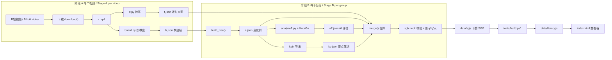

# 项目架构指南 / Architecture guide

本文面向项目的主人：一位围棋初学者，不是程序员，但想弄清楚这个项目的每一部分在做什么、为什么这样做、对应哪个文件的哪一段代码，以及现在做到了哪一步。读完以后，你应该能顺着逻辑从一个视频讲到一个能在浏览器里点开的变化树，也知道哪里还不可靠。

This guide is for the owner of the project: a Go beginner who is not a programmer, but wants to know what every part does, why it is built that way, which block of which file does it, and how far the work has come. After reading it you should be able to follow the logic from one video to one variation tree you can click through in a browser, and you should know where the project is still unreliable.

本文基于 `develop` 分支的提交 `9fa1fcd`（`Merge pull request #15`，手机版界面）写成，写作日期是 2026-11-08。文中的行号（写作 `L55-70`）是这个提交里的大致行号，代码以后再改就会漂移，所以请以函数名为准，行号只用来帮你快速翻到位置。凡是我实际运行过的东西（测试、示例脚本、只读的状态命令），都标了 **[已运行]**；凡是只靠读代码推断、或者根本没法验证的内容，都标了 **[未核实]**。没有标记的句子，是我读这个提交里的代码得到的。

This guide was written against commit `9fa1fcd` of the `develop` branch (`Merge pull request #15`, the mobile edition) on 2026-11-08. Line numbers (written `L55-70`) are approximate positions in that commit and will drift when the code changes, so trust the function names and use the numbers only to find the place quickly. Everything I actually ran (tests, example scripts, read-only status commands) is marked **[ran]**; everything inferred from the code alone, or impossible to verify, is marked **[not verified]**. A sentence without a mark comes from reading the code in that commit.

## 一页概览 / One page summary

这个项目把围棋老师（陈林涛）在 B 站上的定式讲解视频，自动变成可以在浏览器里点着看的"变化树"。每一手棋旁边有三样东西：老师当时说的话（语音转写）、一句话要点，以及 KataGo（一个很强的围棋 AI）只在这个定式涉及的小范围里算出来的评估。整条路是：视频 → 下载 → 转写文字 + 识别棋盘画面 → 拼成变化树 → 让 KataGo 评估分叉点 → 合成 SGF 棋谱文件 → 打包成 `data/library.js` → 查看器 `index.html` 显示。

The project turns the joseki lessons of the Go teacher 陈林涛 (Chen Lintao) on Bilibili into a "variation tree" you can click through in a browser. Next to every move there are three things: what the teacher said at that moment (speech transcript), a one line key point, and an evaluation made by KataGo (a very strong Go AI) inside the small area the joseki is about. The road is: video, download, transcript plus board recognition from the picture, assemble a variation tree, let KataGo evaluate the branch points, merge into an SGF game record, pack into `data/library.js`, show in the viewer `index.html`.

| 步骤 / Step | 做什么 / What it does | 主要文件 / Main files |
|---|---|---|
| 1 下载 / Download | 用 yt-dlp 取视频，被限流就退避重试 / Fetch the video with yt-dlp, back off when throttled | `pipeline/orch2.py` `download()` |
| 2 转写 / Transcribe | Whisper 把语音变成带时间的文字 / Whisper turns speech into timed text | `pipeline/tr.py` |
| 3 识棋盘 / Read the board | 逐帧读视频里的棋盘，只认固定版式 / Read the board frame by frame, fixed layout only | `pipeline/board.py` |
| 4 建树 / Build the tree | 把一串棋盘画面拼成变化树 / Turn the board frames into a variation tree | `pipeline/orch2.py` `build_tree()` |
| 5 评估 / Evaluate | KataGo 只评估分叉点，只搜局部 / KataGo evaluates branch points only, locally | `pipeline/analyze2.py` |
| 6 合并 / Merge | 文字、要点、评估写进 SGF 的注释和 AN 属性 / Text, notes and evaluation go into SGF comments and the AN property | `pipeline/orch2.py` `merge()` |
| 7 显示 / Show | 打包后在浏览器里看，带悬停预览和训练模式 / Pack and view in the browser, with hover previews and quiz mode | `tools/build.ps1`, `index.html` |

| 项目 / Item | 数字（2026-11-08） / Number (2026-11-08) |
|---|---|
| 视频总数 / Videos in total | 115 个，约 20.4 小时：定式大全 52、套路研究 18、避雷 45（来自 `data/sources/chenlintao/index.json`）/ 115, about 20.4 hours: 52 + 18 + 45 (from `index.json`) **[已运行 / ran]** |
| `develop` 上的数据 / Data on `develop` | 94 个分组文件，只有 4 个有内容，1 个带 AI 评估，数据时间 11-01 05:18 / 94 group files, only 4 have content, 1 has AI evaluation, data stamp 11-01 05:18 **[已运行 / ran]** |
| 作者电脑上的工作目录（尚未提交） / The owner's working copy (not committed) | 94 个里有 47 个有内容：定式大全 29/31（13 个带 AI 评估，20 个带要点），套路研究 2/18，避雷 16/45；全部通过 SGF 校验 / 47 of 94 have content: 29/31 in 定式大全 (13 with AI evaluation, 20 with key points), 2/18 and 16/45 in the other two series; all pass SGF validation **[已运行 / ran]** |
| 自动测试 / Automated tests | Python 273 个（3 个跳过，见 6.1）和 Node 118 个，没有失败 / 273 Python tests (3 skipped, see 6.1) and 118 Node tests, no failure **[已运行 / ran]** |
| 版本 / Versions | 项目 `VERSION` 0.1，查看器界面 v4.7 / project `VERSION` 0.1, viewer interface v4.7 |

最需要你知道的五件事：第一，AI 数字是"只在局部范围内、比局部最优差几目"，不是胜率，也不是全局判断。第二，棋盘识别只认一种固定版式，套路研究和避雷两个系列的大部分视频版式不同，被拒绝了。第三，我写这份指南时发现一个还没修的缺陷：从"摆好的起始局面"开始的节点，AI 默认按黑棋先行评估，老师实际下白棋时这个节点的候选点就是错边的（见 6.3）。第四，老师的讲解文字版权属于原作者，私有数据仓库的流程只做了一半（PR 16 还没合并）。第五，KataGo 继续推演面板从来没有连过真实的 KataGo，手机版没有在真机上试过。

The five things you most need to know: first, the AI numbers mean "points worse than the local best, inside a small area", not a winrate and not a whole board judgement. Second, board recognition only accepts one fixed layout, and most videos of the other two series have a different layout and were rejected. Third, while writing this guide I found a defect that is not fixed yet: for nodes that start from a "laid out starting position", the AI assumes Black moves first by default, so when the teacher actually plays White the candidate points of that node are for the wrong side (see 6.3). Fourth, the teacher's commentary belongs to the original author, and the private data repository flow is only half done (PR 16 is not merged). Fifth, the KataGo continue panel has never been connected to a real KataGo, and the mobile edition has not been tried on real phones.

## 目录 / Table of contents

- [一页概览 / One page summary](#一页概览--one-page-summary)
- [0. 先认识这些词 / Key words first](#0-先认识这些词--key-words-first)
- [1. 全景 / The big picture](#1-全景--the-big-picture)
  - [1.1 它要解决什么问题 / The problem](#11-它要解决什么问题--the-problem)
  - [1.2 数据怎么流动 / How the data flows](#12-数据怎么流动--how-the-data-flows)
  - [1.3 三层结构与文件地图 / Three layers and the file map](#13-三层结构与文件地图--three-layers-and-the-file-map)
  - [1.4 一个完整的例子 / A worked example](#14-一个完整的例子--a-worked-example)
- [2. 流水线逐阶段 / The pipeline, stage by stage](#2-流水线逐阶段--the-pipeline-stage-by-stage)
  - [2.1 总调度和工作目录 / The driver and the work folder](#21-总调度和工作目录--the-driver-and-the-work-folder)
  - [2.2 下载 / Download](#22-下载--download)
  - [2.3 转写 / Transcription](#23-转写--transcription)
  - [2.4 识别棋盘 / Board recognition](#24-识别棋盘--board-recognition)
  - [2.5 建变化树 / Building the variation tree](#25-建变化树--building-the-variation-tree)
  - [2.6 KataGo 分析 / KataGo analysis](#26-katago-分析--katago-analysis)
  - [2.7 合并成 SGF / Merging into SGF](#27-合并成-sgf--merging-into-sgf)
  - [2.8 要点笔记与指纹 / Key point notes and fingerprints](#28-要点笔记与指纹--key-point-notes-and-fingerprints)
  - [2.9 错别字词典 / The typo dictionary](#29-错别字词典--the-typo-dictionary)
  - [2.10 护栏 / Guards](#210-护栏--guards)
  - [2.11 重建与小工具 / Regeneration and helper tools](#211-重建与小工具--regeneration-and-helper-tools)
- [3. 查看器 / The viewer](#3-查看器--the-viewer)
  - [3.1 架构 / Architecture](#31-架构--architecture)
  - [3.2 SGF 解析与回放 / SGF parsing and replay](#32-sgf-解析与回放--sgf-parsing-and-replay)
  - [3.3 画棋盘与视角 / Drawing the board and view modes](#33-画棋盘与视角--drawing-the-board-and-view-modes)
  - [3.4 AI 候选点 / AI candidates](#34-ai-候选点--ai-candidates)
  - [3.5 老师的圈与悬停预览 / Teacher circles and hover preview](#35-老师的圈与悬停预览--teacher-circles-and-hover-preview)
  - [3.6 AI 变化的悬停与固定 / AI line hover and pin](#36-ai-变化的悬停与固定--ai-line-hover-and-pin)
  - [3.7 提示框 / The tooltip](#37-提示框--the-tooltip)
  - [3.8 评论卡片、视频链接与征子演示 / Comment cards, video links and ladder demo](#38-评论卡片视频链接与征子演示--comment-cards-video-links-and-ladder-demo)
  - [3.9 算力开关 / The compute switch](#39-算力开关--the-compute-switch)
  - [3.10 KataGo 继续推演面板 / The engine panel](#310-katago-继续推演面板--the-engine-panel)
  - [3.11 训练模式 / Quiz mode](#311-训练模式--quiz-mode)
  - [3.12 页脚、署名与复制 SGF / Footer, credit and copy SGF](#312-页脚署名与复制-sgf--footer-credit-and-copy-sgf)
  - [3.13 手机版与离线应用 / Mobile edition and offline app](#313-手机版与离线应用--mobile-edition-and-offline-app)
  - [3.14 隐私设计 / Privacy design](#314-隐私设计--privacy-design)
- [4. 血的教训 / Lessons learned the hard way](#4-血的教训--lessons-learned-the-hard-way)
- [5. 仓库工作流 / Repository workflow](#5-仓库工作流--repository-workflow)
- [6. 现状与局限 / State and limits](#6-现状与局限--state-and-limits)
- [7. v1.0 就绪清单 / v1.0 readiness checklist](#7-v10-就绪清单--v10-readiness-checklist)
- [8. 术语表 / Glossary](#8-术语表--glossary)
- [附录 A 常用命令 / Appendix A: commands](#附录-a-常用命令--appendix-a-commands)

## 0. 先认识这些词 / Key words first

下面两张表把后文反复出现的词先讲一遍，每个词一句话加一个生活类比。后面第一次真正用到它们时我还会再提醒一次；全部术语在第 8 节也有一份术语表。围棋词放在前面，因为你是围棋初学者，这些词的准确含义比代码更重要。

The two tables below explain the words that come back again and again, one sentence and one everyday analogy each. I remind you again where they are first really used, and section 8 holds the complete glossary. The Go words come first because you are a Go beginner and their exact meaning matters more than any code.

| 围棋词 / Go word | 一句话 / One sentence |
|---|---|
| 定式 | 角上双方都认为公平的一套标准下法，像棋手之间约定俗成的"标准开场白" / Joseki: a standard corner sequence that both sides accept as fair, like a customary opening phrase between players |
| 星位、小目、三三 | 角上的三个常见落点：星位是四四的那个黑点，小目是三四，三三是第三线第三路 / Three common corner points: the star point (4-4, the marked dot), the 小目 (3-4) and the 三三 (3-3) |
| 小飞挂 | 对角上的子"挂"过去，位置是一个小飞（象步，走日字）的距离 / An approach to a corner stone placed a knight's move away |
| 夹击、一间低夹、二间高夹 | 挂角之后，从另一边夹住挂过来的子；"一间/二间"是夹击子和被夹子之间隔几路，"低/高"是夹击子在三路还是四路 / A pincer: attacking the approaching stone from the other side; one or two spaces apart, on the third line (low) or the fourth line (high) |
| 分叉点 | 老师在这里展示了不止一种下法的局面，变化树在这里分叉 / A position where the teacher shows more than one continuation, so the tree branches |
| 变化图、变化树 | 把"如果这样下，对方那样应"画出来就是变化图，把所有变化图按走法串起来就是树，像选择题式的剧情书 / A variation diagram shows "if this, then that"; all of them chained by their moves form a tree, like a choose-your-own-adventure book |
| 提子 | 把被围死的对方棋子从棋盘上拿掉 / Removing opposing stones that have no liberties left |
| 行棋方 | 轮到谁下，也叫"该谁走" / The side to move |
| 目差 | 用"目"（点）表示的差距，AI 说"这手比最优差 1.5 目"，就是预计最后少 1.5 点 / A gap measured in points, "1.5 points worse than the best" means 1.5 points less at the end |
| 局部最优 | 只在讲解的那一小块范围里比较时最好的一手，不等于全盘最好 / The best move when you only compare inside the small area being taught, not the best on the whole board |
| 候选点 | AI 认为值得一看的下一手 / A next move the AI thinks is worth a look |
| 脱先 | 不应对，转去别处下 / Not answering and playing elsewhere (tenuki) |
| 劫材 | 打劫时用来逼对方应一手的威胁 / A ko threat: a forcing move you play during a ko fight |
| 征子 | 连续叫吃、把对方一块棋沿对角线追着跑的手段，成败取决于前方有没有对方的接应子 / A ladder: chasing a group by repeated atari along a diagonal, whether it works depends on stones waiting ahead |

| 技术词 / Technical word | 一句话加类比 / One sentence with an analogy |
|---|---|
| SGF | 围棋棋谱的通用文本格式，像用固定符号写的棋谱笔记本，`;B[pd]` 的意思是黑棋下在 pd 这个点 / The common text format for Go game records, like a notebook written in fixed symbols, `;B[pd]` means Black plays at the point pd |
| 变化树（程序里的树） / Variation tree (in code) | 每个局面是一页，每一手是一条通往下一页的路，页和路连成一棵倒着长的树，像族谱 / Every position is a page and every move a road to the next page, joined into an upside down tree, like a family tree |
| KataGo | 开源的围棋 AI，像一位只报数字不说话的超强棋手 / An open source Go AI, like a very strong player who reports numbers instead of talking |
| 权重（网络文件） / Weights (network file) | AI 学出来的全部"经验"存成的一个大文件，没有它引擎就是空壳，像棋手的毕生棋感 / The file that holds everything the AI learned, without it the engine is an empty shell, like a player's lifetime of intuition |
| 访问次数 visits | AI 在这个局面上"往下推演了多少次"，像请朋友在心里摆 220 遍变化再回答 / How many times the AI looked ahead from this position, like asking a friend to play out 220 lines in their head before answering |
| 先验 prior | AI 还没认真算之前的第一直觉概率，像高手一眼扫过去的"感觉应该下这里" / The AI's first instinct before it really calculates, like a master's glance that says "probably here" |
| PV（主要变化） / PV (principal variation) | AI 预计双方接下来会走的那一串最佳着法，像它心里的"标准答案变化图" / The best sequence the AI expects both sides to follow, like the "model answer diagram" in its head |
| 视角（黑方视角、行棋方视角） / Perspective (Black's, side to move) | 同一个数字站在谁的角度看：黑方视角里，白棋占优时数字是负的 / Whose side a number is read from: in Black's view a number is negative when White is ahead |
| JSON | 一种把数据写成带标签文本的格式，像贴了标签的文件柜 / A text format for data with labels, like a filing cabinet with labelled drawers |
| Docker | 把软件和它需要的环境一起装进一个标准"集装箱"里运行，在哪台电脑上结果都一样 / Runs software together with its environment inside a standard "container" so the result is the same on every computer |
| 原子写入 | 先写到一个临时文件、写完整了再一下子换成正式文件，像先在草稿纸上写好信，再整封放进信箱，别人永远看不到写了一半的信 / Write to a temporary file first and swap it in as a whole, like drafting a letter on scrap paper and mailing it only when finished, so nobody ever sees half a letter |
| 指纹（哈希） / Fingerprint (hash) | 根据内容算出的一小段编码，内容变一点编码就全变，像人的指纹用来认人 / A short code computed from content, change the content a little and the code changes completely, like a fingerprint that identifies a person |
| ASR / Whisper | 自动语音识别，Whisper 是其中一个模型，像一位偶尔会听错同音字的速记员 / Automatic speech recognition, Whisper is one such model, like a stenographer who sometimes mishears homophones |
| yt-dlp 和 ffmpeg / yt-dlp and ffmpeg | 一个下载视频的工具，和一个处理音视频的瑞士军刀 / A video downloader, and a Swiss army knife for audio and video |
| 限流（HTTP 567） / Throttling (HTTP 567) | 网站嫌你请求太快，回一个错误码让你慢点，像饭店门口排队的人被拦住说"等一会儿" / The site answers with an error code because you ask too fast, like being told to wait at a restaurant door |
| 缓存 / Cache | 把用过的东西留一份在手边省得重取，缺点是可能拿到旧的 / Keeping a copy at hand to avoid fetching again, the risk is getting an old one |
| 令牌 token | 一串只有你知道的口令，凭它才能使用某个服务 / A secret string only you know, needed to use a service |
| PWA / 服务工作线程 / PWA and service worker | 让网页像手机应用一样安装、离线也能打开，服务工作线程是浏览器里的"后台管家"，替页面管缓存 / Lets a web page install like a phone app and open offline, the service worker is a "background steward" in the browser that manages the cache |
| 分支 / PR / 提交 / Branch, PR, commit | 分支是并行的一条修改线，提交是一次存档，PR（拉取请求）是请求把某条分支并回主线 / A branch is a parallel line of changes, a commit is one save point, a PR (pull request) asks to merge a branch into the main line |

## 1. 全景 / The big picture

### 1.1 它要解决什么问题 / The problem

围棋定式书和视频讲了很多变化，但有三个痛点：视频里的棋盘没法回放，老师说的话和棋盘上的某一手对不上，而 KataGo 默认只给全盘胜率，想只研究某个角上的局部变化时，周围的子会把答案搅乱。这个项目的做法是把视频"翻译"成棋谱：每一手棋盘上的变化对上老师当时说的那几句话，再让 KataGo 只在这一小块区域里比较，告诉你每个候选点比局部最优差几目，老师走的每一手也一定单独算一遍。

Joseki books and videos teach a lot of variations, but there are three pains: the board in a video cannot be replayed, what the teacher says does not line up with a move on the board, and KataGo by default only gives a whole board winrate, so when you want to study one corner the stones around it disturb the answer. The project "translates" the video into a game record: every change on the board is matched with the sentences the teacher said at that moment, and then KataGo compares candidates only inside that small area and tells you how many points each is worse than the local best, with every move the teacher played always evaluated separately.

这件事要自动化，是因为量很大：视频一共 115 个、约 20 小时，没有人能手工摆完。所以整个"流水线"可以不用人看着一直跑，它的难点不在某一步有多高深，而在每一步都会出错（下载被限流、语音听错字、版式不对、AI 算错边），所以大量代码是在"发现错误、拒绝坏数据、不要把好文件覆盖掉"。

It has to be automated because of the volume: 115 videos, about 20 hours, nobody can lay them out by hand. So the whole "pipeline" can run unattended. The difficulty is not that any single step is clever, but that every step can go wrong (downloads throttled, words misheard, a different layout, the AI evaluating for the wrong side), so a lot of code exists to notice errors, refuse bad data and never overwrite a good file.

### 1.2 数据怎么流动 / How the data flows

下图是整条路。左边的"阶段 A"对每个视频各做一遍，右边的"阶段 B"对每个"分组"做一遍。分组是指讲同一个定式的几个视频合成一棵树（例如三个视频都讲"星位小飞挂小飞守角"，就合成一个分组），分组由 `data/sources/chenlintao/plan.json` 决定。

The diagram shows the whole road. "Stage A" on the left runs once per video, "stage B" on the right runs once per "group". A group is the set of videos about the same joseki merged into one tree (for example three videos about one approach and its answers become one group), and `data/sources/chenlintao/plan.json` decides the groups.



图：视频先拆成文字和棋盘画面两路，在阶段 B 汇合成带评估的 SGF，再打包给查看器。

Figure: a video splits into text and board pictures, which meet again in stage B as an SGF with evaluation, then get packed for the viewer.

阶段 A 的结果都缓存在工作目录里（`v.mp4`、`t.json`、`b.json`），因为下载和转写最慢，不能每次重来；阶段 B 可以反复重跑（比如改了错别字词典之后），重跑时 AI 评估和要点也从缓存里取，只有"变化树变了"的时候才需要重新让 KataGo 算。

The results of stage A are cached in the work folder (`v.mp4`, `t.json`, `b.json`) because downloading and transcribing are the slowest and cannot start over every time. Stage B can be rerun again and again (for example after editing the typo dictionary), and a rerun takes the AI evaluation and the notes from the cache, so KataGo only has to run again when the tree has changed.

### 1.3 三层结构与文件地图 / Three layers and the file map

整个项目可以看成三层。最下面是流水线（Python，在作者的 Windows 电脑上跑，要用显卡、ffmpeg、Whisper 和 KataGo）；中间是数据（SGF 文件和打包出来的 `library.js`，是流水线和查看器之间唯一的交接物）；最上面是查看器（一个网页，纯前端，不需要服务器）。这样分层的好处是：查看器完全不知道流水线怎么工作，只要 SGF 的约定不变，两边可以各自改。

The project has three layers. At the bottom is the pipeline (Python, run on the owner's Windows computer, needing the graphics card, ffmpeg, Whisper and KataGo). In the middle is the data (SGF files and the packed `library.js`, the only hand over between pipeline and viewer). On top is the viewer (a web page, pure front end, no server needed). The benefit is that the viewer does not know how the pipeline works, so as long as the SGF conventions stay the same, both sides can change on their own.

| 路径 / Path | 它是什么 / What it is |
|---|---|
| `pipeline/orch2.py` | 总调度：下载、建树、合并、写 SGF（384 行）/ The driver: download, tree, merge, write SGF (384 lines) |
| `pipeline/tr.py`、`pipeline/board.py` | 转写与识棋盘，各自是一个单独运行的脚本 / Transcription and board recognition, each a script that runs on its own |
| `pipeline/analyze2.py` | 调用 KataGo 评估分叉点 / Calls KataGo to evaluate branch points |
| `pipeline/treesync.py` | 指纹与一致性检查，防止评估和笔记对错节点 / Fingerprints and consistency checks so evaluations and notes never land on the wrong node |
| `pipeline/sgfcheck.py`、`pipeline/wqutil.py` | SGF 校验，以及原子写入、日志、重试等公共工具 / SGF validation, plus atomic writes, logging, retry and other shared helpers |
| `pipeline/fixtext.py`、`pipeline/fixdict.json`、`pipeline/mkfix.py` | 错别字词典（303 条规则）和它的维护工具 / The typo dictionary (303 rules) and its maintenance tool |
| `pipeline/regen.py`、`pipeline/wq.py`、`pipeline/serve.py` | 从缓存重建 SGF、状态与检查命令、本地无缓存服务器 / Rebuild SGFs from the cache, status and check commands, a local no-cache server |
| `data/sources/chenlintao/` | `index.json` 是视频清单，`plan.json` 是哪些视频合成一个分组 / `index.json` is the video list, `plan.json` says which videos form a group |
| `data/sgf/` | 生成的棋谱，按"来源/系列/分组名.sgf"存放 / The generated game records, stored as source/series/group.sgf |
| `data/library.js` | 所有 SGF 打成一个 JS 文件，查看器直接读它，没有它网页是空的 / All SGFs packed into one JS file that the viewer reads, without it the page is empty |
| `index.html` | 查看器主体：解析、画棋盘、悬停预览、算力开关（362 行）/ The viewer core: parsing, board drawing, hover previews, compute switch (362 lines) |
| `engine_core.js`、`engine_net.js`、`engine_panel.js` | KataGo 继续推演面板：纯逻辑、唯一的联网文件、界面 / The KataGo continue panel: pure logic, the only network file, the interface |
| `quiz_core.js`、`quiz.js` | 训练模式：出题与记忆曲线的纯逻辑，以及界面 / Quiz mode: the pure logic of question making and the memory curve, and the interface |
| `mobile.js`、`pwa.js`、`sw.js`、`manifest.webmanifest`、`icons/` | 手机版布局和可安装的离线应用 / The phone layout and the installable offline app |
| `remote/` | 在远程显卡上批量跑 KataGo 的脚本，以及页面可选连接的桥接服务 `katago_bridge.py` / Scripts to run KataGo in batch on a remote GPU, and the bridge `katago_bridge.py` the page may connect to |
| `engine-config/` | KataGo 的配置文件，不含程序和权重 / KataGo configuration files, without program or weights |
| `tools/` | `build.ps1` 打包、`check_repo.py` 和 `check_bilingual.py` 检查、`make_site.py` 生成可部署文件夹等 / `build.ps1` packing, `check_repo.py` and `check_bilingual.py` checks, `make_site.py` building a deployable folder, and more |
| `tests/` | 自动测试，用 Docker 运行 / Automated tests, run in Docker |
| `docs/` | 使用、工作流、许可证、算力平台、事前复盘等文档 / Usage, workflow, license, compute platforms, pre-mortem and other documents |

### 1.4 一个完整的例子 / A worked example

下面用一个很小的、我自己编出来的例子，走一遍"一个视频怎么变成变化树里的一个分叉节点"。所有数字和文字都是虚构的，只是为了让你看清每一步的样子；但生成变化树、合并成 SGF、转换 KataGo 的答案这三步，我是**真的运行了仓库里的函数**（`build_tree()`、`merge()`、`analyze2.query()`、`analyze2.convert()`），下面贴的是它们的真实输出 **[已运行 / ran]**。KataGo 本身没有运行，它的答案是我编的。

Below is a very small example I made up, to follow "how a video becomes one branch node of the variation tree". All numbers and text are fictional, only to show you what each step looks like. But for three steps, building the tree, merging into SGF, and converting the KataGo answer, I **really ran the functions of the repository** (`build_tree()`, `merge()`, `analyze2.query()`, `analyze2.convert()`) and what follows is their real output **[ran]**. KataGo itself was not run, its answer is made up.

设想一个 22 秒的视频片段：棋盘上先下星位（右上角 Q16），白棋小飞挂（R14），然后黑棋一间低夹（R12）；老师接着说"回到前面，也可以走这里"，改下 Q12。

Imagine a 22 second video clip: a star point stone at Q16 in the upper right corner, White's knight's move approach at R14, then Black's pincer one space away on the third line at R12; the teacher then says "back to the earlier position, you can also play here" and plays Q12 instead.

**第 1 步，转写。** Whisper 输出一个列表，每句话有开始时间、结束时间和文字（`t.json`）。注意"黑旗"是语音识别的典型错字，应该是"黑棋"。

**Step 1, transcript.** Whisper outputs a list where each sentence has a start time, an end time and text (`t.json`). Note that "黑旗" is a typical recognition mistake, it should be "黑棋".

```json
[{"s": 2.1,  "e": 4.0,  "t": "好，我们先下一个星位"},
 {"s": 5.2,  "e": 8.0,  "t": "白棋小飞挂"},
 {"s": 11.3, "e": 14.0, "t": "黑旗一间低夹，这是最常见的下法"},
 {"s": 18.4, "e": 21.0, "t": "也可以走这里"}]
```

**第 2 步，棋盘画面。** `board.py` 每秒读 6 帧，每帧得到一个 342 个字符的字符串（18 列乘 19 行，`.` 是空点，`B` 黑子，`W` 白子；点的编号是 行号乘 18 加列号，从上到下、从左到右数）。真实字符串太长，下面只列出非空的点（`pd` 是 SGF 里的坐标写法，Q16 就是 `pd`）。

**Step 2, board frames.** `board.py` reads 6 frames per second and each frame becomes a string of 342 characters (18 columns times 19 rows, `.` is empty, `B` a black stone, `W` a white stone; a point's number is row times 18 plus column, counted top to bottom and left to right). The real string is too long, so only the non empty points are listed below (`pd` is the SGF way to write Q16).

| 时间（秒） / Time (s) | 画面上的子 / Stones on screen |
|---|---|
| 0 到 2 / 0 to 2 | 空棋盘 / empty board |
| 2 到 5 / 2 to 5 | 黑 69（Q16，`pd`）/ B 69 (Q16, `pd`) |
| 5 到 8 | 黑 69，白 106（R14）/ B 69, W 106 (R14) |
| 8 到 8.17 | 多出一个白 100：鼠标指针被误认成棋子，只出现 1 帧 / an extra W 100: the mouse pointer misread as a stone, for 1 frame only |
| 8.17 到 11 | 黑 69，白 106 / B 69, W 106 |
| 11 到 15 | 黑 69，白 106，黑 142（R12）/ B 69, W 106, B 142 (R12) |
| 15 到 18 | 黑 69，白 106：老师退回去了 / B 69, W 106: the teacher went back |
| 18 到 22 | 黑 69，白 106，黑 141（Q12）/ B 69, W 106, B 141 (Q12) |

**第 3 步，变化树。** `build_tree()` 读这些画面，真实运行的结果是 6 个节点（节点 3 是那一帧的鼠标指针，已经被当作闪烁删掉，下面标了 `dead`）。节点 2（白棋 R14 之后）有两个活的子节点：4（黑 R12）和 5（黑 Q12），所以它是一个分叉点，这就是我们要分析和评论的节点。

**Step 3, the tree.** `build_tree()` reads those pictures and the real result is 6 nodes (node 3 is the one frame of mouse pointer, deleted as flicker, marked `dead` below). Node 2 (after White's R14) has two live children, 4 (Black R12) and 5 (Black Q12), so it is a branch point, and this is the node we analyse and comment on.

```text
id 0  父 par None  mv None          pos ''              root
id 1  父 par 0     mv (69, 'B')     pos 'B69'           B Q16
id 2  父 par 1     mv (106, 'W')    pos 'B69W106'       W R14   ch [4, 5]   v [[5,11],[15,18]]
id 3  父 par 2     mv (100, 'W')    pos 'B69W100W106'   dead = True (flicker)
id 4  父 par 2     mv (142, 'B')    pos 'B142B69W106'   B R12   v [[11,15]]
id 5  父 par 2     mv (141, 'B')    pos 'B141B69W106'   B Q12   v [[18,22]]
```

注意节点 2 的出现时间有两段（5 到 11 秒，15 到 18 秒）：老师第二次回到这个局面时，程序认出"这个局面已经有节点了"，没有新建，而是给同一个节点加上第二段时间。

Note that node 2 has two time spans (5 to 11 s and 15 to 18 s): when the teacher came back to this position, the program recognised "a node for this position already exists" and added a second time span to the same node instead of creating a new one.

**第 4 步，给 KataGo 的问题和它的答案。** 只有分叉点（这里是节点 2）才问 KataGo。`analyze2.query()` 把"局面"写成一个请求：已经下过的着法、搜索次数 220、规则和贴目，以及最重要的 `allowMoves`，它把双方的候选点都限制在一个矩形范围内（这里是 50 个点，从 O19 到 S10）。下面是真实输出，其中 `allowMoves` 的点列表我缩写了。

**Step 4, the question for KataGo and its answer.** Only branch points (node 2 here) are sent to KataGo. `analyze2.query()` writes the "position" as a request: the moves played so far, 220 visits, the rules and komi, and above all `allowMoves`, which restricts the candidates of both sides to a rectangle (50 points here, from O19 to S10). This is the real output, with the list of points in `allowMoves` abbreviated.

```json
{"id": "2", "initialStones": [], "moves": [["B", "Q16"], ["W", "R14"]], "rules": "japanese", "komi": 6.5,
 "boardXSize": 19, "boardYSize": 19, "analyzeTurns": [2], "maxVisits": 220,
 "allowMoves": [{"player": "B", "moves": "[50 points, O19 ... S10]", "untilDepth": 40},
                {"player": "W", "moves": "[same list]", "untilDepth": 40}]}
```

本项目让 KataGo 用黑方视角回答，所以拿到答案要换成"行棋方视角"。下面是用真实函数 `convert()` 转换一个编出来的答案：白棋走，黑方领先 3.0 目，转换之后变成"行棋方（白）落后 3.0 目"；候选 C4 的黑方视角 +2.0 变成 -2.0。这是第 4 节第一个教训的核心。

The project makes KataGo answer from Black's point of view, so the answer must be converted to the "side to move" perspective. Below, the real function `convert()` converts a made up answer: White to move, Black leads by 3.0 points, which becomes "the side to move (White) is behind by 3.0"; candidate C4 with +2.0 in Black's view becomes -2.0. This is the core of the first lesson in section 4.

```json
{"turn": "W", "score": -3.0, "wr": 0.4,
 "cand": [{"m": "C4", "v": 120, "s": -2.0, "wr": 0.42, "p": 0.5, "pv": ["C4", "D5"]},
          {"m": "D4", "v": 40,  "s": -3.5, "wr": 0.38, "p": 0.2, "pv": ["D4"]}]}
```

老师走的第二手 Q12，如果 KataGo 主搜索给它的访问次数太少，程序会对"下了 Q12 之后的局面"单独再问一次，并把结果取反（因为那时轮到对方），然后标记 `f: 1`、先验记为 -1，表示"这是单独强制评估的老师着法"。

For the teacher's second move Q12, if the main search gave it too few visits, the program asks once more about "the position after Q12", negates the result (it is then the opponent's turn) and marks it `f: 1` with a prior of -1, meaning "this is the teacher's move, evaluated separately and forced".

**第 5 步，合并。** `merge()` 把时间对上：每句话落在"这句话开始时棋盘上的那个节点"里（5.2 秒那句落在节点 2，11.3 秒那句落在节点 4，等等），错别字词典把"黑旗"改成"黑棋"，AI 评估写进评论，并且把候选点压成一个短字符串放进 `AN` 属性。下面是真实输出（根节点的版权属性 `AP`、`CP`、`SO` 我省略了）：

**Step 5, merge.** `merge()` lines up the times: each sentence lands in "the node that was on the board when the sentence started" (the 5.2 s sentence lands in node 2, the 11.3 s sentence in node 4, and so on), the typo dictionary turns "黑旗" into "黑棋", the AI evaluation goes into the comment, and the candidates are squeezed into one short string in the `AN` property. This is the real output (the credit properties `AP`, `CP`, `SO` of the root are left out):

```text
(;GM[1]FF[4]CA[UTF-8]SZ[19]KM[6.5]GN[demo]PC[...]...
;B[pd]C[【老师讲解 @0|0:02】好，我们先下一个星位]
;W[qf]PL[B]C[【老师讲解 @0|0:05】白棋小飞挂
【AI局部评估】黑先。只在本定式涉及的区域内搜索,不看全盘胜率;数字=比局部最优差几目(0最优,越负越差)。局部最优⟨R12⟩;候选: ⟨R12⟩最优/先验55% ⟨P13⟩-0.2目/先验12% ⟨Q12⟩-0.7目(老师走的)
最优变化 ⟨R12 Q13 Q11⟩
视频变化⟨R12⟩:就是AI局部最优
视频变化⟨Q12⟩:比局部最优差0.7目
【周边子力影响】去掉区域外的子力后,局部最优为⟨R12⟩;带着外围子力时为⟨R12⟩ → 结论一致,外围影响小]
 AN[qh:0.0:0.55:46:118:R12 Q13 Q11;og:-0.2:0.12:45:31:P13 R12;ph:-0.7:-1.00:44:100:Q12 R13]
 (;B[qh]C[【老师讲解 @0|0:11】黑棋一间低夹，这是最常见的下法
【要点与考量】一间低夹是最常见的应对])
 (;B[ph]C[【老师讲解 @0|0:18】也可以走这里]))
```

（为了看清结构，我在 `AN` 和子节点前面加了换行和缩进，真实文件里它们紧跟在前一个括号后面。）几个要点：`PL[B]` 明确写出"轮到黑棋"；`@0|0:05` 是"第 0 个视频的 0 分 5 秒"，查看器把它变成一个能跳到视频那一刻的链接；`⟨R12⟩` 这种尖括号是给查看器的记号，它会把它变成可以点的小标签。

(I added line breaks and indentation before `AN` and the child nodes to show the structure, in the real file they follow the previous bracket directly.) Key points: `PL[B]` states plainly "Black to move"; `@0|0:05` means "video number 0, 0 minutes 5 seconds" and the viewer turns it into a link that jumps to that moment of the video; angle brackets such as `⟨R12⟩` are markers for the viewer, which turns them into little clickable tags.

`AN` 属性里每一项用分号隔开，每项有六个用冒号隔开的字段：

Each entry of the `AN` property is separated by a semicolon and has six colon separated fields:

| 字段 / Field | 例子 / Example | 含义 / Meaning |
|---|---|---|
| 位置 / Point | `qh` | SGF 坐标，`qh` 就是 R12 / SGF coordinate, `qh` is R12 |
| 目差 / Loss | `-0.2` | 比局部最优差几目，最优是 0，越负越差，永远不会是正数 / Points worse than the local best, the best is 0, more negative is worse, never positive |
| 先验 / Prior | `0.55` | AI 的第一直觉；`-1.00` 表示这是单独强制评估的老师着法 / The AI's first instinct, `-1.00` marks a teacher move evaluated separately and forced |
| 胜率 / Winrate | `46` | 百分数，只搜局部，所以没有全局意义，查看器不显示它 / A percentage, meaningless as a whole board number because the search is local, so the viewer does not show it |
| 访问次数 / Visits | `118` | AI 在这一手上推演了多少次 / How many times the AI looked ahead on this move |
| 变化 / PV | `R12 Q13 Q11` | AI 预计的后续着法，空格隔开 / The continuation the AI expects, separated by spaces |

**第 6 步，查看器。** 打开这个节点时，棋盘上会出现：黑色半透明棋子的三个候选点（因为轮到黑棋），圈的颜色按目差分绿、橙、红，圈下面写"最优"或 -0.2、-0.7；老师走的两个点 R12 和 Q12 上有蓝色虚线圈和数字 1、2，对应右边的变化列表；右边的评论被切成"老师讲解""AI 局部评估""周边子力影响"几张卡片。悬停在候选点上会预览那条变化，具体见第 3 节。

**Step 6, the viewer.** When you open this node the board shows three translucent black stones as candidates (because Black is to move), the ring colour is green, orange or red by loss and the label under it says "最优" or -0.2, -0.7. The two points the teacher played, R12 and Q12, carry dashed blue circles with the numbers 1 and 2 that match the variation list on the right, and the comment on the right is cut into cards "老师讲解", "AI 局部评估" and "周边子力影响". Hovering a candidate previews that line, see section 3 for the details.
