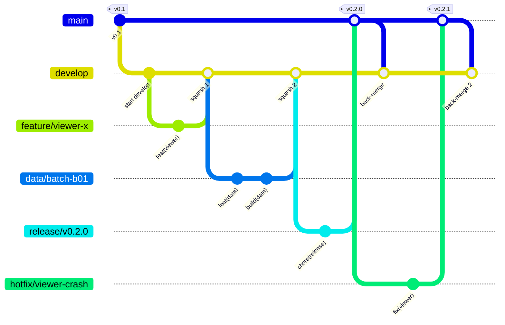
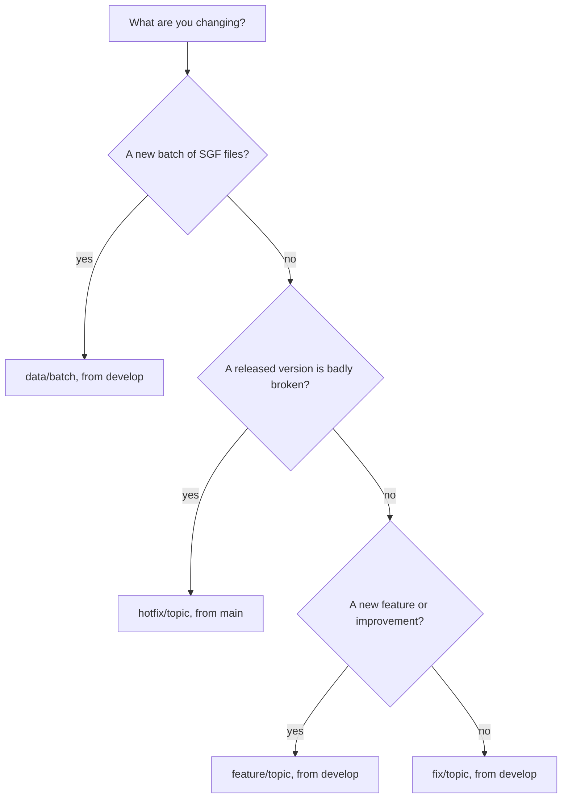

# 分支、提交与发布 / Branching, commits and releases

这是一份面向"一位主要维护者、偶尔有外部贡献、数据成批到来"的项目的工作流(每处理一批新视频,就产出一批 SGF)。写于 2026-11-01。"可选的仓库设置"一节里的命令只是留给维护者按需执行,仓库里没有任何东西会自动运行它们。

This is the workflow for a project with one main maintainer, occasional outside contributions, and data that arrives in batches (every batch of new videos produces a batch of SGF files). It was written on 2026-11-01. The commands in the "Optional repository settings" section are there for the maintainer to run if wanted. Nothing in this repo runs them.

补充一个命名说明:这份指南的早期草稿把集成分支叫作 `dev`。现在统一叫 `develop`,请只使用这个名字。

A small naming note: an early draft of this guide called the integration branch `dev`. The branch is called `develop` and that is the only name to use.

## 1. 总览 / Overview

| 分支 / Branch | 切出自 / Cut from | 合并到 / Merged into | 方式 / How | 说明 / What it is |
|---|---|---|---|---|
| `main` | | | | 已发布的稳定版本,每个版本号的标签都打在这里。 / Released, stable versions. Each version is tagged here. |
| `develop` | `main` | 阶段稳定时合并到 `main` / `main` when a stage is stable | 合并提交 / merge commit | 集成分支,日常工作都先合并到这里。 / Integration branch. All day to day work lands here first. |
| `feature/<topic>` | `develop` | `develop` | 压缩合并 / squash | 查看器、流水线、工具和文档的新功能与改进。 / New features and improvements to the viewer, pipeline, tools and docs. |
| `fix/<topic>` | `develop` | `develop` | 压缩合并 / squash | 修 bug,也包括转写错字这类数据修正。 / Bug fixes, including data fixes such as transcription typos. |
| `data/<batch>` | `develop` | `develop` | 压缩合并 / squash | 一批新的 SGF 文件,例如 `data/2026-12-joseki-batch-2`。 / One batch of new SGF files, for example `data/2026-12-joseki-batch-2`. |
| `release/<version>` | `develop` | 先到 `main`,再合回 `develop` / `main`, then back into `develop` | 合并提交 / merge commit | 可选。用来改版本号和更新日志,例如 `release/v0.2.0`。 / Optional. Version bump and changelog, for example `release/v0.2.0`. |
| `hotfix/<topic>` | `main` | `main` 和 `develop` / `main` and `develop` | 合并提交 / merge commit | 对已发布版本的紧急修复,例如 `hotfix/viewer-crash`。 / An urgent fix to a released version, for example `hotfix/viewer-crash`. |

分支合并之后就删掉。所谓"阶段",是指 `develop` 已经稳定、值得算作一个版本的时刻。只有新版本准备好了,`main` 才会前进。

Delete a branch after it has been merged. A "stage" is a point where `develop` is stable and worth calling a version. `main` only moves when a new version is ready.

## 2. 为什么选这个模型 / Why this model

这是精简版的 Git Flow:两条长期分支(`main` 放已发布的内容,`develop` 做集成),加上短命的主题分支,`release` 和 `hotfix` 只在需要时才用。

It is a trimmed down Git Flow: two long lived branches (`main` for released work, `develop` for integration) plus short lived topic branches, and `release` and `hotfix` only when they are needed.

| 模型 / Model | 适合 / Good for | 与本项目的契合度 / Fit here |
|---|---|---|
| 只有 `main`,主题分支,合并即发布 / GitHub Flow: only `main`, topic branches, merge means release | 持续交付的网站应用 / Web apps that ship continuously | "已发布"和"进行中"分不开。数据是成批来的,而且攒够一大批才发版本,`main` 里会混进做了一半的东西。 / There would be no difference between "released" and "in progress". Data comes in batches and a version is only cut after a large batch, so `main` would hold half finished work. |
| 主干开发:极小的分支或直接提交,依赖完善的自动化测试 / Trunk based development: tiny branches or direct commits, strong automated tests | 测试完善、持续交付的团队 / Teams with solid test suites and continuous delivery | 这里唯一的保障是一个本地小脚本,而且 SGF 数据对不对没法靠单元测试判断。 / The only safety net here is a small local script, and SGF data cannot be unit tested for correctness. |
| 原版 Git Flow:`main` 和 `develop`,再加 feature、release、hotfix 分支 / Git Flow as originally described: `main` and `develop` plus feature, release and hotfix branches | 有明确版本号、有时要同时维护多个版本的软件 / Software with explicit versions, sometimes several supported at once | 与明确的版本号(`v0.1`、`v0.2` 等)相符。同时维护多个版本用不上,所以只保留 release 和 hotfix。 / Matches the explicit versions (`v0.1`, `v0.2` and so on). Supporting several versions at once is not needed, so only release and hotfix are kept. |

Git Flow 的作者在 2020 年补充说明:持续交付的网站应用更适合 GitHub Flow 这类简单流程,而有明确版本号的软件仍然适合 Git Flow。本项目有明确的版本号,所以精简版 Git Flow 合适。将来如果变成随时发布的站点,去掉 `develop` 很容易,历史也不会受影响。

The author of Git Flow added a note in 2020 saying that continuously delivered web apps are better served by something simpler such as GitHub Flow, and that Git Flow still fits software with explicit versions. This project has explicit versions, so the trimmed down Git Flow fits. If it ever becomes a site that is released all the time, dropping `develop` is easy and the history stays intact.

## 3. 流程图 / Diagrams



图:从 `main` 切出 `develop`;feature 和 data 分支用压缩合并(squash)回到 `develop`;`release` 分支用合并提交进入 `main` 并打版本标签,然后把 `main` 合回 `develop`;`hotfix` 从 `main` 切出,修好后同样合回 `main` 和 `develop`。

Diagram: `develop` is cut from `main`. Feature and data branches come back into `develop` with a squash merge. A `release` branch goes into `main` with a merge commit and a version tag, and then `main` is merged back into `develop`. A `hotfix` is cut from `main` and, once fixed, is merged back into both `main` and `develop`.

该用哪个分支:

Which branch should I use:



图:选分支的决策树。新一批 SGF 用 `data/<batch>`(从 `develop` 切出);已发布的版本严重出错用 `hotfix/<topic>`(从 `main` 切出);新功能或改进用 `feature/<topic>`;其余都用 `fix/<topic>`。

Diagram: the decision tree for choosing a branch. A new batch of SGF files uses `data/<batch>` (cut from `develop`). A released version that is badly broken uses `hotfix/<topic>` (cut from `main`). A new feature or improvement uses `feature/<topic>`. Everything else uses `fix/<topic>`.

## 4. 日常流程 / Day to day

### 4.1 功能与修复 / Features and fixes

```bash
git switch develop && git pull --ff-only
git switch -c feature/viewer-dark-mode          # or fix/<topic>
# work, commit with type(scope): subject
python tools/check_repo.py
git push -u origin feature/viewer-dark-mode
gh pr create --base develop --web               # fill in the pull request template
```

合并时选 "Squash and merge",这样 `develop` 上每个 PR 只留一个提交。PR 标题会成为提交主题,所以要保持 `type(scope): subject` 的写法。

Merge with "Squash and merge" so that `develop` gets one commit per pull request. The pull request title becomes the commit subject, so keep it in the `type(scope): subject` style.

### 4.2 一批数据 / A data batch

流水线产出了一批新的 SGF、要点或评估时,按这个流程来。

Use this when the pipeline has produced a batch of new SGF files, key points or evaluations.

```bash
git switch develop && git pull --ff-only
git switch -c data/2026-12-joseki-batch-2
# copy in the new files under data/sgf, data/sources and pipeline/kp_*.json
powershell -ExecutionPolicy Bypass -File tools/build.ps1     # repack data/library.js
python tools/check_repo.py
git add -A data pipeline
git commit -m "feat(data): add five joseki groups" -m "Videos BV1xxxxxxxxx and others, KataGo v1.18.x with the b11c768 network at 220 and 100 visits. Scores are converted to the side to move."
git push -u origin data/2026-12-joseki-batch-2
gh pr create --base develop --web
```

一批数据对应一个 PR。在描述里写明分组名、视频 BV 号和 KataGo 设置,因为压缩合并之后这些内容就是提交信息。数据 PR 里不要夹带查看器或流水线的代码。小批量改动(比如只改了几个错别字)不需要发版,先留在 `develop` 上,等到值得打版本标签时再说。

One batch is one pull request. List the group names, video ids and KataGo settings in the description because they become the commit message after the squash. Keep viewer and pipeline code out of data pull requests. Small batches (a handful of typo fixes, for instance) do not need a release, they just sit on `develop` until a stage is worth tagging.

`data/library.js` 是打包出来的文件。合并时如果它冲突了,不要手工去合:先把 SGF 文件的合并处理完,再重新运行 `tools/build.ps1`。

`data/library.js` is a built file. If it conflicts during a merge, do not merge it by hand: finish the merge of the SGF files, then run `tools/build.ps1` again.

### 4.3 把 develop 合并到 main(发布新版本) / Promoting develop to main (a new version)

阶段稳定时才做这一步。release 分支是可选的,只用来改版本号和更新日志。不用的话,就先在 `develop` 上用普通 PR 把这些改好。

Do this when a stage is stable. A release branch is optional and only useful for the version bump and the changelog edit. If you skip it, make those edits on `develop` in a normal pull request first.

```bash
git switch develop && git pull --ff-only
git switch -c release/v0.2.0
# set VERSION to 0.2.0
# CHANGELOG.md: move the [Unreleased] entries under "## [0.2.0] - YYYY-MM-DD" and add the compare link at the bottom
powershell -ExecutionPolicy Bypass -File tools/build.ps1     # refreshes the data time in data/library.js
git commit -am "chore(release): bump version to 0.2.0"
git push -u origin release/v0.2.0
gh pr create --base main --title "chore(release): v0.2.0" --web
# merge in the browser with "Create a merge commit"
git switch main && git pull --ff-only
git tag -a v0.2.0 -m "v0.2.0" && git push origin v0.2.0
gh release create v0.2.0 --title "v0.2.0" --notes "See the [0.2.0] section of CHANGELOG.md"
# bring the release commit back so develop has it too
git switch develop && git pull --ff-only
gh pr create --base develop --head main --title "chore(release): merge v0.2.0 back into develop" --web
```

### 4.4 紧急修复 / Hotfix

```bash
git switch main && git pull --ff-only
git switch -c hotfix/viewer-crash
# fix it, add a CHANGELOG line, set VERSION to 0.2.1
gh pr create --base main --web      # merge with "Create a merge commit"
# afterwards tag v0.2.1, create the release, and merge main back into develop as in 4.3
```

紧急修复从 `main` 切出分支,修好问题,在更新日志里加一行,并把补丁版本号加一。合并之后打标签、创建发布,再像 4.3 那样把 `main` 合回 `develop`。

For a hotfix, branch off `main`, fix the problem, add a line to the changelog and bump the patch version. After the merge, tag it, create the release, and merge `main` back into `develop` the same way as in 4.3.

## 5. 为什么合并方式不一样 / Why the merge methods differ

从 `feature`、`fix` 和 `data` 分支合并到 `develop` 的 PR 都用压缩合并,这样 `develop` 的历史读起来就像更新日志,一个 PR 对应一个提交。

Pull requests from `feature`, `fix` and `data` branches into `develop` are squashed. The history of `develop` then reads like a changelog, one commit per pull request.

进入 `main` 的合并(release 和 hotfix 分支),以及把 `main` 合回 `develop`,都用真正的合并提交。如果把 `develop` 压缩合并进 `main`,两条分支内容相同、提交却不同,下一次合并必然冲突。变基合并(rebase)完全不用:这个规模的项目没有收益,还会改写提交号。

Anything that goes into `main` (release and hotfix branches) and the merge of `main` back into `develop` use a real merge commit. If `develop` were squashed into `main`, the two branches would hold the same content under different commits and the next merge would conflict. Rebase merges are not used at all. There is no benefit for a project this size and they rewrite commit ids.

## 6. 提交信息 / Commit messages

规则写在 [CONTRIBUTING.md](../CONTRIBUTING.md) 里:主题采用 Conventional Commits 风格(`type(scope): subject`)和祈使语气,后面可以跟一小段平实的说明。Conventional Commits 把 `fix` 对应补丁版本,`feat` 对应次版本,破坏性改动对应主版本。本项目在 0.x 阶段由维护者手动决定何时升版本号(见下一节),所以提交类型只是方便阅读历史。

The rules live in [CONTRIBUTING.md](../CONTRIBUTING.md): a Conventional Commits style subject (`type(scope): subject`) in the imperative mood, then an optional short paragraph in plain words. Conventional Commits maps `fix` to a patch release, `feat` to a minor release and a breaking change to a major release. In the 0.x phase of this project the maintainer decides by hand when to bump the version (next section), so the commit types only help to read the history.

## 7. 版本号策略 / Versioning

本项目遵循语义化版本 2.0.0:主版本号为 0 表示处于初始开发阶段,任何内容都可能变化。本项目自己的约定如下:

The project follows Semantic Versioning 2.0.0, where major version zero means initial development and anything may change. The rules specific to this project:

| 情形 / Situation | 版本号变化 / Version change |
|---|---|
| 一大批新视频处理完了(一个系列做完,或者新分组明显攒够了) / A large batch of new videos is done (a series is finished, or a clear pile of new groups has built up) | 次版本:`0.1.0` 升到 `0.2.0` / Minor: `0.1.0` to `0.2.0` |
| 对已发布版本的小修复(bug、错别字、目差正负号错了) / A small fix to a released version (a bug, typos, a wrong score sign) | 补丁版本:`0.2.0` 升到 `0.2.1`,走 hotfix,或者并入下一个次版本 / Patch: `0.2.0` to `0.2.1`, as a hotfix or folded into the next minor |
| 小批量数据和小改进 / Small data batches and small improvements | 不发版,记在 `[Unreleased]` 下面 / No release, note them under `[Unreleased]` |
| SGF 的约定或 `data/library.js` 的结构变了 / The SGF conventions or the layout of `data/library.js` change | 0.x 阶段升次版本,并在更新日志的 "Changed" 里写明 / Minor in the 0.x phase, and say so under "Changed" in the changelog |
| 老师的全部视频做完,HTML 和 SGF 都打磨好,数据格式稳定 / All of the teacher's videos are done, the HTML and the SGF files are polished and the data format is stable | 再考虑 `1.0.0` / Think about `1.0.0` |

补充说明:

More details:

- 所谓"公开接口",指的是 SGF 文件的属性约定、`data/library.js` 的结构,以及查看器的打开方式。

  The "public interface" is the property conventions of the SGF files, the structure of `data/library.js`, and how the viewer is opened.

- 已有的标签 `v0.1` 视为 `0.1.0`,因为语义化版本要求三段数字,而且已发布的标签不改名。从下一个版本开始用三段式,例如 `v0.2.0`。

  The existing tag `v0.1` counts as `0.1.0`, because SemVer needs three numbers and published tags are not renamed. From the next release on use three numbers, for example `v0.2.0`.

- release 分支名和标签都带版本号(`release/v0.2.0`、`v0.2.0`)。预发布版本如 `v0.2.0-rc.1` 可以用,但不是必需的。

  Branch names carry the version (`release/v0.2.0`) and so do tags (`v0.2.0`). A pre-release such as `v0.2.0-rc.1` is allowed but not needed.

- `VERSION` 只在 release 或 hotfix 分支上修改。页面左上角显示的"界面版本"是查看器自己的编号,和仓库的版本号是两回事。

  `VERSION` changes only on a release or hotfix branch. The "viewer version" shown at the top left of the page is the viewer's own number and is separate from the repository version.

- 更新日志采用 Keep a Changelog 1.1.0 的格式:`Added`、`Changed`、`Deprecated`、`Removed`、`Fixed`、`Security`,日期写成 ISO 8601 格式。

  The changelog uses Keep a Changelog 1.1.0: `Added`, `Changed`, `Deprecated`, `Removed`, `Fixed`, `Security`, with ISO 8601 dates.

## 8. 本地检查 / Local check

`python tools/check_repo.py` 只需要 Python 3。它检查 `index.html` 的引用、JSON 文件、`data/library.js` 与 SGF 是否一致、SGF 语法、Python 语法,以及是否有权重、视频或密钥文件即将被提交。开 PR 之前先跑一遍。目前没有任何东西会自动运行它。

`python tools/check_repo.py` needs only Python 3. It checks the references in `index.html`, JSON files, whether `data/library.js` matches the SGF files, SGF syntax, Python syntax, and that no weights, videos or key files are about to be committed. Run it before opening a pull request. Nothing runs it automatically at the moment.

## 9. 与本地 josekiapp 工作目录衔接(仅为建议) / Fitting this to the local josekiapp working directory (suggestion only)

工作目录 `josekiapp` 目前只有 `main`,另外有未提交的 `index.html` 改动、未跟踪的 `remote/` 目录,流水线还在往里写文件。下面是不打扰这些内容的迁移办法:

The working directory `josekiapp` currently has only `main`, plus uncommitted changes to `index.html`, an untracked `remote/` folder, and a pipeline that writes files into it. A way to move over without disturbing any of that:

1. 等加入这份指南的 PR 合并进 `develop` 之后,趁流水线空闲时运行 `git fetch origin`,再运行 `git switch -c data/<batch> origin/develop`。未提交的改动会跟着过去,而且不会冲突,因为这份指南没有改动 `index.html`、`remote/`、`data/` 和 `pipeline/`。

   After the pull request that adds this guide is merged into `develop`, run `git fetch origin` while the pipeline is idle and then `git switch -c data/<batch> origin/develop`. Uncommitted changes come along. They do not conflict because the guide does not touch `index.html`, `remote/`, `data/` or `pipeline/`.

2. 查看器的工作放到单独的 `feature/viewer-...` 分支,`remote/` 目录放到 `feature/remote-gpu`,不要混进数据批次。可以用 `git add -p` 拆分改动。流水线正在写文件时,避免使用 `git stash`。

   Put viewer work on its own `feature/viewer-...` branch and the `remote/` folder on `feature/remote-gpu`. Do not mix them into a data batch. `git add -p` helps to split changes. Avoid `git stash` while the pipeline is writing files.

3. 更稳妥的做法是另外克隆一份干净的仓库,只用来发布。`josekiapp` 继续当生产区,做好的产物先拷过去再提交。多一步拷贝,换来的是 `git switch` 永远不会干扰流水线。

   A safer alternative is a second, clean clone used only for publishing. `josekiapp` stays the production area and finished output is copied across before committing. It costs one copy step, and `git switch` never interferes with the pipeline.

4. 以后每处理一批视频:先跑流水线,再按 4.2 节的流程走。

   For every later batch of videos: run the pipeline, then follow section 4.2.

## 10. 可选的仓库设置(由维护者自己执行,这里没有执行过任何一条) / Optional repository settings (maintainer runs these, nothing here has been run)

这些命令会修改 GitHub 仓库的设置,先在网页上看一下当前状态再决定。仓库名已经填好了。

These commands change GitHub repository settings, so look at the current state in the web UI first. The repository name is filled in already.

### 10.1 合并方式与分支清理 / Merge methods and branch cleanup

```bash
# allow squash and merge commits, turn off rebase merges, delete merged branches
gh repo edit Xtraordinaire9911/ai-weiqi-new-mind \
  --enable-squash-merge --enable-merge-commit --enable-rebase-merge=false \
  --delete-branch-on-merge

# use the pull request title and body as the default squash commit message
gh api -X PATCH repos/Xtraordinaire9911/ai-weiqi-new-mind \
  -f squash_merge_commit_title=PR_TITLE -f squash_merge_commit_message=PR_BODY
```

第一条命令允许压缩合并和合并提交,关闭变基合并,并在分支合并后自动删除。第二条让 PR 的标题和正文成为压缩合并时默认的提交信息。

The first command allows squash and merge commits, turns off rebase merges and deletes a branch once it is merged. The second makes the pull request title and body the default squash commit message.

### 10.2 分支保护 / Branch protection

经典的分支保护规则在 GitHub Free 的公开仓库上也能使用。下面的取值适合"一位维护者加偶尔的贡献者"。`enforce_admins` 设为 false,这样紧急情况下你自己仍然可以直接推送;批准数设为 0,是因为 GitHub 不允许作者批准自己的 PR,要求 1 个批准会把你自己挡在门外。

Classic branch protection is available on public repositories on the GitHub Free plan. The values below suit one maintainer plus occasional contributors. `enforce_admins` is false so you can still push in an emergency, and the approval count is 0 because GitHub does not let an author approve their own pull request, so requiring 1 would lock you out.

```bash
gh api -X PUT repos/Xtraordinaire9911/ai-weiqi-new-mind/branches/main/protection --input - <<'JSON'
{
  "required_status_checks": null,
  "enforce_admins": false,
  "required_pull_request_reviews": { "required_approving_review_count": 0, "dismiss_stale_reviews": true },
  "restrictions": null,
  "required_linear_history": false,
  "allow_force_pushes": false,
  "allow_deletions": false,
  "required_conversation_resolution": true
}
JSON

gh api -X PUT repos/Xtraordinaire9911/ai-weiqi-new-mind/branches/develop/protection --input - <<'JSON'
{
  "required_status_checks": null,
  "enforce_admins": false,
  "required_pull_request_reviews": { "required_approving_review_count": 0 },
  "restrictions": null,
  "allow_force_pushes": false,
  "allow_deletions": false
}
JSON
```

要撤销的话:运行 `gh api -X DELETE repos/Xtraordinaire9911/ai-weiqi-new-mind/branches/main/protection`,`develop` 同理。也可以改用 Rulesets(Settings 里的 Rules),效果相同,界面更友好。

To undo: `gh api -X DELETE repos/Xtraordinaire9911/ai-weiqi-new-mind/branches/main/protection`, and the same for `develop`. Rulesets (Settings, Rules) can do the same with a friendlier interface.

### 10.3 默认分支 / Default branch

把 `main` 留作默认分支,访客和 `git clone` 拿到的就是已发布的版本。代价是:issue 模板和 PR 模板必须进入默认分支才会生效,所以要等第一次把 `develop` 合并到 `main` 之后才会出现。想让它们马上生效,可以运行 `gh repo edit Xtraordinaire9911/ai-weiqi-new-mind --default-branch develop`,不过访客看到的就成了尚未发布的内容。两种做法都合理,由你决定。

Keeping `main` as the default branch means visitors and `git clone` get the released version. The catch is that issue templates and the pull request template only take effect once they are on the default branch, so they will not show up until the first promotion from `develop` to `main`. To have them right away you can run `gh repo edit Xtraordinaire9911/ai-weiqi-new-mind --default-branch develop`, at the price that visitors then see unreleased work. Both are reasonable, it is your call.

### 10.4 标签 / Labels

issue 表单用到了 `bug` 和 `enhancement`(GitHub 默认就有),以及还不存在的 `data`。其余几个是可选的。

The issue forms use `bug` and `enhancement`, which GitHub creates by default, and `data`, which does not exist yet. The rest are optional.

```bash
gh label create data     --color 0E8A16 --description "Variations, commentary and evaluations"
gh label create viewer   --color 1D76DB --description "The index.html viewer"
gh label create pipeline --color 5319E7 --description "Pipeline and tools"
gh label create remote   --color FBCA04 --description "Remote GPU and cloud notes"
```

## 来源(2026-11-01 访问) / Sources (visited 2026-11-01)

- 约定式提交规范 / Conventional Commits 1.0.0: https://www.conventionalcommits.org/en/v1.0.0/
- 更新日志格式 / Keep a Changelog 1.1.0: https://keepachangelog.com/en/1.1.0/
- 语义化版本(0.y.z 以及何时到 1.0.0) / Semantic Versioning 2.0.0 (version 0.y.z and when to reach 1.0.0): https://semver.org/
- GitHub Flow: https://docs.github.com/en/get-started/using-github/github-flow
- Git Flow 原文及作者 2020 年的补充 / Git Flow and the author's 2020 note: https://nvie.com/posts/a-successful-git-branching-model/
- 主干开发 / Trunk based development: https://trunkbaseddevelopment.com/
- 分支保护接口(请求体、Free 计划下公开仓库可用) / Branch protection REST endpoint (request body, availability for public repos on Free): https://docs.github.com/en/rest/branches/branch-protection
- 受保护分支说明 / About protected branches: https://docs.github.com/en/repositories/configuring-branches-and-merges-in-your-repository/managing-protected-branches/about-protected-branches
- PR 模板和 issue 表单 / Pull request templates and issue forms: https://docs.github.com/en/communities/using-templates-to-encourage-useful-issues-and-pull-requests/creating-a-pull-request-template-for-your-repository and https://docs.github.com/en/communities/using-templates-to-encourage-useful-issues-and-pull-requests/syntax-for-issue-forms
- 仓库的合并选项 / Repository merge options such as squash_merge_commit_title: https://docs.github.com/en/rest/repos/repos#update-a-repository
- 小团队分支策略的博客对比,仅供参考 / A blog comparison of branching strategies for small teams, for background only: https://www.deployhq.com/blog/trunk-based-development-vs-gitflow
