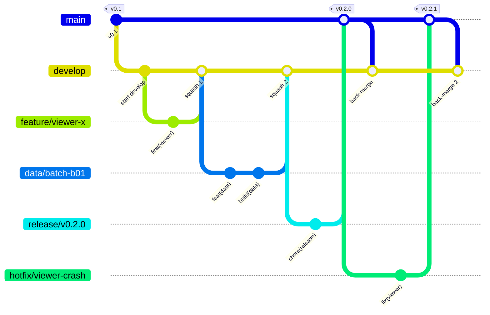
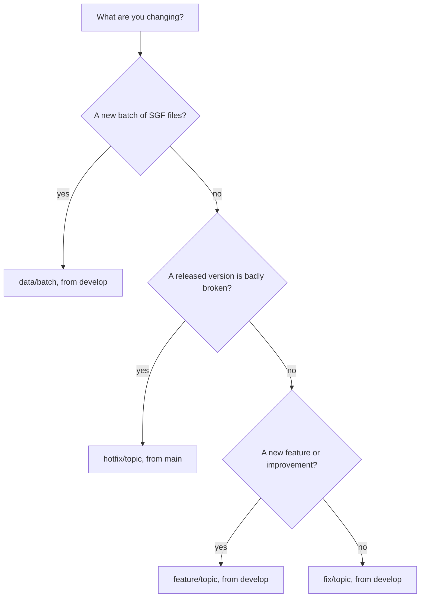

# Branching, commits and releases

This is the workflow for a project with one main maintainer, occasional outside contributions, and data that arrives in batches (every batch of new videos produces a batch of SGF files). It was written on 2026-11-01. The commands in the "Optional repository settings" section are there for the maintainer to run if wanted. Nothing in this repo runs them.

A small naming note: an early draft of this guide called the integration branch `dev`. The branch is called `develop` and that is the only name to use.

## 1. Overview

| Branch | Cut from | Merged into | How | What it is |
|---|---|---|---|---|
| `main` | | | | Released, stable versions. Each version is tagged here. |
| `develop` | `main` | `main` when a stage is stable | merge commit | Integration branch. All day to day work lands here first. |
| `feature/<topic>` | `develop` | `develop` | squash | New features and improvements to the viewer, pipeline, tools and docs. |
| `fix/<topic>` | `develop` | `develop` | squash | Bug fixes, including data fixes such as transcription typos. |
| `data/<batch>` | `develop` | `develop` | squash | One batch of new SGF files, for example `data/2026-12-joseki-batch-2`. |
| `release/<version>` | `develop` | `main`, then back into `develop` | merge commit | Optional. Version bump and changelog, for example `release/v0.2.0`. |
| `hotfix/<topic>` | `main` | `main` and `develop` | merge commit | An urgent fix to a released version, for example `hotfix/viewer-crash`. |

Delete a branch after it has been merged. A "stage" is a point where `develop` is stable and worth calling a version. `main` only moves when a new version is ready.

## 2. Why this model

It is a trimmed down Git Flow: two long lived branches (`main` for released work, `develop` for integration) plus short lived topic branches, and `release` and `hotfix` only when they are needed.

| Model | Good for | Fit here |
|---|---|---|
| GitHub Flow: only `main`, topic branches, merge means release | Web apps that ship continuously | There would be no difference between "released" and "in progress". Data comes in batches and a version is only cut after a large batch, so `main` would hold half finished work. |
| Trunk based development: tiny branches or direct commits, strong automated tests | Teams with solid test suites and continuous delivery | The only safety net here is a small local script, and SGF data cannot be unit tested for correctness. |
| Git Flow as originally described: `main` and `develop` plus feature, release and hotfix branches | Software with explicit versions, sometimes several supported at once | Matches the explicit versions (`v0.1`, `v0.2` and so on). Supporting several versions at once is not needed, so only release and hotfix are kept. |

The author of Git Flow added a note in 2020 saying that continuously delivered web apps are better served by something simpler such as GitHub Flow, and that Git Flow still fits software with explicit versions. This project has explicit versions, so the trimmed down Git Flow fits. If it ever becomes a site that is released all the time, dropping `develop` is easy and the history stays intact.

## 3. Diagrams



Which branch should I use:



## 4. Day to day

### 4.1 Features and fixes

```bash
git switch develop && git pull --ff-only
git switch -c feature/viewer-dark-mode          # or fix/<topic>
# work, commit with type(scope): subject
python tools/check_repo.py
git push -u origin feature/viewer-dark-mode
gh pr create --base develop --web               # fill in the pull request template
```

Merge with "Squash and merge" so that `develop` gets one commit per pull request. The pull request title becomes the commit subject, so keep it in the `type(scope): subject` style.

### 4.2 A data batch

Use this when the pipeline has produced a batch of new SGF files, key points or evaluations.

```bash
git switch develop && git pull --ff-only
git switch -c data/2026-12-joseki-batch-2
# copy in the new files under data/sgf, data/sources and pipeline/kp_*.json
powershell -ExecutionPolicy Bypass -File tools/build.ps1     # repack data/library.js
python tools/check_repo.py
git add -A data pipeline
git commit -m "feat(data): add five joseki groups" -m "Videos BV1xxxxxxxxx and others, KataGo v1.18.x with the b11c768 network at 220 and 100 visits. Scores are converted to the side to move."
git push -u origin data/2026-12-joseki-batch-2
gh pr create --base develop --web
```

One batch is one pull request. List the group names, video ids and KataGo settings in the description because they become the commit message after the squash. Keep viewer and pipeline code out of data pull requests. Small batches (a handful of typo fixes, for instance) do not need a release, they just sit on `develop` until a stage is worth tagging.

`data/library.js` is a built file. If it conflicts during a merge, do not merge it by hand: finish the merge of the SGF files, then run `tools/build.ps1` again.

### 4.3 Promoting develop to main (a new version)

Do this when a stage is stable. A release branch is optional and only useful for the version bump and the changelog edit. If you skip it, make those edits on `develop` in a normal pull request first.

```bash
git switch develop && git pull --ff-only
git switch -c release/v0.2.0
# set VERSION to 0.2.0
# CHANGELOG.md: move the [Unreleased] entries under "## [0.2.0] - YYYY-MM-DD" and add the compare link at the bottom
powershell -ExecutionPolicy Bypass -File tools/build.ps1     # refreshes the data time in data/library.js
git commit -am "chore(release): bump version to 0.2.0"
git push -u origin release/v0.2.0
gh pr create --base main --title "chore(release): v0.2.0" --web
# merge in the browser with "Create a merge commit"
git switch main && git pull --ff-only
git tag -a v0.2.0 -m "v0.2.0" && git push origin v0.2.0
gh release create v0.2.0 --title "v0.2.0" --notes "See the [0.2.0] section of CHANGELOG.md"
# bring the release commit back so develop has it too
git switch develop && git pull --ff-only
gh pr create --base develop --head main --title "chore(release): merge v0.2.0 back into develop" --web
```

### 4.4 Hotfix

```bash
git switch main && git pull --ff-only
git switch -c hotfix/viewer-crash
# fix it, add a CHANGELOG line, set VERSION to 0.2.1
gh pr create --base main --web      # merge with "Create a merge commit"
# afterwards tag v0.2.1, create the release, and merge main back into develop as in 4.3
```

## 5. Why the merge methods differ

Pull requests from `feature`, `fix` and `data` branches into `develop` are squashed. The history of `develop` then reads like a changelog, one commit per pull request.

Anything that goes into `main` (release and hotfix branches) and the merge of `main` back into `develop` use a real merge commit. If `develop` were squashed into `main`, the two branches would hold the same content under different commits and the next merge would conflict. Rebase merges are not used at all. There is no benefit for a project this size and they rewrite commit ids.

## 6. Commit messages

The rules live in [CONTRIBUTING.md](../CONTRIBUTING.md): a Conventional Commits style subject (`type(scope): subject`) in the imperative mood, then an optional short paragraph in plain words. Conventional Commits maps `fix` to a patch release, `feat` to a minor release and a breaking change to a major release. In the 0.x phase of this project the maintainer decides by hand when to bump the version (next section), so the commit types only help to read the history.

## 7. Versioning

The project follows Semantic Versioning 2.0.0, where major version zero means initial development and anything may change. The rules specific to this project:

| Situation | Version change |
|---|---|
| A large batch of new videos is done (a series is finished, or a clear pile of new groups has built up) | Minor: `0.1.0` to `0.2.0` |
| A small fix to a released version (a bug, typos, a wrong score sign) | Patch: `0.2.0` to `0.2.1`, as a hotfix or folded into the next minor |
| Small data batches and small improvements | No release, note them under `[Unreleased]` |
| The SGF conventions or the layout of `data/library.js` change | Minor in the 0.x phase, and say so under "Changed" in the changelog |
| All of the teacher's videos are done, the HTML and the SGF files are polished and the data format is stable | Think about `1.0.0` |

More details:

- The "public interface" is the property conventions of the SGF files, the structure of `data/library.js`, and how the viewer is opened.
- The existing tag `v0.1` counts as `0.1.0`, because SemVer needs three numbers and published tags are not renamed. From the next release on use three numbers, for example `v0.2.0`.
- Branch names carry the version (`release/v0.2.0`) and so do tags (`v0.2.0`). A pre-release such as `v0.2.0-rc.1` is allowed but not needed.
- `VERSION` changes only on a release or hotfix branch. The "viewer version" shown at the top left of the page is the viewer's own number and is separate from the repository version.
- The changelog uses Keep a Changelog 1.1.0: `Added`, `Changed`, `Deprecated`, `Removed`, `Fixed`, `Security`, with ISO 8601 dates.

## 8. Local check

`python tools/check_repo.py` needs only Python 3. It checks the references in `index.html`, JSON files, whether `data/library.js` matches the SGF files, SGF syntax, Python syntax, and that no weights, videos or key files are about to be committed. Run it before opening a pull request. Nothing runs it automatically at the moment.

## 9. Fitting this to the local josekiapp working directory (suggestion only)

The working directory `josekiapp` currently has only `main`, plus uncommitted changes to `index.html`, an untracked `remote/` folder, and a pipeline that writes files into it. A way to move over without disturbing any of that:

1. After the pull request that adds this guide is merged into `develop`, run `git fetch origin` while the pipeline is idle and then `git switch -c data/<batch> origin/develop`. Uncommitted changes come along. They do not conflict because the guide does not touch `index.html`, `remote/`, `data/` or `pipeline/`.
2. Put viewer work on its own `feature/viewer-...` branch and the `remote/` folder on `feature/remote-gpu`. Do not mix them into a data batch. `git add -p` helps to split changes. Avoid `git stash` while the pipeline is writing files.
3. A safer alternative is a second, clean clone used only for publishing. `josekiapp` stays the production area and finished output is copied across before committing. It costs one copy step, and `git switch` never interferes with the pipeline.
4. For every later batch of videos: run the pipeline, then follow section 4.2.

## 10. Optional repository settings (maintainer runs these, nothing here has been run)

These commands change GitHub repository settings, so look at the current state in the web UI first. The repository name is filled in already.

### 10.1 Merge methods and branch cleanup

```bash
# allow squash and merge commits, turn off rebase merges, delete merged branches
gh repo edit Xtraordinaire9911/ai-weiqi-new-mind \
  --enable-squash-merge --enable-merge-commit --enable-rebase-merge=false \
  --delete-branch-on-merge

# use the pull request title and body as the default squash commit message
gh api -X PATCH repos/Xtraordinaire9911/ai-weiqi-new-mind \
  -f squash_merge_commit_title=PR_TITLE -f squash_merge_commit_message=PR_BODY
```

### 10.2 Branch protection

Classic branch protection is available on public repositories on the GitHub Free plan. The values below suit one maintainer plus occasional contributors. `enforce_admins` is false so you can still push in an emergency, and the approval count is 0 because GitHub does not let an author approve their own pull request, so requiring 1 would lock you out.

```bash
gh api -X PUT repos/Xtraordinaire9911/ai-weiqi-new-mind/branches/main/protection --input - <<'JSON'
{
  "required_status_checks": null,
  "enforce_admins": false,
  "required_pull_request_reviews": { "required_approving_review_count": 0, "dismiss_stale_reviews": true },
  "restrictions": null,
  "required_linear_history": false,
  "allow_force_pushes": false,
  "allow_deletions": false,
  "required_conversation_resolution": true
}
JSON

gh api -X PUT repos/Xtraordinaire9911/ai-weiqi-new-mind/branches/develop/protection --input - <<'JSON'
{
  "required_status_checks": null,
  "enforce_admins": false,
  "required_pull_request_reviews": { "required_approving_review_count": 0 },
  "restrictions": null,
  "allow_force_pushes": false,
  "allow_deletions": false
}
JSON
```

To undo: `gh api -X DELETE repos/Xtraordinaire9911/ai-weiqi-new-mind/branches/main/protection`, and the same for `develop`. Rulesets (Settings, Rules) can do the same with a friendlier interface.

### 10.3 Default branch

Keeping `main` as the default branch means visitors and `git clone` get the released version. The catch is that issue templates and the pull request template only take effect once they are on the default branch, so they will not show up until the first promotion from `develop` to `main`. To have them right away you can run `gh repo edit Xtraordinaire9911/ai-weiqi-new-mind --default-branch develop`, at the price that visitors then see unreleased work. Both are reasonable, it is your call.

### 10.4 Labels

The issue forms use `bug` and `enhancement`, which GitHub creates by default, and `data`, which does not exist yet. The rest are optional.

```bash
gh label create data     --color 0E8A16 --description "Variations, commentary and evaluations"
gh label create viewer   --color 1D76DB --description "The index.html viewer"
gh label create pipeline --color 5319E7 --description "Pipeline and tools"
gh label create remote   --color FBCA04 --description "Remote GPU and cloud notes"
```

## Sources (visited 2026-11-01)

- Conventional Commits 1.0.0: https://www.conventionalcommits.org/en/v1.0.0/
- Keep a Changelog 1.1.0: https://keepachangelog.com/en/1.1.0/
- Semantic Versioning 2.0.0 (version 0.y.z and when to reach 1.0.0): https://semver.org/
- GitHub Flow: https://docs.github.com/en/get-started/using-github/github-flow
- Git Flow and the author's 2020 note: https://nvie.com/posts/a-successful-git-branching-model/
- Trunk based development: https://trunkbaseddevelopment.com/
- Branch protection REST endpoint (request body, availability for public repos on Free): https://docs.github.com/en/rest/branches/branch-protection
- About protected branches: https://docs.github.com/en/repositories/configuring-branches-and-merges-in-your-repository/managing-protected-branches/about-protected-branches
- Pull request templates and issue forms: https://docs.github.com/en/communities/using-templates-to-encourage-useful-issues-and-pull-requests/creating-a-pull-request-template-for-your-repository and https://docs.github.com/en/communities/using-templates-to-encourage-useful-issues-and-pull-requests/syntax-for-issue-forms
- Repository merge options such as squash_merge_commit_title: https://docs.github.com/en/rest/repos/repos#update-a-repository
- A blog comparison of branching strategies for small teams, for background only: https://www.deployhq.com/blog/trunk-based-development-vs-gitflow
